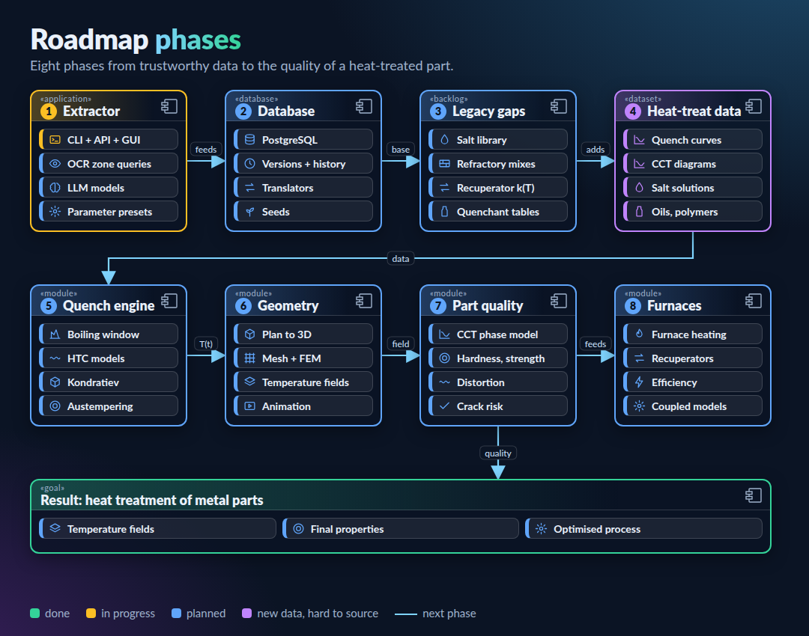
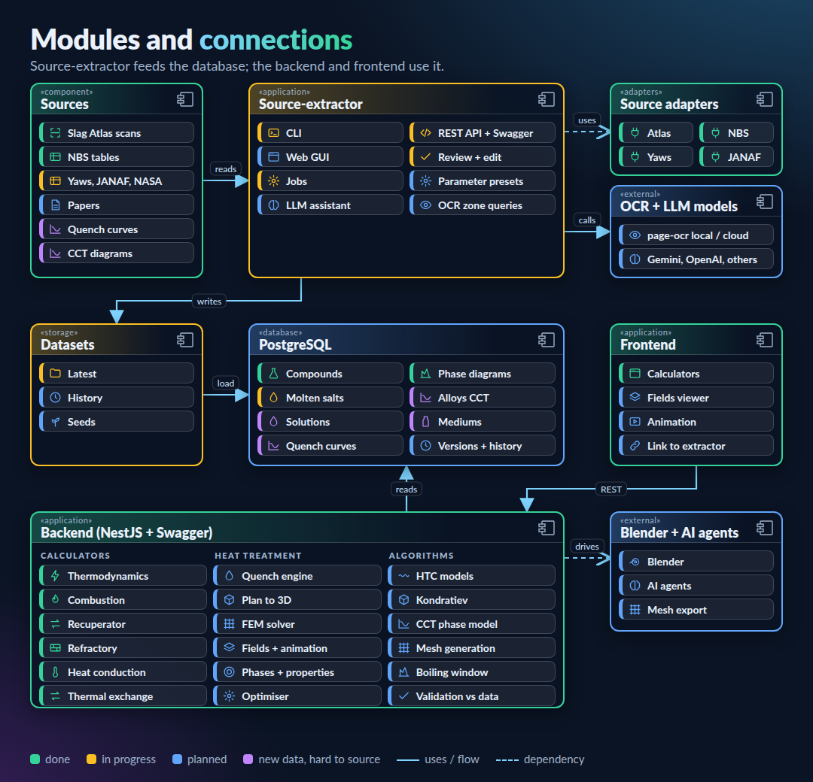
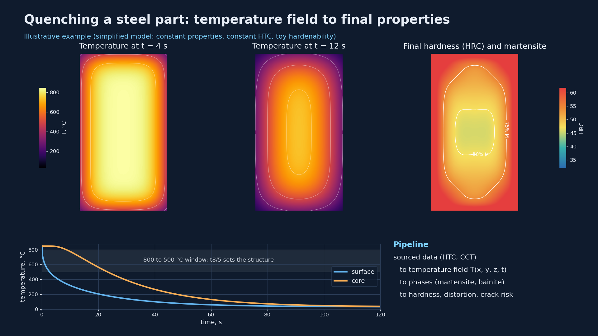

# Project Roadmap

> Human-oriented overview. Details live in the technical plans linked at the bottom.
> Legend: 🟢 done · 🟡 in progress · 🔵 planned · 🟣 research / data risk

## In one page

**Where we are.** The calculation core works: gases and thermodynamics, combustion, recuperator, thermal exchange, metals, heat conduction in simple shapes, and most refractory calculators. Data for them is prepared offline in Python and stored as processed datasets. Phase-diagram digitising works for binary and ternary systems, but it lives in a small side tool and the main project does not use a database yet.

**Where we go.** Heat treatment of metal parts: heating and cooling in the furnace, quenching in water-salt solutions, polymer solutions, oils and pressurised water, and prediction of the final structure and properties of the part. To do this honestly we first need **trustworthy data** and a **place to keep it with history**.

**Steps, in order.**

1. **Source-extractor becomes the one door to every source.** Console, API (with Swagger) and a web GUI in the same stack as our frontend. It runs OCR and LLM models (Gemini first, later OpenAI, Anthropic, local ones), lets us query OCR for a zone with adjustable settings, and gives many parameters to tune how curves, nodes and zones are recognised. The Python folder of this repository turns into *adapters* for specific sources (Slag Atlas, NBS, Yaws and so on); general logic lives in the extractor. The main frontend gets a link to it.
2. **Database with versioned datasets.** The newest dataset and images stay in one folder, older versions in another (removable once we are satisfied). The database keeps the history: versions, a flag for the latest one, prompts, models, parameters, and a log of what changed (corrected formulas, coefficients, new coefficients). Everything goes through migrations; history tables are only extended, never rewritten. Processed datasets stay in the repository as the current state and as seeds for a fresh install; the backend then reads the database only.
3. **Close the remaining legacy gap that still matters.** Recuperator: use material `λ(T)` in the calculation and show it in plots (data already exists; the scalar paste path is what is wrong). Salt library, mix-preset persistence and other refractory leftovers are skipped for now.
4. **Collect heat-treatment data through the extractor.** Digitised cooling curves of real quenchants (heat transfer coefficient versus medium temperature, surface temperature, agitation), CCT diagrams of steels and other alloys, boiling points and phase diagrams of water-salt solutions (NaCl, CaCl₂, MgCl₂, NaNO₃, Ca(NO₃)₂, Mg(NO₃)₂ first). Viscosity and conductivity of salt solutions are the open risk: we digitise where sources exist, infer where they do not, and always mark confidence. Theory is checked against experiment; for oils experiment is the main source.
5. **Quench and heat-treatment engine.** Boiling window of salt solutions, transition to convection, inverse problems (time and cooling rate), Kondratiev sizing, and process options such as austempering, martempering and interrupted intensive quenching in water-based media instead of toxic hot-salt baths.
6. **Complex parts and temperature fields.** A new *plan-to-3D* module builds a 3D model and a calculation mesh from a 2D part drawing (Blender driven by AI agents). On top of it: Kondratiev number for real shapes, finite-element solution, visualisation and animation of heating and cooling.
7. **From temperature field to part quality.** Phase composition from CCT data, then hardness, strength, distortion and crack risk; optimisation of medium, interruption moment and tempering.
8. **Furnaces and recuperators as a system.** Efficiency and coupled models.

## Phases

Eight phases, from trustworthy data to the quality of a heat-treated part. Colours: 🟡 in
progress, 🔵 planned, 🟣 new data that is hard to source.

## Modules and connections

The source-extractor feeds datasets and the database; the backend and the frontend use the
database. Blender with AI agents is an external module driven by the backend for plan-to-3D.

## Target result

The chain ends with a temperature field of the part and its final properties
(illustrative, simplified model, not calculated data):

## Technical plans

Index: [`docs/plans/README.md`](plans/README.md)

- Source-extractor migration — [`docs/plans/SOURCE_EXTRACTOR_MIGRATION.md`](plans/SOURCE_EXTRACTOR_MIGRATION.md)
- Database and dataset versioning — [`docs/plans/DATABASE_AND_VERSIONING.md`](plans/DATABASE_AND_VERSIONING.md)
- Legacy gaps — [`docs/plans/LEGACY_GAPS_CLOSURE.md`](plans/LEGACY_GAPS_CLOSURE.md) (analysis: `tmp/reports/migrations/legacy-gaps-20261124.md`)
- Heat-treatment data — [`docs/plans/HEAT_TREATMENT_DATA.md`](plans/HEAT_TREATMENT_DATA.md)
- Quench and heat-treatment engine — [`docs/plans/QUENCH_ENGINE.md`](plans/QUENCH_ENGINE.md)
- Plan to 3D, geometry, fields, properties, furnaces — [`docs/plans/GEOMETRY_FIELDS_PROPERTIES.md`](plans/GEOMETRY_FIELDS_PROPERTIES.md)

Module-level migration status stays in [`docs/migration/ROADMAP.md`](migration/ROADMAP.md).
