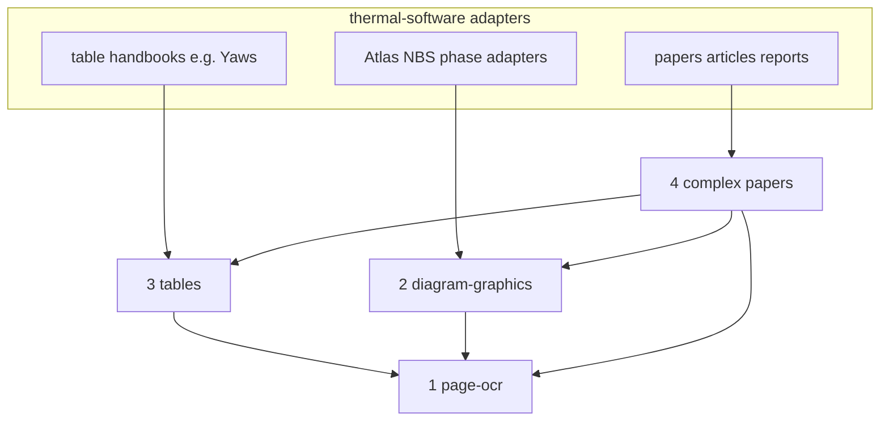

# Shared libraries as separate repos (plan)

Status: **plan only** — boundaries agreed; remotes/submodules not created yet.

Each library is its **own git repository**, consumed by thermal-software as a **git submodule** under `vendor/` (pinned SHA). Not packages that live only inside this monorepo long-term.

## Split

| # | Separate repo → submodule path | Responsibility |
| --- | --- | --- |
| 1 | **`page-ocr`** → `vendor/page-ocr` | Page image → text/blocks; **local container** or **cloud (Modal)**; **engine-pluggable** (Surya is current, not the product name) |
| 2 | **`diagram-graphics`** → `vendor/diagram-graphics` | Generic figure/diagram CV: detect, trace, calibrate, overlay, build polylines — **not** tied to Slag Atlas or “phase diagram” as a product |
| 3 | **`handbook-table-tools`** → `vendor/handbook-table-tools` | Tabular handbooks: columns/units/`@`; calls page-ocr |
| 4 | **`source-paper-tools`** → `vendor/source-paper-tools` | Mixed scientific documents; layout + routing to 1–3 |

**thermal-software** = thin **source adapters** only (Yaws, Atlas/NBS, later papers/handbooks). It does not host the shared library source long-term; it only pins and imports the four remotes.

Slag Atlas / NBS / phase-equilibrium datasets stay **source adapters** in this repo (`python/src/phase_diagrams/`). They call `diagram-graphics` the same way Yaws calls `handbook-table-tools` — the shared repo must not be named or scoped as phase-diagram-only.



**Local vs cloud:** one OCR repo/submodule, not two. Backend switch only.

**Engine vs product name:** submodule and public API are **`page-ocr`** (generic). Surya is an **implementation backend** behind `PAGE_OCR_ENGINE=surya`. Do not name the repo `surya-ocr`.

**Complex papers** segment a document and delegate to OCR / tables / graphics; they do not own the engine.

## 1 — OCR (`page-ocr`)

- Contract: `ocr_page(image_bytes) → {blocks, …}` (stable for all consumers)
- Runtimes: local container + Modal cloud, **same engine config**
- Env (generic): `PAGE_OCR_BACKEND=local|modal`, `PAGE_OCR_ENGINE=surya`, model/quant/Modal app vars under `PAGE_OCR_*` / `PAGE_OCR_MODAL_*` — not `YAWS_*` as primary names
- Modal app id: e.g. `page-ocr` (not `yaws-surya-ocr`)
- Swapping off Surya later = new engine plugin, same submodule and callers

## 2 — Graphics + diagrams (`diagram-graphics`)

- Generic plotted-figure tooling (axes/ticks, curves, regions, overlays, calibrations)
- First consumer today: ternary/binary **phase** diagrams from Atlas — that specificity lives in the **adapter**, not in the repo name or core API
- Uses `page-ocr` for labels/captions when needed
- Atlas PDF paths, NBS promote, `shared/processed/phase-diagrams/` stay in thermal-software

## 3 — Tables (`handbook-table-tools`)

- Any coefficient/property **table handbook** (Yaws first; others later)
- Schema helpers; OCR via `page-ocr`; not book paths/catalogs

## 4 — Complex papers (`source-paper-tools`)

- Layout, region typing, assembly of structured paper JSON
- Delegates to `page-ocr`, `handbook-table-tools`, `diagram-graphics`
- Adapters: PDF path, refKey, `shared/processed/<source>/`

## Adapters in this repo

| Kind | Examples | Uses |
| --- | --- | --- |
| Table handbook | `yaws1999/` | 3 → 1 |
| Diagram sources | `phase_diagrams/` (Atlas/NBS glue) | 2 → 1 |
| Complex paper | future `python/src/<paper_source>/` | 4 → 1,3,2 |

## Layout

```text
thermal-software/                    # this product repo
  .gitmodules
  vendor/page-ocr/                   # git submodule → separate page-ocr repo
  vendor/diagram-graphics/           # git submodule → separate repo (generic)
  vendor/handbook-table-tools/       # git submodule → separate repo
  vendor/source-paper-tools/         # git submodule → separate repo
  python/src/yaws1999/               # table-handbook adapter
  python/src/phase_diagrams/         # Atlas/NBS/phase adapter (source-specific)
```

Each shared repo has its own remote, issues, versioning, and CI. thermal-software bumps submodule SHAs when it adopts a release.

## Later execution

1. Freeze boundaries (this document).
2. Create the four remotes; move generic code out of the monorepo; `git submodule add` into `vendor/`.
3. Start with repos 1–3 (in use today); add repo 4 when a paper source is onboarded.
4. Rename env/app away from Yaws/Surya product branding; keep Surya only as `PAGE_OCR_ENGINE`.
