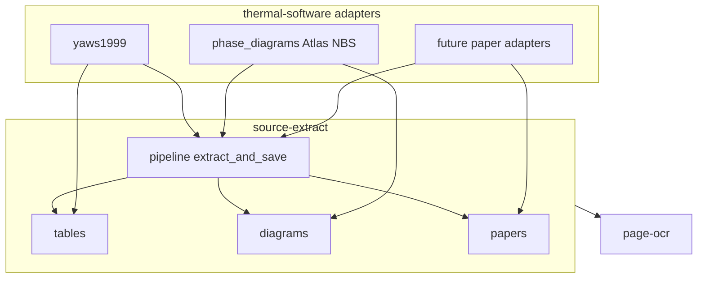

# Shared libraries as separate repos (plan)

Status: **scaffold ready** under [`vendor/`](../vendor/). `yaws1999` tables/writers delegate to `source_extract.tables` (DjVu quirks + column schemas stay in the adapter). `phase_diagrams` still runs in-tree; source-specific NBS / Slag Atlas / `compounds.json` logic was removed from `source_extract.diagrams` and remains under `python/src/phase_diagrams/`.

Two **separate git repositories** (submodules later):

| # | Repo → submodule path | Responsibility |
| --- | --- | --- |
| 1 | **`page-ocr`** → `vendor/page-ocr` | Page image → text/blocks; local container or Modal; engine-pluggable (Surya now) |
| 2 | **`source-extract`** → `vendor/source-extract` | **Source file in → structured result out**: tables, diagrams, and mixed papers |

**thermal-software** = thin **source adapters** only (paths, catalogs, quirks, CLI). Adapters call **`source-extract`** only; that library uses **`page-ocr`** for recognition and writes structured results.



## 1 — `page-ocr`

- `ocr_page(image_bytes) → {blocks, …}`
- `PAGE_OCR_BACKEND=local|modal`, `PAGE_OCR_ENGINE=surya`, …
- No handbook/diagram product logic

## 2 — `source-extract`

One package with submodules:

| Subpackage | Role |
| --- | --- |
| `source_extract.tables` | Column schema, dataset/debug shape, export, verify, progress |
| `source_extract.diagrams` | Figure/diagram CV (detect, trace, calibrate, overlay) |
| `source_extract.papers` | Mixed papers (scaffold) |
| `source_extract.pipeline` | `extract_and_save(ExtractRequest)` — high-level write path |

OCR stays in `page-ocr`; only `source-extract` depends on it. Diagram/table/paper **kinds** share one repo because they share the same job: ingest a source and persist results.

## Adapters in this repo

| Adapter | Uses |
| --- | --- |
| `yaws1999/` | source-extract.tables / pipeline |
| `phase_diagrams/` | source-extract.diagrams / pipeline |
| future paper package | source-extract.papers / pipeline |

## Layout

```text
thermal-software/
  vendor/page-ocr/          # git submodule → page-ocr remote
  vendor/source-extract/    # git submodule → source-extract remote
  python/src/yaws1999/      # adapter
  python/src/phase_diagrams/
```

## Local vendor trees

| Path | Contents |
| --- | --- |
| `vendor/page-ocr/` | OCR client + Modal app + Surya engine + PDF render |
| `vendor/source-extract/` | tables + diagrams + papers + `extract_and_save` (depends on page-ocr) |

Each has a local `.git`. Remotes / `.gitmodules` TBD.

## Later execution

1. Push remotes; `git submodule add` for the two repos.
2. Wire adapters to `source-extract` only (OCR stays behind it); leave live parsers alone until Yaws batch is done.
3. Env: `PAGE_OCR_*`.
