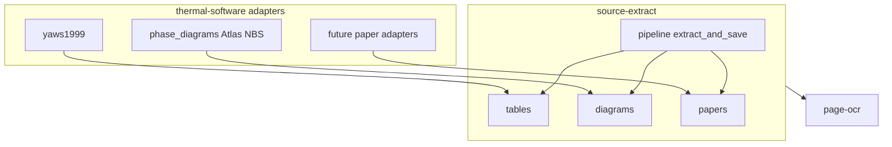

# Shared libraries as separate repos (plan)

Status: **wired**. `yaws1999` tables/writers/progress delegate to `source_extract.tables` (DjVu quirks + column schemas stay in the adapter). Generic diagram CV lives in `source_extract.diagrams`; Atlas/NBS adapters under `python/src/phase_diagrams/` import it directly (CLI, NBS, compounds, host builders/output). NBS Table I OCR uses `page-ocr` VLM (tesseract remains as a legacy engine option).

Two **separate git repositories**, registered as submodules under `vendor/`:

| # | Repo → submodule path | Responsibility |
| --- | --- | --- |
| 1 | **`page-ocr`** → `vendor/page-ocr` | Page image → text/blocks; local container or Modal; engine-pluggable (Surya now) |
| 2 | **`source-extract`** → `vendor/source-extract` | **Source file in → structured result out**: tables, diagrams, and mixed papers |

**thermal-software** = thin **source adapters** only (paths, catalogs, quirks, CLI). Adapters import **`source_extract.tables`** / **`source_extract.diagrams`** (and may use `pipeline` later). That library uses **`page-ocr`** for recognition.



## 1 — `page-ocr`

- `ocr_page(image_bytes) → {blocks, …}`
- `PAGE_OCR_BACKEND=local|modal`, `PAGE_OCR_ENGINE=surya`, …
- Modal `PageOcr(quant=bf16|q8)` — one deploy, pick quant per call
- No handbook/diagram product logic

## 2 — `source-extract`

One package with submodules:

| Subpackage | Role |
| --- | --- |
| `source_extract.tables` | Column schema, dataset/debug shape, export, verify, progress |
| `source_extract.diagrams` | Figure/diagram CV (detect, trace, calibrate, overlay) |
| `source_extract.papers` | Mixed papers (scaffold) |
| `source_extract.pipeline` | `extract_and_save(ExtractRequest)` — high-level write path |

OCR stays in `page-ocr`; only `source-extract` depends on it. Diagram/table/paper **kinds** share one repo because they share the same job: ingest a source and persist results.

## Adapters in this repo

| Adapter | Uses |
| --- | --- |
| `yaws1999/` | `source_extract.tables` (dataset, export, naming, progress, columns) |
| `phase_diagrams/` | `source_extract.diagrams` directly for generic CV; host code for Atlas/NBS/CLI/compounds |
| future paper package | `source_extract.papers` / optionally `pipeline` |

Production and image builds copy `vendor/*/src` into `/app/vendor/*/src` and set `PYTHONPATH` accordingly (`docker/python/Dockerfile`, `compose.production.yml`). Dev Compose still bind-mounts the vendor trees for live edits.

## Layout

```text
thermal-software/
  vendor/page-ocr/          # git submodule → page-ocr remote
  vendor/source-extract/    # git submodule → source-extract remote
  python/src/yaws1999/      # adapter
  python/src/phase_diagrams/
```

## Local vendor trees

| Path | Contents |
| --- | --- |
| `vendor/page-ocr/` | OCR client + Modal app + Surya engine + PDF render |
| `vendor/source-extract/` | tables + diagrams + papers + `extract_and_save` (depends on page-ocr) |

Tracked via `.gitmodules`.

| Make target | Purpose |
| --- | --- |
| `make init-submodules` | Clone / checkout the SHAs pinned by this repo (`git submodule update --init --recursive`). Also the first step of `make setup`. |
| `make update-submodules` | Fetch latest remote tips for `vendor/*` (`git submodule update --init --remote --recursive`). Commit the new pointers in the parent when you want to pin them. |

## Install (host project)

Also summarized in [SETUP.md](../SETUP.md):

```bash
git clone <thermal-software> && cd thermal-software
make setup                                 # init-submodules + .env + sync-vendor-env
make setup-secrets
make up
# later, pull newer vendor libs:
#   make update-submodules
# page-ocr code is always mounted; install.sh only to provision/refresh llama + GGUFs:
#   cd vendor/page-ocr && ./install.sh --all
# Modal cloud OCR:
#   make page-ocr-deploy
```

`make sync-vendor-env` copies `PAGE_OCR_*` / `MODAL_TOKEN_*` from the main `.env`
into each `vendor/*/.env` that has a `.env.example`. `page-ocr install` / `deploy`
do the same when they detect a parent host `.env`.
