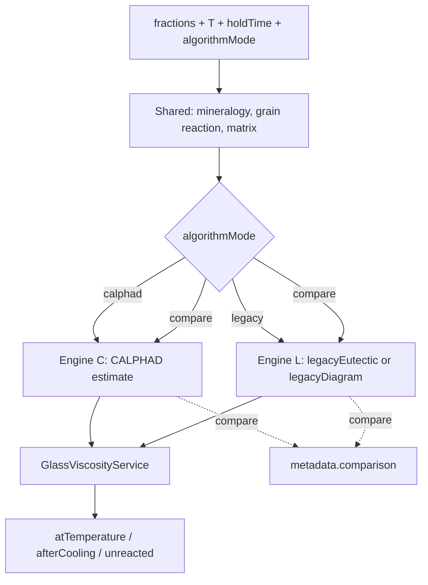
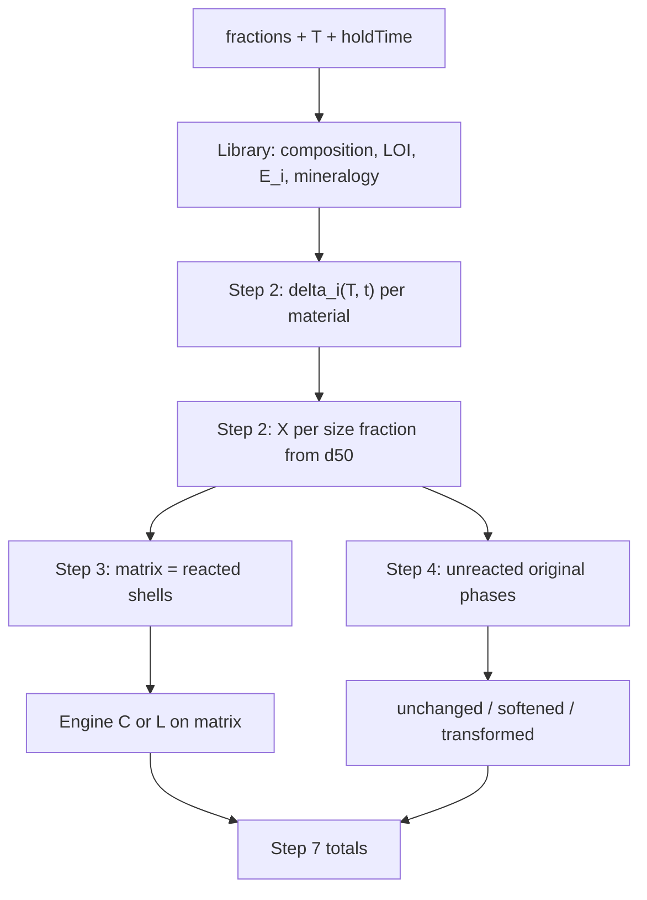

# Phase Equilibrium Algorithm (CALPHAD estimate + legacy parallel)

**Service (target):** `backend/src/modules/refractory/services/composition/phase-equilibrium.service.ts`  
**Orchestration (target):** dedicated CALPHAD-estimate service(s) under `services/composition/` — controllers stay thin  
**Endpoint:** `POST /api/v1/refractory/phase-equilibrium` ([API](../../api/refractory-api-phase-equilibrium.md))  
**Glass / melt η:** `GlassViscosityService` ([glass-viscosity](../glass-viscosity/INDEX.md))  
**Property G(T):** compound-data via `CompoundPropertyResolver` (never call equation classes from business logic)  
**Legacy diagram detail:** [`LEGACY_DIAGRAM_PHASE_EQUILIBRIUM.md`](./LEGACY_DIAGRAM_PHASE_EQUILIBRIUM.md)  
**Related:** [`REFRACTORINESS_ALGORITHM.md`](./REFRACTORINESS_ALGORITHM.md), [`MINERAL_PHASE_IDENTIFICATION.md`](./MINERAL_PHASE_IDENTIFICATION.md)

---

## Status

| Item | State |
|------|--------|
| `minerals-thermodynamic/` → compound-data overlay | Available (`make compound-data-build`) |
| Solid G / Hf / S / Cp for many minerals & oxides | Available in `shared/processed/compound-data/` |
| Staged liquid coeffs (ionic / associate / MQM / QC) | Partial (CAS, Al–Ti–O, Fe–Ti–V–O, …) |
| Eutectic anchors (NSRDS–NBS 61-1) | Available (`shared/processed/eutectic-data/`) |
| Molten-salt mixture props | Available (`shared/processed/molten-salt-mixtures/`) |
| Glass viscosity / glass points | Available |
| Validated digitized diagrams (fields, isotherms, invariants) | **Deferred** — after SE review; then legacy-diagram engine |
| Default production path | **CALPHAD estimate** (this doc) that runs on data we have **now** |

Today’s `PhaseEquilibriumService` still implements the old CAS-eutectic cubic liquid %. That path becomes **`legacyEutectic`**, kept for comparison. The diagram lever-rule plan in the legacy doc becomes **`legacyDiagram`** once validated diagram data land.

---

## Purpose

For a mix of library raw materials fired at temperature T for hold time t, report:

- **at T:** crystals, liquid, glass (each liquid/glass with viscosity when a model applies);
- **after cooling:** same crystals; all liquid quenched to glass (with glass points when available);
- **unreacted original phases:** shrinking-core shells vs cores from **per-fraction grain size**.

**Particle-size / fraction effect is mandatory** for every engine (`calphad`, `legacy`, `compare`). A 3–5 mm tabular alumina grain keeps most of its corundum; the same alumina below ~0.1 mm dissolves into the matrix. Equilibrium is never computed on the bulk mix alone when size fractions are given: only reacted shells enter the matrix; cores stay as unreacted original phases.

The **new** equilibrium kernel estimates G from thermodynamics + anchors, not from unverified diagram grids. Full ionic-liquid coverage for every oxide is **not** required to ship: missing excess Gibbs is filled by documented fallbacks and flagged as estimated.

---

## Algorithm modes (API + frontend)

Request field `algorithmMode` (enum):

| Mode | Behaviour |
|------|-----------|
| `calphad` (default) | CALPHAD-estimate engine only |
| `legacy` | One legacy engine only (`legacyVariant`: `eutectic` \| `diagram`) |
| `compare` | Run CALPHAD-estimate **and** the chosen legacy engine; return both + diffs |

Frontend:

- default control = **new algorithm only** (`calphad`);
- optional **Compare with legacy** → `compare` (user picks `legacyEutectic` and/or `legacyDiagram` when the latter exists);
- comparison UI shows side-by-side liquid %, solidus/liquidus, crystal list, and warnings — not a silent blend of the two results.

---

## Data used now (authoritative locations)

| Dataset | Path | Role in CALPHAD estimate |
|---------|------|--------------------------|
| Compound library | `shared/processed/compound-data/` | Solid (and some liquid end-member) G, Hf, S, Cp, Tm; mineral overlay from staging |
| Minerals staging | `shared/processed/minerals-thermodynamic/` | Source-level assessments feeding the overlay (HP633, Robie, Abdul TDB, Mao CAS, Jung, Malan, …) |
| Eutectics | `shared/processed/eutectic-data/nsrds-nbs-61-1.entries.json` | Experimental solidus / invariant anchors when liquid excess is incomplete |
| Molten salts | `shared/processed/molten-salt-mixtures/mixtures.json` | Salt-system liquid properties / mixture hooks (not oxide slag ionic by default) |
| Glass models | refractory glass-viscosity module | η(T), glass points; glass-former retention below solidus |
| Material mineralogy | `data/materials/*.data.ts` | Starting crystals + amorphous remainder |
| Digitized diagrams | `data/phase-diagrams/` / SE datasets | **Not** required for `calphad`; feed `legacyDiagram` after validation |

**Refs:** every coefficient / eutectic row keeps its `RefKey` (or NSRDS bibliography id). Estimated liquid excess must set `status: estimated` (or equivalent) and a warning — never pretend full CALPHAD assessment coverage.

---

## Shared steps (all engines)

These stay common so modes differ only in **how the matrix (and transforming cores) are equilibrated**. Grain reaction by fraction is **not** optional and is **not** legacy-only.

### Inputs (fractions)

- `fractions[]`: `{ materialId, d50_mm, massFraction }`. Mix components only; the **same material may appear in several size fractions** (e.g. coarse + fine tabular alumina).
- `temperature` T (°C), `holdTime_hours` t, optional `totalMass`, plus `algorithmMode` / `legacyVariant`.
- Per material from the library: fired `composition`, LOI, `activationEnergy_Jmol`, `mineralogy`.

### Step 1 — raw mineralogy

Library `mineralogy.phases[]` + amorphous remainder = *Glass (material)*. Fired-basis masses; LOI of precursors from the catalog. Consistency test: phase oxides ≤ material composition (remainder ≥ 0 within 0.5 wt%).

### Step 2 — grain reaction (shrinking core) — keep

Each grain reacts from its surface to a depth δ (diffusion-controlled, Arrhenius in T):

`δᵢ(T, t) = δ_ref · √(t / t_ref) · exp(−Eᵢ / (2R) · (1/T − 1/T_ref))`

- `Eᵢ` = `activationEnergy_Jmol` of material i (same library value as `/shrinkage`).
- T, T_ref in kelvin via `celsiusToKelvin`.
- `GRAIN_REACTION_CONSTANTS`: `penetrationDepthRef_mm` = 0.1, `referenceTemperature_C` = 1450, `referenceHoldTime_hours` = 2.

Reacted mass fraction of a sphere of diameter `d = d50_mm`:

`X = 1 − (1 − 2δ/d)³` when `2δ < d`, otherwise `X = 1`.

Calibration: at the reference firing (1450 °C, 2 h), the unreacted-core table (`legacy/refractory/docs/spec.md` §4.3) is reproduced within about 10 %. `δ_ref` is a model calibration (documented in `GRAIN_REACTION_CONSTANTS`), not diagram data.

| d50 | Unreacted, this model | Unreacted, legacy table |
|-----|-----------------------|-------------------------|
| < 0.2 mm | 0 % | 0 % |
| 0.5 mm | 22 % | 30 % |
| 2 mm | 73 % | 60 % |
| 5 mm | 88 % | 85 % |

As δ → ∞ (long hold, fine powders), X → 1 → full equilibrium of the bulk composition. When δ = 0, nothing reacts.

**All oxide phases** react through this model (including ZrO2, CeO2, La2O3, Cr2O3, B2O3): ultrafine grades dissolve into the matrix; coarse grades mostly stay as unreacted grains.

**Inert phases** only: carbides (SiC, TiC, B4C, Cr3C2), nitrides (Si3N4, h-BN, AlN, TiN, Si2N2O, AlON), graphite. They never react (X treated as 0 for those phases); oxidation is not modelled. Their oxide impurities react normally.

Output per fraction: `penetrationDepth_mm` (δ), `reactedFraction` (X).

### Step 3 — matrix

The matrix is **only** the reacted shells of all fractions:

`m_matrix · c_matrix = Σ_fractions m_f · X_f · c_i,reactive`

- `m_f` = fired mass of the fraction: `massFraction · (100 − LOIᵢ)`, rescaled to the fired body.
- `c_i,reactive` = fired composition of material i without inert phases.

Glass of the matrix G (from raw amorphous remainders in the shells):

`m_G · c_G = Σ_fractions m_f · X_f · w_glass,i · c_glass,i`

The matrix is what Engine C or L equilibrates. Oxides with no solid G **and** no eutectic/liquid coverage → `unmodelled`.

### Step 4 — unreacted original phases

For every original phase p of material i (crystals and amorphous remainder):

- `unreactedMass = Σ_fractions of i  m_f · (1 − X_f) · w_p` (inerts: X = 0);
- `unreactedShare = unreactedMass / originalMass`.

**State at T:**

- `unchanged` — T below catalog `stableBelow_C` (e.g. corundum, mullite, SiC);
- `transformed` — at/above `stableBelow_C`: catalog transformation products, or own-composition equilibrium via the **active** engine (e.g. K-feldspar → leucite + liquid);
- glass cores: `unchanged` / `softened` / `transformed` from own equilibrium + η(T) (annealing threshold 10¹² Pa·s), same rules as the legacy doc.

Products of transformed cores join totals with origin `unreactedTransformed`. Full transformation table examples: [`LEGACY_DIAGRAM_PHASE_EQUILIBRIUM.md`](./LEGACY_DIAGRAM_PHASE_EQUILIBRIUM.md) § Step 4.

---

## Engine C — CALPHAD estimate (default)

**Goal:** minimize Gibbs energy of the matrix (and of each transforming core) at T using compound-data solids and the best available liquid description, with explicit fallbacks.

### C.1 Candidate phases

1. Build the oxide (and fluoride) system from the matrix composition.
2. Collect candidate **stoichiometric solids** whose formulae are spannable by those components and that have usable G(T) (or Hf298+S298+Cp) in compound-data / mineral overlay.
3. Include **liquid** as one phase (composition variable) and, when glass-former rules apply, a **glass** pseudo-phase that does not crystallize (Step 6).
4. Solid solutions only when compound-data or a staged assessment supplies them (e.g. Malan hematite/rutile SS); otherwise stoichiometric.

### C.2 Liquid Gibbs — priority ladder

Use the **highest rung that covers the composition**; lower rungs are estimates and must be labelled.

| Priority | When | Liquid model |
|----------|------|----------------|
| 1 | Staged assessment covers the oxide set (e.g. Abdul associate CaO–SiO2; Mao ionic CAS; Jung MQM Al–Ti–O; Malan QC Fe–Ti–V–O) | That liquid model + its L / Δg / associate terms from minerals-thermodynamic → compound-data / staging |
| 2 | Partial excess only (some binaries known) | Ideal mixing + known excess; missing binaries = 0 with warning `liquidExcessIncomplete` |
| 3 | Oxide / salt system hits an NSRDS eutectic (or set of nearby eutectics) | **Eutectic-anchored estimate:** solidus from eutectic T; liquidus from end-member Tm (compound-data) + lever/interpolation between eutectic liquid composition and primary solids; liquid G ≈ Σ xᵢ Gᵢ^liq − T S_mix^ideal, optionally shifted so G_liquid ≈ G_solids at the eutectic T |
| 4 | Molten-salt mixture id matches components | Use mixture dataset for liquid properties; phase amounts still from G / anchors |
| 5 | Only end-member Tm / Hf known | Coarse estimate: linear liquid fraction between lowest relevant eutectic (or min Tm − margin) and max Tm; confidence `LOW` |

**Hard limit:** ionic / associate / MQM parameters are **not** invented. Ideal + eutectic anchors are the allowed estimate when assessments are missing.

Numerical minimization uses approved wrappers only ([`NUMERICAL_METHODS_CONVENTION.md`](../../NUMERICAL_METHODS_CONVENTION.md)). Prefer closed-form integrals for G when compound-data supplies them.

### C.3 Equilibrium solve at T

1. Normalize composition (fired basis; oxidation-in-air for Fe/Mn when those subsystem data exist — else leave as input oxides and warn).
2. Global minimization over phase amounts (and liquid composition) subject to mass balance.
3. If the solver is unstable or candidates are sparse, fall back to **eutectic-anchored assemblage**: pick the eutectic whose component set best matches the matrix; below eutectic T → solids only (barycentric or stoichiometry fit); between solidus and liquidus → liquid + primary solids; above liquidus → all liquid.
4. Record `method`: `calphad_full` | `calphad_partial_excess` | `eutectic_anchored` | `tm_estimate`, plus `confidence` and warnings.

### C.4 Glass formers (with CALPHAD)

Same policy as today: alkali silicates, borates, fused silica / microsilica / clay glass **stay glass** when there is no coexisting liquid that dissolves them. Viscosity and glass points from `GlassViscosityService`. Do not force subsolidus diagram crystals for those glasses.

### C.5 After cooling

Liquid → glass (quench). Crystals unchanged. No crystallization-on-cooling model in v1.

---

## Engine L — legacy (parallel)

| Variant | Source of truth | Use |
|---------|-----------------|-----|
| `legacyEutectic` | Current service: CAS ~1265 °C eutectic, cubic liquid %, selective melting blend | Always available for regression / UI compare |
| `legacyDiagram` | Digitized main systems + extra-oxide subsystems ([legacy doc](./LEGACY_DIAGRAM_PHASE_EQUILIBRIUM.md)) | Enabled only when diagram datasets pass validation; until then API returns “not available” if requested alone |

Legacy engines **must not** be deleted while `compare` is supported. Shared Steps 1–4 and glass mapping stay identical so diffs isolate the equilibrium kernel.

---

## Step 6 — glass and melt properties

Unchanged contract: `selectModel` → η(T) / glass points; fluoride fixes (MOLAR_MASSES + Fluegel F) as in the legacy doc. `NOT_SUPPORTED` → null + warning, no silent invent.

---

## Step 7 — totals and compare payload

- **atTemperature / afterCooling / unreactedOriginalPhases / matrix / unmodelled / warnings** — same outer shape as the API doc.
- **`metadata.engine`:** active engine id + method + confidence.
- **`metadata.comparison`** (only if `algorithmMode=compare`):
  - `calphad` and `legacy` result summaries (liquid %, solidus_C, liquidus_C, crystal phaseIds);
  - `deltaLiquid_pct`, phase set symmetric difference;
  - no merged “average” assemblage.

Mass balance: Σ phases + `unmodelled` = 100 % (fired).

---

## Outputs / API deltas (plan)

Add to request DTO:

- `algorithmMode`: `calphad` | `legacy` | `compare` (default `calphad`);
- `legacyVariant?`: `eutectic` | `diagram` (default `eutectic` when legacy/compare).

Add to response metadata as above. Full field list remains in [`refractory-api-phase-equilibrium.md`](../../api/refractory-api-phase-equilibrium.md) (update when implementing).

---

## Code layout (target)

| Piece | Location |
|-------|----------|
| Orchestration | `services/composition/phase-equilibrium.service.ts` — mode switch, one call per engine |
| CALPHAD estimate | `services/composition/phase-equilibrium-calphad.service.ts` (private steps; no free helpers beside the class) |
| Legacy eutectic | existing calculator logic extracted behind `phase-equilibrium-legacy-eutectic.service.ts` |
| Legacy diagram | `phase-equilibrium-legacy-diagram.service.ts` when data ready |
| Compare | private method on orchestrator building `metadata.comparison` |
| Eutectic lookup | utils/static class over processed eutectic-data (relative imports) |
| Liquid model adapters | map staging/compound liquid coeffs → G^ex; one concern per file |
| DTOs / enums | `algorithm-mode.enum.ts`, `legacy-variant.enum.ts`, extend result metadata DTO |
| Frontend | refractory phase-equilibrium screen: mode toggle + optional compare panel |

Grain reaction, mineralogy, glass-phase utils stay as shared.

---

## Implementation roadmap

1. **Docs / API contract** — this plan; enum + request fields; frontend mode UX copy.
2. **Wire data access** — compound-data G(T) for candidate solids; eutectic index by component set; molten-salt lookup by formulae.
3. **Ship Engine C** with rungs 3–5 (eutectic-anchored + Tm) so every mix returns a result; attach rung 1–2 where staging liquid exists (CAS / Abdul / Jung / Malan).
4. **Extract Engine L `legacyEutectic`** from current service; enable `compare`.
5. **Frontend** — default `calphad`; checkbox/toggle “Compare with legacy”.
6. **After diagram validation** — enable `legacyDiagram`; optional third compare column.
7. **Refractoriness** — prefer CALPHAD-estimate solidus/liquidus / liquid-level T; keep legacy formula as compare (see refractoriness doc update when coding).

---

## Limits

**Grain / fractions (shared):**

- One δ calibration for all materials; `Eᵢ` only sets temperature sensitivity.
- Grains modelled as spheres of diameter `d50`; phases evenly distributed in each grain.
- Fluorine as a mineraliser (faster mullite) is **not** in the grain-reaction rate.

**CALPHAD estimate:**

- Incomplete ionic / associate liquid databases → excess often ideal or eutectic-anchored; confidence drops; warnings required.
- Yazhenskikh workshops: species inventory only — **no** numeric L; do not fabricate.
- Stoichiometric solids by default; limited SS only with data.
- Air atmosphere; no FeO/Ce reduction path without data.
- No crystallization on cooling; glass does not dissolve crystals below solidus.
- Fluoride / borate volatilization not modelled.
- Digitized diagram fields are out of scope until validated — they do not block shipping Engine C.
