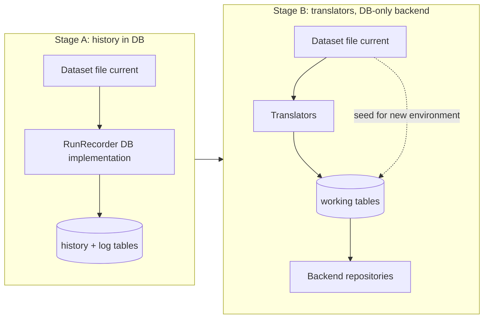
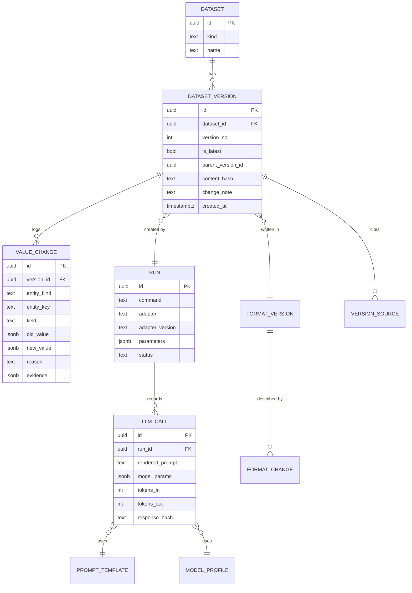
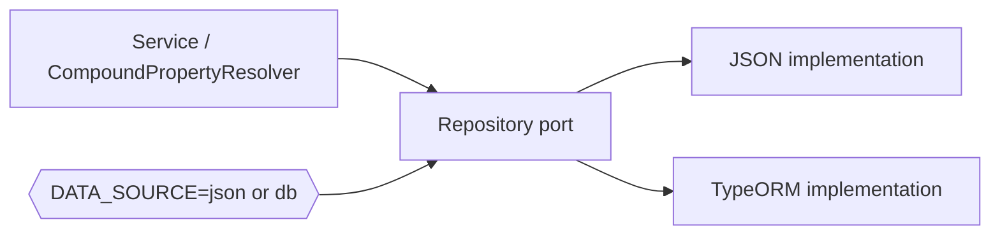

# Plan: Database and dataset versioning (Roadmap phase 2)

Status: 🔵 planned · Part of [`PROJECT_ROADMAP.md`](../PROJECT_ROADMAP.md) ·
Depends on [`SOURCE_EXTRACTOR_MIGRATION.md`](SOURCE_EXTRACTOR_MIGRATION.md) (phases 2–3: recorder, dataset store) ·
Supersedes the table list in [`STEP_05_DATABASE_MIGRATION.md`](../migration/STEP_05_DATABASE_MIGRATION.md)

## 1. Goal

Keep the history of every dataset change in PostgreSQL and, in a second stage, let the backend read its
working data from the database only.

- **One dataset format now.** Later formats are added with a note of what changed.
- **Filesystem keeps the last version only** of datasets and images (`current/`). Older versions live in
  `history/`, which can be cleared once we are satisfied with the quality.
- **Database keeps the history:** every dataset version (the latest has a flag), the prompts, the models
  and the parameters used, and a log of differences between versions (formula corrections, changed and
  new coefficients).
- **Migrations only.** The schema is created and changed by migrations. History and log tables are
  protected (append-only) but can be extended by new migrations.
- **Processed datasets stay in the repository** as the current state and as seeds for installing a new
  environment. After stage 2 the backend reads the database only.

## 2. Current state (facts)

| Item | State |
|---|---|
| Postgres service | present in `compose.yml` (`postgres:${POSTGRES_VERSION}`) |
| Backend ORM | `@nestjs/typeorm` + `typeorm` installed; entities exist only for refractory (`material`, `mix-preset`, `eutectic-data`) |
| Migrations | none; no `database/` module |
| Working data | JSON under `shared/processed/` (`compound-data`, `eutectic-data`, `phase-diagrams`, `molten-salt-mixtures`, `metal-data`, `JANAF`, `NASA`, `yaws1999`, ...) read from files |

## 3. Two stages

Stage A can ship without any working table; Stage B reuses the version ids from Stage A.

## 4. Schema

### 4.1 History and log tables (append-only, protected)

| Table | Purpose |
|---|---|
| `dataset` | one row per dataset (for example a phase-diagram system, the NBS entries, a compound-data shard) |
| `dataset_version` | each version of a dataset; **`is_latest`** is true for exactly one row per dataset (partial unique index) |
| `format_version`, `format_change` | format id, version, and the note of what changed between format versions |
| `run` | one extractor run: command, adapter, resolved parameter set, status |
| `llm_call` | each model call: rendered prompt, model, parameters, usage, response hash |
| `prompt_template`, `model_profile` | versioned templates and named model profiles (provider, model id, options) |
| `version_source` | links a version to literature (`RefKey` from `shared/references/references.json`) |
| `value_change` | the **difference log**: entity, field, old value, new value, `reason`, evidence |

`value_change.reason` is an enum with at least: `formula_correction`, `coefficient_changed`,
`coefficient_added`, `value_digitised`, `value_removed`, `format_migration`, `manual_edit`.

### 4.2 Protection rules

- `synchronize` is **off**; schema changes go through migrations only (`backend` migration folder,
  generated and reviewed, never edited after merge).
- History and log tables are append-only: `UPDATE` and `DELETE` are revoked for the application role, and
  a trigger rejects them for any other role except an explicit maintenance role.
- The only mutable column in history tables is `dataset_version.is_latest`, changed inside the same
  transaction that inserts the next version (a dedicated function, not application SQL).
- Tables can be **extended** (new columns, new tables) by new migrations; existing columns are never
  repurposed.
- Pruning of the filesystem `history/` folder never deletes database rows.

### 4.3 Working tables (Stage B, grouped by domain)

| Domain | Tables (first cut) | Source dataset kind |
|---|---|---|
| Compounds | `compound`, `compound_property`, `equation_coefficients` (type, ref, page, range), `nasa7_key`, `nasa9_key` | `compound-data`, `NASA`, `JANAF`, `yaws1999` |
| Phase diagrams | `diagram_system`, `diagram_curve`, `diagram_node`, `eutectic` | `phase-diagrams`, `eutectic-data` |
| Molten salts | `salt_mixture`, `salt_property` | `molten-salt-mixtures` |
| Metals | `metal`, `metal_property_series`, `approximation` | `metal-data` |
| Later | `quenchant`, `cooling_curve`, `htc_profile`, `cct_diagram`, `solution_property` | see [`HEAT_TREATMENT_DATA.md`](HEAT_TREATMENT_DATA.md) |

Every working row carries `version_id` (the dataset version it was loaded from) and keeps `ref`
(`RefKey`) and `page`. NASA data stays referenced by `nasa7Key`/`nasa9Key`; coefficients are not copied
into compounds (project rule).

## 5. Translators (datasets → DB)

- One `@Injectable()` translator service per dataset kind in `backend/src/database/translators/`,
  each implementing a small behavioural interface (`kind`, `load(version)`, `diff(from, to)`).
- A translator reads a dataset file, validates it against the format registry, writes the working rows
  and, when a previous version exists, writes `value_change` rows from the structured diff.
- Idempotent: loading the same `content_hash` twice is a no-op.
- Entry points: a Nest command `db:seed` (all kinds from `shared/processed/`, used for a fresh
  environment) and `db:load <kind> [--version]` (one kind). Both run inside Docker.
- Diff reasons come from the extractor's run manifest when present; otherwise `manual_edit` or
  `format_migration`.

## 6. Backend reads the DB only

1. Introduce a repository interface per domain with the JSON implementation first (no behaviour change).
2. Add the TypeORM implementation behind the same interface.
3. Run **parity tests**: identical results for a fixed set of inputs from both implementations
   (compounds, refractory phase diagrams, thermodynamics property calls).
4. Switch the default to `db`, keep `json` for tests and seeds, then remove JSON reads from runtime paths.

Property calculations still go through `CompoundPropertyResolver`; only where it loads coefficients from changes.

## 7. Work breakdown

| Phase | Content | Done when |
|---|---|---|
| A0 Database module | `backend/src/database/` module, TypeORM config from `.env`, migration runner, `npm run migration:*` scripts in the Docker backend | an empty migration applies and rolls back |
| A1 History schema | migration for §4.1 tables, role and trigger protection, partial unique index for `is_latest` | tests prove `UPDATE`/`DELETE` rejection and a single latest per dataset |
| A2 DB `RunRecorder` | Postgres implementation of the extractor port (via backend API or direct connection, decided in A2) | one extractor run appears with version, parameters, prompts, models |
| A3 Seed of history | register current files of each dataset as version 1 | every dataset in `shared/processed/` has one latest version |
| B1 Working schema, compounds | compound tables + translator + `db:seed` | compound property API returns identical values from DB |
| B2 Diagrams and eutectics | diagram tables + translator (refractory phase-diagram repository moves to DB) | refractory tests pass on DB |
| B3 Salts and metals | salt and metal tables + translators | parity tests pass |
| B4 DB-only switch | default `DATA_SOURCE=db`; JSON runtime reads removed | e2e and unit suites green on DB only |

Material write CRUD and a durable mix-preset library are **not** in the current legacy plan; they can
be revisited after A0 if product need appears.

## 8. Dataset format versioning rules

- Each dataset kind has one format id and a monotonically increasing format version.
- A format change = new registry entry + migration function + change note. Datasets are migrated by the
  extractor (`transform_data` or a registered migration), producing a new dataset version with
  `reason = format_migration` rows.
- The format registry exists in two places that must agree: the extractor registry (files) and
  `format_version`/`format_change` (database). A CI check compares them.

## 9. Docs and tests (Definition of Done)

- Docs: new `docs/api/DATABASE_SERVICES.md` (translators, repositories, commands),
  `docs/algorithms/` note for the diff algorithm, `docs/INTERFACES_IMPLEMENTATION_INDEX.md` entries for
  DTOs and interfaces, update of `docs/migration/IMPLEMENTATION_STATUS.md` (including the stale
  "Database 0%" lines).
- Tests: unit tests (≥ 80 % coverage) and migration tests inside Docker
  (`docker compose exec backend npm run test`); Postgres for tests comes from the compose service.

## 10. Risks and decisions

| Risk / decision | Handling |
|---|---|
| Append-only vs corrections | corrections are new versions plus `value_change` rows; never edits |
| Large datasets (`compound-data` ~19k compounds) | load in batches inside one transaction per dataset; hash short-circuits unchanged shards |
| Two sources of truth during Stage B | repository port + parity tests; JSON remains the seed source of truth |
| Extractor → DB connection | decided in A2: backend ingestion endpoint (preferred, keeps DB access in one app) vs direct connection |
| Who owns migrations | the backend; the extractor never creates tables |
