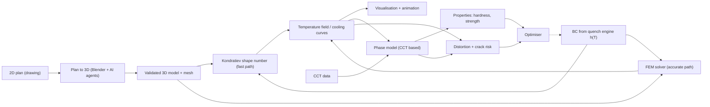

# Plan: Plan-to-3D, geometry, fields, properties, furnaces (Roadmap phases 6–8)

Status: 🔵 planned · Part of [`PROJECT_ROADMAP.md`](../PROJECT_ROADMAP.md) ·
Depends on [`QUENCH_ENGINE.md`](QUENCH_ENGINE.md) (boundary conditions, process sequences) and
[`HEAT_TREATMENT_DATA.md`](HEAT_TREATMENT_DATA.md) (CCT data) ·
Covers phases 6 (geometry and fields), 7 (phases and properties) and 8 (furnaces and recuperators)

## 1. Goal

From a 2D part drawing to a temperature field `T(x, y, z, t)` and to the predicted structure and
properties of the part (hardness, strength, distortion tendency, crack risk), then to furnaces and
recuperators as a system. Every result states its confidence and the data it relied on.

## 2. Pipeline

## 3. Plan to 3D (new module)

| Item | Decision |
|---|---|
| Tooling | Blender in a container, driven by scripted AI agents; Blender is an **external module** called by the backend (see the modules image in the roadmap) |
| Input | 2D drawing (vector or raster) with dimensions; units and views declared by the user |
| Agent roles | *interpreter* (reads the drawing, proposes features and dimensions), *modeller* (builds the model through a fixed Blender script API), *checker* (verifies dimensions, watertightness, volume) |
| Output | a model file, a surface/volume mesh in a neutral format, a report of dimensions and checks |
| Human in the loop | the user confirms the interpreted dimensions and features before meshing |
| Scope of the first version | prismatic and axisymmetric parts (plates, shafts, stepped cylinders, flanges, simple holes) |

Safety and determinism: agents may only call a **whitelisted script API** (primitives, extrude, boolean,
fillet, hole, array); they never run arbitrary code. Every run stores drawing hash, prompts, model,
script and result, like extractor runs (same recorder).

### 3.1 Service layout

New backend module `backend/src/modules/geometry/` (one construct per file): `PlanToModelService`
(orchestrates the job), `BlenderRunnerService` (starts the Blender container job), `MeshService`
(mesh generation and quality metrics), `GeometryMetricsService` (volume, area, characteristic
dimensions), plus DTOs, enums, interfaces. Long jobs run as asynchronous jobs with status polling.

## 4. Kondratiev number for real shapes (fast path)

- For canonical shapes the Kondratiev shape number comes from characteristic dimensions (already
  specified in [`HEAT_CONDUCTION_15_BC_SELECTION_KONDRATIEV.md`](../algorithms/heat-conduction/HEAT_CONDUCTION_15_BC_SELECTION_KONDRATIEV.md);
  complex geometries: [`HEAT_CONDUCTION_16_COMPLEX_GEOMETRIES.md`](../algorithms/heat-conduction/HEAT_CONDUCTION_16_COMPLEX_GEOMETRIES.md)).
  Primary literature for the regular-regime method is in the local pool `tmp/sources/thermal_exchange/`
  (cite by author/title/year only when adding `RefKey`s).
- For complex parts a shape number is estimated from geometry metrics of the mesh (volume, area,
  characteristic lengths) and **calibrated against FEM** on a library of reference shapes; the estimate
  stores its calibration error.
- Use: quick screening of quench options, input to the optimiser; the accurate path is FEM.

## 5. FEM solver (accurate path)

| Item | Decision |
|---|---|
| Problem | transient heat conduction with temperature-dependent `k(T)`, `cp(T)`, surface BC `h(T_surface)` from the quench engine, optional latent heat of transformation |
| Placement | a Python worker (compute-heavy) in the python container, called through backend jobs; the backend owns the API and persistence |
| Library | chosen at the start of the step by a short comparison (candidates: scikit-fem, FEniCSx); selection criteria: licence, Docker footprint, transient support, 3D mesh input. This plan does not fix the choice |
| Time stepping | implicit scheme, adaptive step controlled by surface temperature change (cooling transients are stiff) |
| Verification | against analytic solutions (plate, infinite cylinder, sphere) and against the thermal-distribution module on canonical shapes |
| Output | field snapshots (compressed arrays), cooling curves at probe points, run record |

Results are stored as files (arrays) plus metadata rows (database), not as rows per node.

## 6. Visualisation and animation

- Frontend viewer for the mesh and scalar field with a time slider and play control; probe points with
  cooling-curve plots; cut planes.
- Library chosen at the start of the step (candidate: three.js with the existing React stack); decision
  criteria: bundle size, mesh and colour-map support.
- Export of an animation (frames or video) for reports.

## 7. Phases and properties (phase 7)

| Block | Method | Data |
|---|---|---|
| Phase composition | for each point: cooling curve → transformation kinetics from CCT (additivity rule for diffusional phases, Koistinen–Marburger for martensite) | CCT diagrams ([`HEAT_TREATMENT_DATA.md`](HEAT_TREATMENT_DATA.md)), Ms/Mf, composition |
| Hardness | rule of mixtures from phase fractions and phase hardness; calibrated with labels on the CCT diagram | hardness labels, tempering data |
| Strength | correlation from hardness and structure, with its validity range | handbook correlations (with `RefKey`) |
| Distortion tendency | thermo-elastic-plastic model with transformation strain; first a simplified indicator from temperature gradients and transformation timing, FEM stress later | thermal expansion, transformation strains |
| Crack risk | indicator from stress against strength and from gradient at the martensite start | same |
| Optimisation | loops over quenchant, interruption moment and tempering for a target property window and a cost/safety score | quench engine, phase model |

Honesty rules: each output has a validity range and a confidence; extrapolation outside the data
(unknown steel, no CCT) returns a refusal with the reason, not a number. The first validation uses
published end-quench (Jominy) hardness profiles and published CCT hardness labels.

Backend module `backend/src/modules/microstructure/` (one construct per file): `PhaseFractionService`,
`MartensiteService`, `HardnessService`, `DistortionIndicatorService`, `CrackRiskService`,
`OptimiserService`, with DTOs, enums, interfaces and constants.

## 8. Furnaces and recuperators as a system (phase 8)

- Furnace heating and cooling of parts, with furnace construction and heating method as inputs; heating
  history feeds the part field model.
- Recuperator: material `λ(T)` through the whole result (see [`LEGACY_GAPS_CLOSURE.md`](LEGACY_GAPS_CLOSURE.md) §3);
  interlayer temperatures of the shell.
- Coupled recuperator ↔ furnace ↔ generator view reusing the combustion, recuperator and thermal-exchange modules.
- Efficiency indicators and coupled models; separate API spec when the step starts.

## 9. Work breakdown

| Step | Content | Done when |
|---|---|---|
| G1 Geometry metrics + Kondratiev for canonical and mesh inputs | `geometry` module skeleton, metrics service, calibration set | shape number matches FEM within a stated error on the reference set |
| G2 Plan to 3D, prismatic parts | Blender container, whitelist script API, agents, user confirmation step | three reference drawings produce valid watertight models with correct volume |
| G3 FEM worker | library selection note; solver; verification against analytic cases | analytic verification passes in Docker |
| G4 Viewer + animation | field viewer in the frontend; probe plots | a FEM result opens with time slider |
| P1 Phase model | CCT-based fractions and martensite | reproduces CCT-diagram overlays for reference steels |
| P2 Hardness + strength | rule of mixtures and correlations | Jominy profile for a reference steel within stated tolerance |
| P3 Distortion + crack indicators | simplified indicators | documented behaviour on test shapes; limits stated |
| P4 Optimiser | loops over medium/interruption/tempering | returns ranked options with confidence |
| F1 Furnace + recuperator system | see §8 | separate acceptance when started |

## 10. Docs and tests (Definition of Done)

- Docs per step: `docs/api/` specs for `geometry` and `microstructure`, `docs/algorithms/` notes for
  Kondratiev calibration, FEM formulation, phase kinetics, hardness, indicators; interface/DTO index entries;
  `docs/services/COMMON_THERMAL_LIBRARY.md` if shared utilities are added; update
  `docs/migration/IMPLEMENTATION_STATUS.md` in the same commit.
- Tests inside Docker (≥ 80 % coverage for backend modules; Python tests for the worker).
- Literature references for every correlation (`RefKey` and page).

## 11. Risks

| Risk | Handling |
|---|---|
| AI agents misread drawings | human confirmation of dimensions; checker agent; whitelisted API |
| FEM cost for large 3D meshes | worker with job queue; coarse/fine mesh option; Kondratiev fast path |
| No CCT data for a steel | refusal with reason; data collection through the extractor |
| Distortion and crack models are empirical | publish indicators first, with validity ranges; FEM stress later |
| Library choices (FEM, viewer) | short comparison note at the start of each step; criteria listed above |
