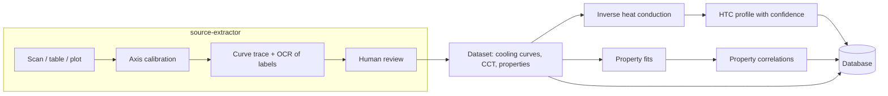

# Plan: Heat-treatment data through the extractor (Roadmap phase 4)

Status: 🟣 research / data risk · Part of [`PROJECT_ROADMAP.md`](../PROJECT_ROADMAP.md) ·
Depends on [`SOURCE_EXTRACTOR_MIGRATION.md`](SOURCE_EXTRACTOR_MIGRATION.md) (adapters, OCR zone queries) and
[`DATABASE_AND_VERSIONING.md`](DATABASE_AND_VERSIONING.md) (tables, translators) ·
Feeds [`QUENCH_ENGINE.md`](QUENCH_ENGINE.md) ·
Details: [`QUENCH_SOURCE_PICKLIST.md`](QUENCH_SOURCE_PICKLIST.md) (sources and what to pick),
[`SOLUTION_PROPERTY_ALGORITHM.md`](SOLUTION_PROPERTY_ALGORITHM.md) (prediction of solution properties),
[`SOLUTION_VERIFICATION_EXAMPLES.md`](SOLUTION_VERIFICATION_EXAMPLES.md) (examples from sources)

## 1. Goal

Collect trustworthy, versioned data for quenching and heat treatment, with the confidence of every
value stated. New data kinds are added as **adapters of the extractor**, not as special code.

## 2. Data kinds

| Kind | What it holds | Typical source | Main difficulty |
|---|---|---|---|
| Cooling curves | temperature versus time of a probe in a quenchant; cooling rate versus temperature | supplier data sheets, handbooks, papers (plots) | different probes, agitation and bath temperature |
| HTC profiles | heat transfer coefficient `h(T_surface, T_medium, agitation, q)` | reconstructed from cooling curves; handbooks | inverse problem, noise |
| Quenchant properties | oils, polymer solutions, water under pressure, inverse-solubility polymers | data sheets, standards, papers | proprietary and incomplete |
| Aqueous salt solutions | boiling point, phase diagram, density, viscosity, thermal conductivity, heat capacity, surface tension versus temperature and concentration | CRC-style tables, handbooks, papers | viscosity and conductivity are the open risk |
| CCT / TTT diagrams | transformation start/finish curves, cooling-curve overlays, hardness labels | steel atlases, handbooks | curve shapes and labels in scans; composition and austenitising conditions |
| Steel and alloy descriptors | composition, austenitising temperature, grain size, Ms/Mf, hardenability | handbooks, existing `metal-data` | consistent identification |

First solutions: NaCl, CaCl₂, MgCl₂, NaNO₃, Ca(NO₃)₂, Mg(NO₃)₂; sulfates, nitrites and hydroxides later.

Local source pools (first extraction / theory backlog). When registering literature in
`shared/references/references.json`, cite authors, titles and years only — **do not** put original
file names from these folders into plans or `RefKey`s.

| Folder | Use for |
|---|---|
| `tmp/sources/quenching/` | aqueous salt solution properties, cooling-curve plots, intensive quench and oils (experiments and papers) |
| `tmp/sources/thermal_exchange/` | heat-transfer handbooks: boiling and convection theory, Kondratiev regular thermal regime, thermotechnical tables (supports HTC models and inverse sizing, not only quench data) |

### 2.1 Sources

The local pool was read once by hand; the result is a per-source list of what to pick, the dataset it
goes to, the extraction method, priority and state — in
[`QUENCH_SOURCE_PICKLIST.md`](QUENCH_SOURCE_PICKLIST.md) (pool items A1–A9 for properties and phase
equilibria, B1–B19 for quenching theory and experiments, §4 problems found in the files, §5 sources to
acquire). Main findings:

- The pool already contains primary material for the central data: CaCl₂ and LiCl formulas (Conde), 20 °C
  property tables for NaCl, CaCl₂, MgCl₂, LiCl, NaNO₃, scanned phase diagrams of CaCl₂ and MgCl₂, boiling-heat-transfer
  chapters of Kutateladze and Mikheev, cooling-time tables (French & Hamill) and cooling curves (Petrash, Grabov et al.).
- Some files are wrong or unusable: one table of "saturated solutions" is rejected; one file labelled as the
  NaNO₂ study contains another paper; two books have no text layer; one file is a composite of two papers.

### 2.2 Gaps

| # | Gap | Why it matters | Closing action | Priority |
|---|---|---|---|---|
| G1 | Density, surface tension, viscosity, conductivity, heat capacity formulas of CaCl₂ and LiCl in the Conde report are not extracted | only primary source at high concentration | read the formulas on the page images (A1) | high |
| G2 | MgCl₂ solubility above 116.7 °C and boiling above ≈ 125 °C; the Mg set of the Pitzer model is biased near 45 % | saturation at the boiling temperature; solution boiling point `T_S` of the quench model | digitise the MgCl₂ diagram of the Russian handbook (A3: 116.7 °C 46.2 %; 181–182 °C 55.8 %; saturated solution boils at 193 °C, 55.6 %) and cross-check with A4 | high |
| G3 | Boiling point versus pressure and saturated concentration at the boiling temperature, per salt | water under pressure; near-saturation CaCl₂ crystallises at low pressure | dataset `solution-phase-equilibrium` and the algorithm of [`SOLUTION_PROPERTY_ALGORITHM.md`](SOLUTION_PROPERTY_ALGORITHM.md) §5 | high |
| G4 | Nitrates (NaNO₃ partly, Ca(NO₃)₂, Mg(NO₃)₂) and nitrites: almost no data; the NaNO₂ HTC paper is missing from the pool | first-solutions list | acquire U7, U8 of the pick list | medium |
| G5 | Conductivity and surface tension of NaCl, CaCl₂, MgCl₂ up to saturation and above 100 °C | open risk of §2 | handbook tables, Conde, Melinder (pick list U4, U5, U11); ranges stored with each fit | high |
| G6 | Boiling-model constants: nucleate-boiling relation and its dependence on pressure, critical flux, film-boiling radiation factor, Tolubinsky bubble parameters | nucleate-boiling HTC cannot be computed without them | take them from the boiling chapters of Kutateladze and Mikheev (B1, B2) and confirm in the original works (U9); no constant without a `ref` | high |
| G7 | Kobasko parameters exist as printed tables and plots: `Ω(Bi)`, `k_F`, Ms versus carbon, `q_cr1` versus concentration, HTC versus bath temperature | needed for `ϑ_I`, `ϑ_II`, `τ_nb` and the boiling window | dataset `quenchant-model-parameter` (§5); digitise the plots (B6–B8) | high |
| G8 | Optimal concentration is evidenced for NaCl and LiCl (density 1000–1110 kg/m³) and by cooling-rate curves for 0–20 % NaCl (maximum at 10–15 %); nothing for CaCl₂ and MgCl₂ curves; 20–26 % NaCl and 40 % CaCl₂ lie outside | film-boiling suppression there is an extrapolation | results outside the documented range carry the flag `extrapolated`; look for more experiments | medium |
| G9 | Cooling data for salt solutions exist as tables and a few curves; no cooling curves at high concentration | HTC reconstruction (§4.1) has little to start from | digitise B10–B13; ISO 9950 / ASTM D6200 conditions (U10) | medium |
| G10 | LiCl is covered by Conde and by the optimum-concentration plot but is not in the first-solutions list | data already exist | decision (§10) | medium |

### 2.3 Verification examples

Concrete examples are quoted from the sources and used **only to measure confidence** of frozen models —
never to fit, scale or select them. The list, the independence classes, the result classes and the protocol
are in [`SOLUTION_VERIFICATION_EXAMPLES.md`](SOLUTION_VERIFICATION_EXAMPLES.md).

## 3. Confidence model

Every stored value carries a `confidence` and a `basis`; nothing is stored without them.

| `confidence` | Meaning | Example |
|---|---|---|
| `measured` | value printed in the source as a number or table | boiling point from a table |
| `digitised` | read from a plot with calibrated axes; stores calibration error | cooling curve points |
| `fitted` | model fitted to measured or digitised values; stores fit residual and range | viscosity vs T correlation |
| `inferred` | derived from related data or a theory; stores the assumption | conductivity from a mixing rule |

`basis` is a `RefKey` (and page) for literature, or an extractor run id for derived values. The quench
engine reports the lowest confidence used by a calculation.

**There is no `legacy` level.** Old code, earlier notes, scratch scripts and library defaults are scratch
models: they may be used to explore, never as a source of data or coefficients. Every stored value and every
coefficient is traced to a registered source; a value that cannot be traced is not stored and is listed in the
gap report. A library is used only to cross-check our own implementation after its coefficients have been
traced to the original paper.

## 4. Pipelines

### 4.1 Cooling curves → HTC

1. Digitise `T(t)` of the probe (and, when given, cooling rate versus temperature) with the diagram
   commands of the extractor; record probe geometry, material, initial temperature, bath temperature,
   agitation.
2. Reconstruct the surface heat flux and `h(T_surface)` with an **inverse heat conduction** step on the
   existing thermal-distribution solver (sequential estimation, regularised). The result is a profile
   `h(T_surface)` per (medium, bath temperature, agitation).
3. Store the profile with its confidence (`fitted`, residual of the forward re-simulation against the
   digitised curve) and the curve it came from.
4. Probe standards (for example ISO 9950, ASTM D6200 for oils) define the probe and bath; their exact
   conditions are checked against the source text when a source is registered, not assumed.

### 4.2 CCT / TTT diagrams

- New adapter family `cct`: calibrate temperature (linear) and time (logarithmic) axes, trace the
  start/finish curves per phase (ferrite, pearlite, bainite, martensite), read hardness labels with OCR zone queries.
- Dataset format: per steel, composition and austenitising conditions, curve polylines per phase and
  fraction (start, 50 %, finish where given), Ms/Mf, hardness labels, source and page.
- Steels first; other alloys later with the same format.

### 4.3 Solution properties

- Tables are read with the `tables` side of the extractor (as for Yaws); plots with the diagram side.
- Where a property is missing, the order is: digitise another source → fit a correlation to what exists
  (marked `fitted`; the fit uses source data only, never the verification examples) → infer from a mixing
  or electrolyte rule whose coefficients come from a source (marked `inferred`) → leave empty. The
  quench engine must handle an empty property by stating that the calculation is not possible, never by using a placeholder.
- How the properties are predicted (activity model, boiling point at pressure, saturation, transport
  properties, uncertainty) is in [`SOLUTION_PROPERTY_ALGORITHM.md`](SOLUTION_PROPERTY_ALGORITHM.md).
- Phase diagrams of the water–salt systems reuse the phase-diagram pipeline already built for
  binary systems.

## 5. Dataset formats (first cut)

All formats carry the standard `format` block and are registered in the format registry.

| Dataset kind | Key fields |
|---|---|
| `quench-cooling-curve` | `quenchant`, `bath_temperature`, `agitation`, `probe{material, diameter, length}`, `initial_temperature`, `series[{t, T}]`, `calibration_error`, `ref`, `page` |
| `quench-htc-profile` | `quenchant`, `conditions`, `h(T_surface)` series, `fit_residual`, `source_curve_id`, `confidence` |
| `quenchant-property` | `quenchant`, `property`, `T`, `concentration`, `value`, `unit`, `confidence`, `basis` |
| `cct-diagram` | `steel`, `composition`, `austenitising{T, time, grain}`, `phases[{name, start[], finish[]}]`, `ms`, `mf`, `hardness_labels[]`, `ref`, `page` |
| `solution-phase-equilibrium` | `solute`, `branch` (`boiling`, `ice`, or a hydrate name), `pressure` (for `boiling`), `series[{concentration, temperature}]`, `valid_range`, `model` (table or fitted formula with coefficients), `confidence`, `ref`, `page` |
| `quenchant-model-parameter` | `quenchant_class`, `parameter` (`omega_bi`, `shape_factor`, `ms_carbon`, `q_cr1_concentration`, `htc_bath_temperature`, …), `argument{name, unit}`, `series[{x, y}]`, `conditions`, `confidence`, `ref`, `page` |
| `quench-cooling-time-table` | `quenchant`, `bath_temperature`, `agitation`, `probe`, `initial_temperature`, `rows[{position, target_temperature, time}]`, `ref`, `page` |

Database tables for these kinds are listed in [`DATABASE_AND_VERSIONING.md`](DATABASE_AND_VERSIONING.md) §4.3.

## 6. Work breakdown

| Step | Content | Done when |
|---|---|---|
| D1 Source survey | inventory the local quench source pool by kind (solution properties, cooling curves, intensive quench, oils); register usable literature in `shared/references/references.json` and the adapter catalog without original file names; `make references-check` passes | each planned dataset has at least one registered source |
| D2 Cooling-curve adapter | adapter + format + first 5 curves digitised | curves review in the GUI; calibration error stored |
| D3 HTC reconstruction | inverse solver on the thermal-distribution module; forward re-simulation check | residual report for each curve |
| D4 Solution properties | boiling point and phase data for the six salts; density; then viscosity and conductivity where sources exist | table of coverage with confidence per property and salt |
| D5 CCT adapter | adapter + format + first 10 steels | curves and hardness labels reviewed |
| D6 Gap report | machine-written report of missing/low-confidence properties per solution | report in `tmp/reports/` and summary in docs; seeded with the gaps G1–G10 of §2.2 |
| D7 Boiling-model constants | close G6: take the nucleate-boiling, critical-flux and film-boiling constants from the registered boiling chapters (pick list B1, B2) and confirm them in the original works | every constant of the boiling window has `ref`; nothing is a placeholder; no scratch relation is used |
| D8 Kobasko parameters | close G7: `quenchant-model-parameter` datasets (`Ω(Bi)`, `k_F`, Ms versus carbon, `q_cr1` versus concentration, HTC versus bath temperature) | values reviewed against the page images; the worked examples of the source are evaluated as verification, not fitted |
| D9 Pressure and saturation | close G2 and G3: `solution-phase-equilibrium` boiling and solubility curves per salt, pressure as a field | for each salt, boiling point versus pressure with the saturation concentration at that temperature, or a stated gap |
| D10 Property algorithm | implement steps A1–A6 of [`SOLUTION_PROPERTY_ALGORITHM.md`](SOLUTION_PROPERTY_ALGORITHM.md) | property × salt × range table with stated uncertainty; refusals outside ranges tested |
| D11 Verification report | evaluate the examples of [`SOLUTION_VERIFICATION_EXAMPLES.md`](SOLUTION_VERIFICATION_EXAMPLES.md) on frozen code | report in `tmp/reports/`; deviation register; no coefficient changed because of a result |

## 7. Validation

- Digitised curves: overlay of the trace on the original image is reviewed in the extractor GUI before promotion.
- HTC profiles: forward simulation reproduces the digitised cooling curve within a stated tolerance.
- Properties: cross-check between sources through the `compare_sources` assist tool; disagreements are
  stored as separate rows with their basis, not averaged silently.
- Theory is compared with experiment; for oils experiment is the primary source.
- Extracted tables: the number of numeric columns must equal the number of header labels. A text
  extraction of one cooling-time table showed six columns under five labels; the missing header was
  found only on the page image. A mismatch blocks promotion until reviewed on the image.
- Extracted formulas: a formula whose text extraction is garbled is **not stored** until it is read on the
  page image or in the original source; it is never repaired from memory.
- A table of property values of unknown provenance is not a source. A table with provenance is compared
  with other sources of the same property; when they disagree beyond the stated uncertainty both are stored
  as separate rows with their basis (the saturated-solution table of unknown origin was rejected this way).
- **Verification examples are not used for fitting.** Examples quoted from sources only measure the
  confidence of frozen models; a deviation is reported, never removed by adjusting a coefficient. Protocol:
  [`SOLUTION_VERIFICATION_EXAMPLES.md`](SOLUTION_VERIFICATION_EXAMPLES.md).
- Values outside the documented range of a source (concentration, temperature, pressure) are returned with
  the flag `extrapolated`, so the quench engine can show it.

## 8. Docs and tests (Definition of Done)

- Docs: `docs/algorithms/` note for inverse HTC reconstruction; source and format descriptions beside the
  other extraction docs; `docs/migration/IMPLEMENTATION_STATUS.md` update.
- Tests inside Docker: format validation, calibration, a synthetic cooling curve with a known `h(T)`
  that the inverse step must recover within tolerance.

## 9. Risks

| Risk | Handling |
|---|---|
| Salt-solution viscosity/conductivity not available in usable form | digitise → fit → infer with explicit confidence; report gaps rather than guess |
| Oil HTC theory unreliable | experimental curves are the primary data |
| Proprietary quenchant data | store only what the licence permits; mark the basis |
| Probe and agitation differences between sources | store conditions; never merge curves with different conditions |
| Boiling-window constants (G6) missing or unsourced | the quench engine refuses the nucleate-boiling HTC for a solution until D7 gives a registered constant |
| Near-saturation solutions: boiling point and solubility at pressure (G2, G3) | state a lower bound or a gap; never present a model estimate as a measured value |
| Optimal-concentration effect is documented only for low concentrations (G8) | mark film-boiling-free predictions at 20–26 % NaCl or 40 % CaCl₂ as `extrapolated` |
| Garbled formulas and column mismatches in text extraction | review on the page image; see §7 |
| Wrong or composite files in the pool (a paper under another title, two papers in one file) | check content against the title page before registration; list in the pick list §4 |
| Pressure to make a model "fit" the examples | rule of §7 and of the verification plan: no tuning; deviations are reported |

## 10. Open questions

| Question | Options |
|---|---|
| Add LiCl to the first solutions (G10)? | yes: Conde and the optimum-concentration plot cover it; no: keep to the six listed salts |

Decisions taken: mixtures with organic components are not planned; legacy code and notes are scratch models
only; outputs of library models are not data (their coefficients are registered from the original papers).
