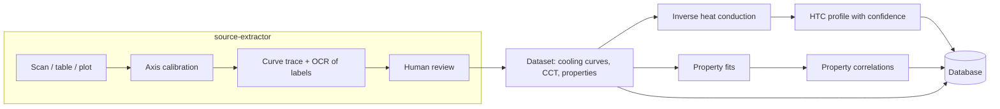

# Plan: Heat-treatment data through the extractor (Roadmap phase 4)

Status: 🟣 research / data risk · Part of [`PROJECT_ROADMAP.md`](../PROJECT_ROADMAP.md) ·
Depends on [`SOURCE_EXTRACTOR_MIGRATION.md`](SOURCE_EXTRACTOR_MIGRATION.md) (adapters, OCR zone queries) and
[`DATABASE_AND_VERSIONING.md`](DATABASE_AND_VERSIONING.md) (tables, translators) ·
Feeds [`QUENCH_ENGINE.md`](QUENCH_ENGINE.md)

## 1. Goal

Collect trustworthy, versioned data for quenching and heat treatment, with the confidence of every
value stated. New data kinds are added as **adapters of the extractor**, not as special code.

## 2. Data kinds

| Kind | What it holds | Typical source | Main difficulty |
|---|---|---|---|
| Cooling curves | temperature versus time of a probe in a quenchant; cooling rate versus temperature | supplier data sheets, handbooks, papers (plots) | different probes, agitation and bath temperature |
| HTC profiles | heat transfer coefficient `h(T_surface, T_medium, agitation, q)` | reconstructed from cooling curves; handbooks | inverse problem, noise |
| Quenchant properties | oils, polymer solutions, water under pressure, inverse-solubility polymers | data sheets, standards, papers | proprietary and incomplete |
| Aqueous salt solutions | boiling point, phase diagram, density, viscosity, thermal conductivity, heat capacity, surface tension versus temperature and concentration | CRC-style tables, handbooks, papers | viscosity and conductivity are the open risk |
| CCT / TTT diagrams | transformation start/finish curves, cooling-curve overlays, hardness labels | steel atlases, handbooks | curve shapes and labels in scans; composition and austenitising conditions |
| Steel and alloy descriptors | composition, austenitising temperature, grain size, Ms/Mf, hardenability | handbooks, existing `metal-data` | consistent identification |

First solutions: NaCl, CaCl₂, MgCl₂, NaNO₃, Ca(NO₃)₂, Mg(NO₃)₂; sulfates, nitrites and hydroxides later.

Local source pools (first extraction / theory backlog). When registering literature in
`shared/references/references.json`, cite authors, titles and years only — **do not** put original
file names from these folders into plans or `RefKey`s.

| Folder | Use for |
|---|---|
| `tmp/sources/quenching/` | aqueous salt solution properties, cooling-curve plots, intensive quench and oils (experiments and papers) |
| `tmp/sources/thermal_exchange/` | heat-transfer handbooks: boiling and convection theory, Kondratiev regular thermal regime, thermotechnical tables (supports HTC models and inverse sizing, not only quench data) |

## 3. Confidence model

Every stored value carries a `confidence` and a `basis`; nothing is stored without them.

| `confidence` | Meaning | Example |
|---|---|---|
| `measured` | value printed in the source as a number or table | boiling point from a table |
| `digitised` | read from a plot with calibrated axes; stores calibration error | cooling curve points |
| `fitted` | model fitted to measured or digitised values; stores fit residual and range | viscosity vs T correlation |
| `inferred` | derived from related data or a theory; stores the assumption | conductivity from a mixing rule |
| `legacy` | taken from old code or unverified notes, not yet checked against a primary source | early seed row pending review |

`basis` is a `RefKey` (and page) for literature, or an extractor run id for derived values. The quench
engine reports the lowest confidence used by a calculation.

## 4. Pipelines

### 4.1 Cooling curves → HTC

1. Digitise `T(t)` of the probe (and, when given, cooling rate versus temperature) with the diagram
   commands of the extractor; record probe geometry, material, initial temperature, bath temperature,
   agitation.
2. Reconstruct the surface heat flux and `h(T_surface)` with an **inverse heat conduction** step on the
   existing thermal-distribution solver (sequential estimation, regularised). The result is a profile
   `h(T_surface)` per (medium, bath temperature, agitation).
3. Store the profile with its confidence (`fitted`, residual of the forward re-simulation against the
   digitised curve) and the curve it came from.
4. Probe standards (for example ISO 9950, ASTM D6200 for oils) define the probe and bath; their exact
   conditions are checked against the source text when a source is registered, not assumed.

### 4.2 CCT / TTT diagrams

- New adapter family `cct`: calibrate temperature (linear) and time (logarithmic) axes, trace the
  start/finish curves per phase (ferrite, pearlite, bainite, martensite), read hardness labels with OCR zone queries.
- Dataset format: per steel, composition and austenitising conditions, curve polylines per phase and
  fraction (start, 50 %, finish where given), Ms/Mf, hardness labels, source and page.
- Steels first; other alloys later with the same format.

### 4.3 Solution properties

- Tables are read with the `tables` side of the extractor (as for Yaws); plots with the diagram side.
- Where a property is missing, the order is: digitise another source → fit a correlation to what exists
  (marked `fitted`) → infer from a mixing or electrolyte rule (marked `inferred`) → leave empty. The
  quench engine must handle an empty property by stating that the calculation is not possible, never by using a placeholder.
- Phase diagrams of the water–salt systems reuse the phase-diagram pipeline already built for
  binary systems.

## 5. Dataset formats (first cut)

All formats carry the standard `format` block and are registered in the format registry.

| Dataset kind | Key fields |
|---|---|
| `quench-cooling-curve` | `quenchant`, `bath_temperature`, `agitation`, `probe{material, diameter, length}`, `initial_temperature`, `series[{t, T}]`, `calibration_error`, `ref`, `page` |
| `quench-htc-profile` | `quenchant`, `conditions`, `h(T_surface)` series, `fit_residual`, `source_curve_id`, `confidence` |
| `quenchant-property` | `quenchant`, `property`, `T`, `concentration`, `value`, `unit`, `confidence`, `basis` |
| `cct-diagram` | `steel`, `composition`, `austenitising{T, time, grain}`, `phases[{name, start[], finish[]}]`, `ms`, `mf`, `hardness_labels[]`, `ref`, `page` |

Database tables for these kinds are listed in [`DATABASE_AND_VERSIONING.md`](DATABASE_AND_VERSIONING.md) §4.3.

## 6. Work breakdown

| Step | Content | Done when |
|---|---|---|
| D1 Source survey | inventory the local quench source pool by kind (solution properties, cooling curves, intensive quench, oils); register usable literature in `shared/references/references.json` and the adapter catalog without original file names; `make references-check` passes | each planned dataset has at least one registered source |
| D2 Cooling-curve adapter | adapter + format + first 5 curves digitised | curves review in the GUI; calibration error stored |
| D3 HTC reconstruction | inverse solver on the thermal-distribution module; forward re-simulation check | residual report for each curve |
| D4 Solution properties | boiling point and phase data for the six salts; density; then viscosity and conductivity where sources exist | table of coverage with confidence per property and salt |
| D5 CCT adapter | adapter + format + first 10 steels | curves and hardness labels reviewed |
| D6 Gap report | machine-written report of missing/low-confidence properties per solution | report in `tmp/reports/` and summary in docs |

## 7. Validation

- Digitised curves: overlay of the trace on the original image is reviewed in the extractor GUI before promotion.
- HTC profiles: forward simulation reproduces the digitised cooling curve within a stated tolerance.
- Properties: cross-check between sources through the `compare_sources` assist tool; disagreements are
  stored as separate rows with their basis, not averaged silently.
- Theory is compared with experiment; for oils experiment is the primary source.

## 8. Docs and tests (Definition of Done)

- Docs: `docs/algorithms/` note for inverse HTC reconstruction; source and format descriptions beside the
  other extraction docs; `docs/migration/IMPLEMENTATION_STATUS.md` update.
- Tests inside Docker: format validation, calibration, a synthetic cooling curve with a known `h(T)`
  that the inverse step must recover within tolerance.

## 9. Risks

| Risk | Handling |
|---|---|
| Salt-solution viscosity/conductivity not available in usable form | digitise → fit → infer with explicit confidence; report gaps rather than guess |
| Oil HTC theory unreliable | experimental curves are the primary data |
| Proprietary quenchant data | store only what the licence permits; mark the basis |
| Probe and agitation differences between sources | store conditions; never merge curves with different conditions |
