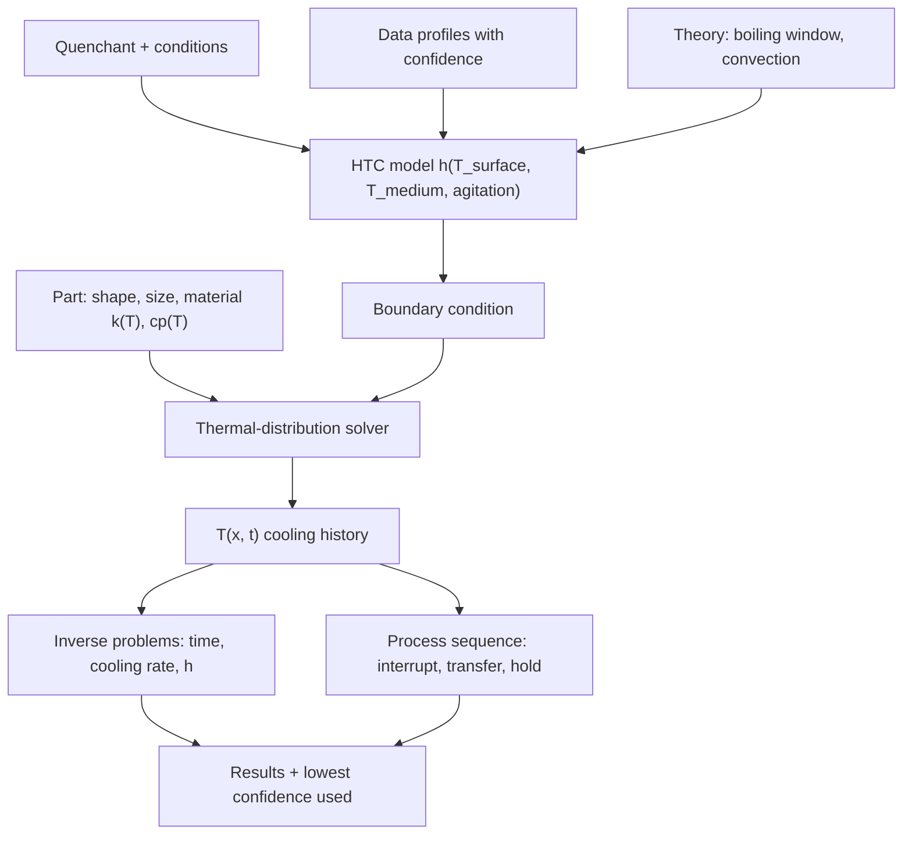

# Plan: Quench and heat-treatment engine (Roadmap phase 5)

Status: 🔵 planned · Part of [`PROJECT_ROADMAP.md`](../PROJECT_ROADMAP.md) ·
Depends on [`HEAT_TREATMENT_DATA.md`](HEAT_TREATMENT_DATA.md), the existing `thermal-distribution`
module and [`DATABASE_AND_VERSIONING.md`](DATABASE_AND_VERSIONING.md) ·
Feeds [`GEOMETRY_FIELDS_PROPERTIES.md`](GEOMETRY_FIELDS_PROPERTIES.md)

Theory and tables for boiling, convection and Kondratiev sizing also come from the local pool
`tmp/sources/thermal_exchange/` (register by author/title/year only; no original file names in
plans or `RefKey`s). Experiment-facing quench sources stay under `tmp/sources/quenching/` — see
[`HEAT_TREATMENT_DATA.md`](HEAT_TREATMENT_DATA.md).

## 1. Goal

A quench calculator on top of the thermal-distribution solver: given a part, a quenchant and process
conditions, return the cooling history and the answers the legacy hardening page gave (time to a target
core temperature, required cooling intensity), plus the new process options (austempering,
martempering, interrupted and intensive quenching in water-based media instead of toxic hot-salt baths).

## 2. Scope

| In scope | Out of scope here |
|---|---|
| Boiling window of salt solutions; transition to convection | 3D geometry and FEM ([`GEOMETRY_FIELDS_PROPERTIES.md`](GEOMETRY_FIELDS_PROPERTIES.md)) |
| HTC models per quenchant class, validated against digitised curves | phase composition and properties (same plan) |
| Kondratiev-based sizing and inverse problems for canonical shapes | furnace system models (phase 8) |
| Process sequences: interruption, transfer, isothermal hold | data collection ([`HEAT_TREATMENT_DATA.md`](HEAT_TREATMENT_DATA.md)) |
| Furnace heating and cooling of a part (furnace construction and heating method as inputs) | |

## 3. Physics blocks

### 3.1 HTC models per quenchant class

| Class | Approach | Notes |
|---|---|---|
| Aqueous salt solutions | boiling window: film boiling → nucleate boiling → convection; nucleate boiling flux from a relation and constants taken from registered sources (boiling chapters of Kutateladze and Mikheev; see [`HEAT_TREATMENT_DATA.md`](HEAT_TREATMENT_DATA.md) gap G6) — no unsourced relation; transition temperatures from solution boiling point and properties | theory first; replaced by data profiles where digitised curves exist |
| Polymer solutions (including inverse-solubility polymers) | data-driven `h(T_surface)` profiles by concentration and agitation | cloud-point behaviour stored as a property |
| Oils | data-driven profiles from experimental curves | theory unreliable; gap reported if no data |
| Water under pressure | boiling point shift with pressure; profile from theory plus data | pressure as a process parameter |
| Gas / air | convective correlations from the existing thermodynamics module | reuses Nusselt/HTC services |

Rule: **data profile beats theory.** If a profile exists for the exact conditions, it is used; else the
theory model, with the confidence of its inputs; else the calculation is refused with a clear message.

### 3.2 Boiling window

- Start and end of nucleate boiling from surface temperature versus solution boiling point and
  critical heat flux; existing algorithm docs: [`HTC_00_REGIMES_OVERVIEW.md`](../algorithms/heat-transfer-coefficient/HTC_00_REGIMES_OVERVIEW.md),
  [`HTC_01_CRITICAL_FLUX.md`](../algorithms/heat-transfer-coefficient/HTC_01_CRITICAL_FLUX.md),
  [`HTC_02_FILM_BOILING.md`](../algorithms/heat-transfer-coefficient/HTC_02_FILM_BOILING.md).
- Duration of the nucleate boiling stage from the cooling history; transition to convection after the window.
- Output includes the surface-temperature interval and time interval of each regime.

### 3.3 Inverse problems

| Question | Method |
|---|---|
| Time to reach a target core temperature | root finding on the forward solution with the approved wrapper (`brentq`) |
| Required thermal diffusivity or cooling intensity for a target time | Kondratiev-type relation for canonical shapes (plate, infinite cylinder, sphere, finite cylinders, cube-like; see [`HEAT_CONDUCTION_15_BC_SELECTION_KONDRATIEV.md`](../algorithms/heat-conduction/HEAT_CONDUCTION_15_BC_SELECTION_KONDRATIEV.md)), then refinement with the forward solver |
| `h(T_surface)` from a measured curve | sequential inverse conduction (see [`HEAT_TREATMENT_DATA.md`](HEAT_TREATMENT_DATA.md) §4.1) |

Numerical methods use the approved wrappers (`brentq`, `nelderMead`, …) and `numeric-format.util.ts` for
responses; no direct library calls.

### 3.4 Process sequences

| Process | Definition | Output |
|---|---|---|
| Direct quench | one quenchant until target temperature | cooling history |
| Interrupted / intensive quench | quench in a water-based medium until a criterion (for example average cross-section temperature), then transfer | interruption moment, equalisation, second stage |
| Austempering | quench to an isothermal temperature, hold | hold time versus bainite curve (needs CCT/TTT data) |
| Martempering | quench to just above Ms, equalise, cool in air | temperature gradient at the equalisation point |
| Furnace heating / cooling | furnace gas temperature program, heating method | heating history of the part |

## 4. Backend module layout

New module `backend/src/modules/quench/`, following the same structure as nearby modules. One construct per file.

| Folder | Content (first cut) |
|---|---|
| `controllers/` | `quench.controller.ts` (thin; one service call per handler) |
| `services/` | `quench-orchestrator.service.ts` (chains services), `quenchant-catalog.service.ts`, `htc-profile.service.ts`, `boiling-window.service.ts`, `quench-solver.service.ts` (uses thermal-distribution), `kondratiev-inverse.service.ts`, `process-sequence.service.ts` |
| `dto/` | request/response DTOs per endpoint (`quench-request.dto.ts`, …) |
| `enums/` | `quenchant-class.enum.ts`, `boiling-regime.enum.ts`, `process-kind.enum.ts`, `confidence.enum.ts` |
| `interfaces/` | behavioural contracts, for example `htc-model.interface.ts` |
| `types/` | data shapes (profile points, regime intervals) |
| `constants/` | named constants (no magic numbers) |

Property calculations use `CompoundPropertyResolver`; quenchant properties come from repositories
(JSON first, DB after [`DATABASE_AND_VERSIONING.md`](DATABASE_AND_VERSIONING.md) phase B).

### 4.1 API (shape, to be fixed in the API spec)

| Method and path | Purpose |
|---|---|
| `GET /quench/quenchants` | catalog with class, available profiles and confidence |
| `POST /quench/boiling-window` | regimes and intervals for solution + part conditions |
| `POST /quench/simulate` | cooling history for a canonical shape |
| `POST /quench/inverse` | time / cooling intensity for a target temperature |
| `POST /quench/process` | process sequence (interrupted, austempering, martempering) |

The thermal-distribution `runTimeSteppingLoop` and `alphaCurve` (implemented on the service, not on
controller DTOs) are exposed through the quench module rather than through new thermal-distribution endpoints.

### 4.2 Frontend

New process section `quench` next to `thermal-distribution` in `frontend/src/modules/processes/`:
quenchant selector with confidence badges, shape and size inputs, boiling-window chart, cooling curves,
inverse-problem form, process-sequence form. Charts follow the existing process sections.

## 5. Validation

| Check | Method |
|---|---|
| Regression against legacy | reproduce legacy hardening-page results for reference cases (nucleate boiling start/end, durations, HTC table values) |
| Against digitised experiments | forward simulation with the reconstructed profile reproduces the source curve within tolerance; report per quenchant |
| Theory vs data | for salt solutions, predicted regime temperatures versus profile transitions; mismatches reported |
| Solver | existing thermal-distribution tests plus new tests of the Kondratiev inverse on canonical shapes against the forward solver |

## 6. Work breakdown

| Step | Content | Done when |
|---|---|---|
| Q1 Spec + docs | API spec in `docs/api/QUENCH_API_SPEC.md`; algorithm notes in `docs/algorithms/quench/` | documents reviewed |
| Q2 Catalog + profiles | quenchant catalog service; data-profile HTC model; confidence propagation | catalog returns the first digitised / registered quenchants with stated confidence |
| Q3 Boiling window | theory model for salt solutions; legacy regression | legacy reference cases reproduced |
| Q4 Simulation + inverse | `quench-solver` and `kondratiev-inverse` on canonical shapes | inverse and forward agree on test shapes |
| Q5 Process sequences | interrupted, austempering, martempering | each process has a documented example and test |
| Q6 Frontend section | `quench` process section | works against the API in Docker |
| Q7 Validation report | comparison with digitised curves | report in `tmp/reports/`, summary in docs |

## 7. Docs and tests (Definition of Done)

- Docs: `docs/api/QUENCH_API_SPEC.md`, `docs/algorithms/quench/`, DTO/interface entries in
  `docs/INTERFACES_IMPLEMENTATION_INDEX.md`, `docs/migration/IMPLEMENTATION_STATUS.md` update.
- Tests (≥ 80 % coverage) in `backend/test/unit/quench/`, run inside Docker.
- Literature references for every coefficient set (`RefKey`); numerical routines through approved wrappers.

## 8. Risks

| Risk | Handling |
|---|---|
| Theory unreliable for oils and polymers | data-driven profiles; refusal with message when no data |
| Salt-solution properties missing | confidence propagation; report instead of placeholder |
| Scope: canonical shapes only | complex geometry belongs to [`GEOMETRY_FIELDS_PROPERTIES.md`](GEOMETRY_FIELDS_PROPERTIES.md) |
