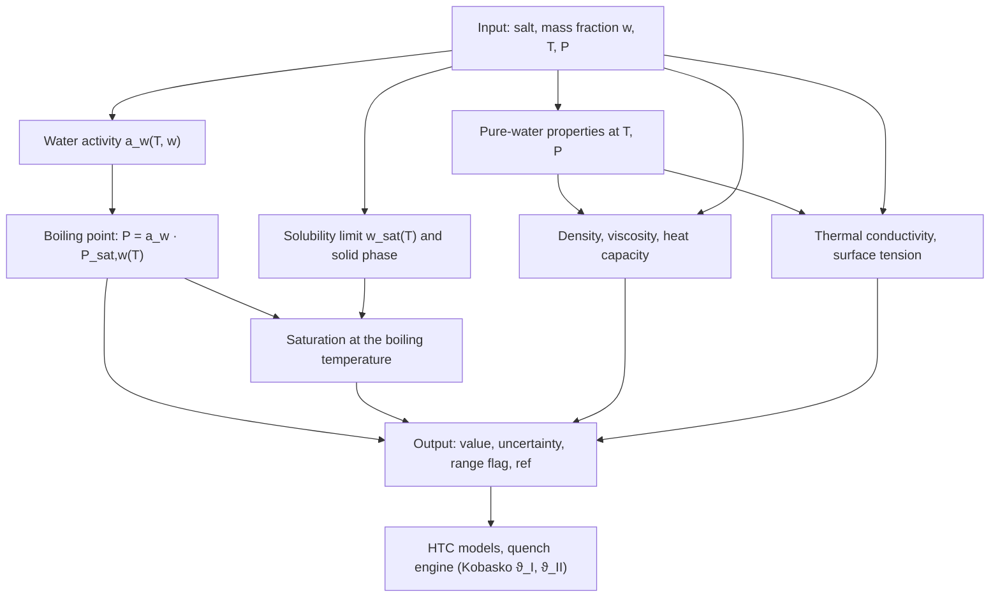

# Plan: Algorithm for predicting aqueous salt-solution properties

Status: 🟣 research · Part of [`HEAT_TREATMENT_DATA.md`](HEAT_TREATMENT_DATA.md) (roadmap phase 4) ·
Needs the sources listed in [`QUENCH_SOURCE_PICKLIST.md`](QUENCH_SOURCE_PICKLIST.md) ·
Checked by [`SOLUTION_VERIFICATION_EXAMPLES.md`](SOLUTION_VERIFICATION_EXAMPLES.md) ·
Feeds [`QUENCH_ENGINE.md`](QUENCH_ENGINE.md)

## 1. Goal and scope

Predict, for a water–salt solution from dilute to saturated, at a given temperature `T` and pressure `P`:
boiling point, saturation (solubility) limit, density, viscosity, thermal conductivity, heat capacity and
surface tension — each with a stated uncertainty and a flag for the range it was computed in.

First solutions: NaCl, CaCl₂, MgCl₂, NaNO₃, Ca(NO₃)₂, Mg(NO₃)₂; LiCl is an open question (see
[`HEAT_TREATMENT_DATA.md`](HEAT_TREATMENT_DATA.md) §10). One salt per solution in the first cut; mixtures and
solutions with organic components are out of scope.

## 2. Rules (mandatory)

1. **Every coefficient, table and equation comes from a registered source** (`RefKey` and page). Earlier
   scratch calculations, old code and library defaults are *not* sources. A library may be used only as a
   cross-check of our own implementation, after its coefficients have been traced to the original paper.
2. **Verification examples are never used to fit, scale or select.** An example taken from a source is
   computed after the model and its coefficients are frozen; the result is a statement about confidence
   ([`SOLUTION_VERIFICATION_EXAMPLES.md`](SOLUTION_VERIFICATION_EXAMPLES.md)). No correction factor, shifted
   coefficient or re-weighted term may be introduced to reduce a deviation.
3. **No placeholder values.** Outside every registered range the property is refused, not guessed.
4. **Range is part of the result.** Each output carries `in_range`, `extrapolated` (inside the physical
   domain but outside the range of the source) or `refused`.
5. **Two models for one property are both kept** when they disagree; the disagreement is reported, not averaged.
6. Property calculations go through `CompoundPropertyResolver`; roots are found with the approved wrapper
   `brentq`; no numerical library is called directly (see `AGENTS.md` §5).

## 3. Data flow

## 4. Property by property

| Property | Primary approach | Cross-check | Coefficients come from | Range found so far | Open |
|---|---|---|---|---|---|
| Water activity `a_w` | Pitzer ion-interaction model (parameters per ion pair, temperature-dependent); for CaCl₂ and LiCl the closed vapour-pressure formula of Conde | the other of the two; tabulated 1 atm boiling points | original Pitzer parameter papers (a high-temperature set for Na, Ca, Cl, SO₄ to 250 °C; a Mg set); Conde report | Pitzer: NaCl, CaCl₂ to saturation at 1 atm; Mg set unreliable near 45 % MgCl₂ | identify and register the original publication of the Mg set; nitrates |
| Boiling point `T_b(w, P)` | solve `P = a_w(T, w)·P_sat,w(T)` for `T` | Dühring lines per concentration | as above; water `P_sat` from the water module | 1 atm to saturation for NaCl and CaCl₂ | MgCl₂ above 125 °C; pressures below ≈ 0.7 atm near saturation (crystallisation) |
| Solubility `w_sat(T)` | solid–liquid equilibrium branches: ice line, hydrate lines, anhydrous line; Conde closed formulas for LiCl and CaCl₂; tables for NaCl, MgCl₂, nitrates | handbook tables | Conde; handbook tables (to pick) | CaCl₂ to 176 °C (point D); NaCl to boiling (28.9 % at ≈ 108 °C, from a handbook cited in a patent); MgCl₂ only to 116.7 °C | MgCl₂ above 116.7 °C; nitrates |
| Saturation at the boiling temperature `w*` | root of `w = w_sat(T_b(w, P))` | — | derived | exists when the boiling curve crosses the solubility curve | no root → solution crystallises before it boils; report that |
| Density | Laliberté–Cooper apparent-density mixing model | tables at 20 °C (CRC-type) and a wider-range table source | Laliberté & Cooper (2004) | NaCl to 26.6 wt %, CaCl₂ to 51 wt %, T ≤ 100–154 °C (library fit ranges) | MgCl₂, nitrates; ranges to confirm from the paper |
| Viscosity | Laliberté model | 20 °C tables | Laliberté (2007) | same as density | MgCl₂ at high concentration |
| Heat capacity | Laliberté model | tables | Laliberté (2009) | CaCl₂ to 41.8 wt % | above that: refuse or `extrapolated` |
| Thermal conductivity | no single primary correlation to saturation: candidates are the brine correlations of Melinder (limited concentration and temperature range), Conde's formula for LiCl and CaCl₂, a mixing rule `k = k_w + Σ α_i C_i` with tabulated `α_i` | any measured table | Melinder; Conde; handbook tables (to pick) | brines to about 23–30 wt % | the central open risk (gap G5) |
| Surface tension | linear molality increment `σ = σ_w + K_s·m` with tabulated `K_s`; thermodynamic models (Dutcher; Li & Lu) | Conde (LiCl, CaCl₂) | handbook tables, Conde, original model papers | none verified | all salts (gap G5) |

Notes:

- "Library fit ranges" are the ranges of the implementations we looked at; the authoritative range is the
  one printed in the original paper and must be recorded when the source is registered.
- A scratch factor used in a conductivity estimate during the first session was calibrated on a table of
  brine data. It is a fitted number without a source and **is not carried over**.

## 5. Boiling point, pressure and saturation (the main algorithm)

1. Compute `a_w(T, w)` from the chosen model for the salt (Pitzer or Conde).
2. For pressure `P` find `T_b` with `brentq` on `f(T) = a_w(T, w)·P_sat,w(T) − P`. `P_sat,w` comes from the
   water module, not from a local formula.
3. Compute `w_sat(T_b)` from the solubility branches. Select the branch by temperature: ice, then the
   hydrate lines in order, then the anhydrous line. Transition temperatures between hydrates are data
   (for example CaCl₂ points C and D; MgCl₂ hexa- to tetrahydrate at 116.7 °C).
4. Saturation at the boiling temperature: solve `w* = w_sat(T_b(w*, P))` with `brentq` on `w`.
   - If `w < w*` the solution boils before it saturates.
   - If no root exists in `(0, 1)` the solution is saturated at every boiling point of the pressure range;
     the algorithm returns "crystallises before boiling" and the temperature where it does.
5. A concentration given as "x % below saturation at the boiling temperature" is `w = w* − x`; with
   pressure varying, `w*` is recomputed at each pressure. Near saturation the boiling point falls with
   pressure, the solubility falls with temperature, and for CaCl₂ the solution can crystallise below
   about 0.7 atm.

Uncertainty propagation for the boiling point (derived from the Clausius–Clapeyron relation, not a data
point): `δT_b ≈ (R·T_b² / ΔH_vap)·δ(ln a_w)`, which is about 28 K per unit of `ln a_w` near 100 °C. A
1 % error in `a_w` therefore shifts `T_b` by about 0.3 K. The activity model's stated uncertainty is
turned into a boiling-point uncertainty with this relation.

## 6. Uncertainty and confidence

- Each model record carries the uncertainty **stated by its source** and the range of that statement.
- Our own verification result (agrees / marginal / disagrees, see the verification document) is stored
  beside it; it does not replace the stated value and never reduces it.
- Output confidence is the lowest of the inputs used (`measured`, `digitised`, `fitted`, `inferred`; there
  is no `legacy` level — see [`HEAT_TREATMENT_DATA.md`](HEAT_TREATMENT_DATA.md) §3).
- Extrapolation: no number is attached; the result carries the flag and the quench engine displays it.

## 7. Findings from the first (scratch) exploration

These are observations from throw-away calculations, listed so that the plan targets the right risks.
They are **not data**; each must be re-established through the verification protocol with frozen code.

| Observation | Consequence for the plan |
|---|---|
| Laliberté viscosity and density at 20 °C agree with a 20 °C handbook table for NaCl up to 26 % and CaCl₂ up to 40 % to about 1 % | consistent, but the handbook data are probably among the data the model was fitted to, so this is not independent evidence |
| A table of "saturated solutions" with viscosities 1.35 mPa·s (NaCl) and 2.5 mPa·s (CaCl₂ near 40 %) disagrees with the handbook table (about 2.0 and 9.0 mPa·s) | that table is rejected as a source (provenance unknown); it must not be stored |
| Pitzer (high-temperature Na–Ca–Cl set) gave 104.9 °C for 20 % NaCl at 1 atm and 120.2 °C for 40 % CaCl₂ | close to tabulated 1 atm boiling points; to be formally verified |
| Conde's vapour-pressure formula for CaCl₂ gave 117.3 °C at 40 %, about 3 K below the Pitzer value; versus tabulated boiling points it is within ±2 K to 70 % and about 7 K low at 75 % | both models are kept and the difference reported |
| The Mg Pitzer set underestimates the boiling point near 45 % MgCl₂ by about 7 K against a single measured point | MgCl₂ high-concentration values stay `inferred` with a lower-bound statement until a source is found |
| Saturation at the boiling temperature is known for NaCl and CaCl₂ (CaCl₂ to 176 °C) but not for MgCl₂ above 116.7 °C | solubility data for MgCl₂ is a pick-list item |
| No library supplies conductivity or surface tension of these salts up to saturation | gap G5; picks from handbook tables and Conde |

## 8. Planned constructs (for the implementation step)

Follow `AGENTS.md` §1; shown for scoping only.

| Construct | Form | Reason |
|---|---|---|
| Water activity per model | `@Injectable` service (uses the water module) | DI |
| Boiling point, saturation | `@Injectable` orchestration service using `brentq` wrapper | root finding with injected services |
| Property correlations (one per equation method) | `Equation<T>` classes in `utils/`, coefficient types in `type/` | existing convention for equations |
| Solute data (Pitzer parameters, Conde coefficients, Laliberté constants) | `data/*.data.ts` with `ref: RefKey.Xxx`, `page` | sourced coefficients |
| Result with range flag | DTO | API boundary |

## 9. Work steps

| Step | Content | Done when |
|---|---|---|
| A1 Source registration | pick-list items for the algorithm registered in `references.json`; `make references-check` passes | each coefficient set has a `RefKey` |
| A2 Water side | pure-water `ρ, μ, k, cp, σ, P_sat` taken from the existing water module | water layer verified against the printed water tables of the pool |
| A3 Activity and boiling point | Pitzer sets and Conde formula implemented; boiling point at pressure | verification examples evaluated and reported, no tuning |
| A4 Solubility and saturation | solubility branches per salt; `w*` algorithm | cases of §5 incl. "no root" covered by tests |
| A5 Transport and caloric properties | Laliberté set; conductivity and surface tension from picked sources | ranges recorded; refusals tested |
| A6 Report | machine-written table: property × salt × range × stated uncertainty × verification status | report in `tmp/reports/`, summary in docs |

Docs of the finished algorithm go to `docs/algorithms/` and `docs/services/COMMON_THERMAL_LIBRARY.md` per
`AGENTS.md` §9; `docs/migration/IMPLEMENTATION_STATUS.md` is updated in the same change.
