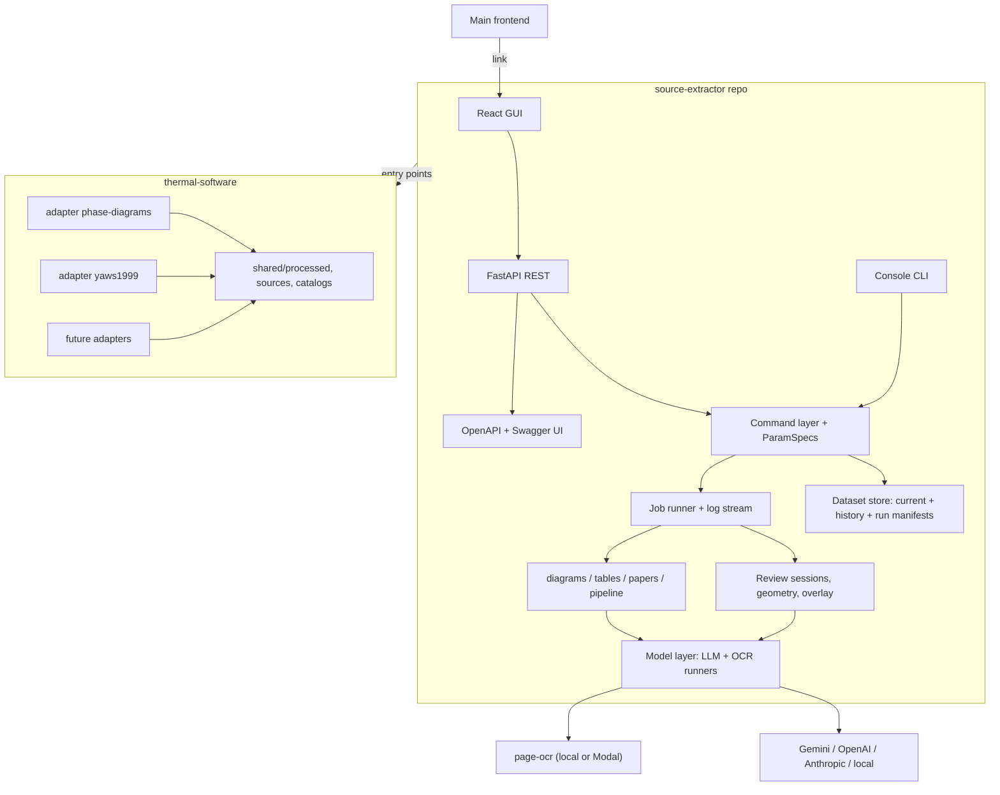
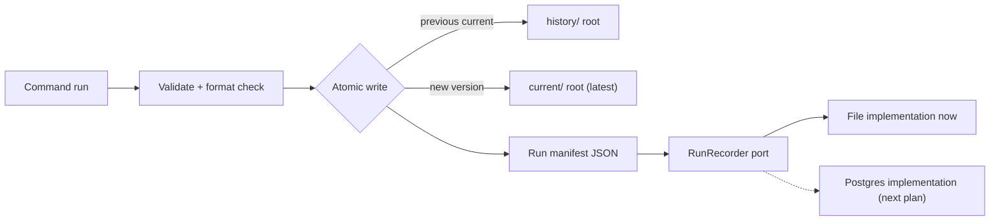

# Plan: Source-extractor as the single entry point (Roadmap phase 1)

Status: 🟡 in progress (phases 0–5 scaffold; review domain+API+React editor full-ported; §12 cutover gate still open for Analyze/NBS/OCR/LLM/history) ·
Part of [`PROJECT_ROADMAP.md`](../PROJECT_ROADMAP.md) ·
Next plan: [`DATABASE_AND_VERSIONING.md`](DATABASE_AND_VERSIONING.md)

## 1. Goal

Turn `vendor/source-extract` (SE) into the **only door** for every action on a source: console
commands, REST API with Swagger, and a web GUI in the same stack as the main frontend. SE runs
OCR and LLM models, lets us query OCR for a zone with adjustable settings, and exposes many more
parameters (zones, curves, nodes, output corrections) than today. This repository keeps only
**source adapters** (`python/` becomes adapters); general logic moves into SE.

## 2. Principles

- **Single entry point.** Console, API and GUI call the same command layer; none holds logic of its own.
- **General in SE, specific in the host.** SE owns rules, computer vision, model orchestration,
  review and versioning mechanics. The host keeps source adapters only (Slag Atlas, NSRDS-NBS,
  Yaws, JANAF, compound catalogs, oxide quirks, dataset paths, promote rules).
- **Inversion of dependency.** Today adapters import SE. After the migration SE discovers adapters
  through Python entry points (group `source_extract.adapters`); adapters implement a small
  protocol and import only the SE public API. No circular imports.
- **No Atlas/NBS names inside SE.** Anything that names a concrete source becomes adapter configuration.
- **`services/diagram-review` is a local reference only.** It is excluded from git through
  `.git/info/exclude`, used for parity checks, deleted at cutover. It is never staged or committed.
- **Where code lands.** SE work is committed in the SE repository (submodule `vendor/source-extract`);
  this repository commits adapters, compose/make wiring, docs and the submodule pointer.
- **Code standards.** SE Python follows the same SRP rules as the host: one construct per file, no
  helper families, files under 300 lines. The ~3k-line `session.py` is split by responsibility
  during the move, never pasted as one module. Tests run in Docker.

## 3. Target architecture

## 4. Layout of SE (new parts)

| Package | Responsibility |
|---|---|
| `source_extract/adapters/` | `SourceAdapter` protocol, registry, entry-point loader, capability flags |
| `source_extract/commands/` | one `CommandSpec` per operation, each with a `ParamSpec` list |
| `source_extract/params/` | `ParamSpec` (name, type, default, range, description, group, advanced flag), presets, validation |
| `source_extract/models/llm/` | provider-agnostic client and provider adapters |
| `source_extract/models/ocr/` | OCR runners over `page-ocr` plus own region OCR |
| `source_extract/assist/` | LLM tool functions the assistant can call |
| `source_extract/review/` | sessions, edit operations, geometry, overlay, confirm/export (from diagram-review) |
| `source_extract/jobs/` | async job runner, state, log streaming |
| `source_extract/versioning/` | dataset roots, format registry, change notes, run manifests, `RunRecorder` port |
| `source_extract/api/` | FastAPI app, routers, Pydantic schemas |
| `source_extract/cli/` | console entry `source-extract ...` |
| `frontend/`, `docker/` | React app; images and compose |

Commands: diagrams `extract`, `auto`, `trace-curves`, `nodes`, `detect-isotherms`, `index-figures`,
`validate`, `promote`; tables `extract`, `verify`.

## 5. Adapter protocol

An adapter declares data and hooks; it never executes policy for SE.

- Identity and the kinds it serves (`diagrams`, `tables`, `papers`).
- Source catalog: sources, PDF/DjVu paths, page-offset mapping, figure index (today `sources.json` + `SourceRegistry`).
- Roots: current dataset root, work root, history root (see §9).
- Config resolution: where binary/ternary configs live, how a system id maps to a config and an output file.
- Source-specific hooks: NBS cross-check and status resolution, compound/oxide knowledge, field naming
  that needs Atlas refs, validators, promote rules, formula and molar-mass tables.
- Dataset format ids and the current format version per dataset kind.

Mapping of the existing host code:

| Today | After migration |
|---|---|
| `python/src/phase_diagrams/` | adapter `phase-diagrams`: keeps `nbs/`, `compounds/`, `constants/oxide_*`, `status_tolerance`, `builders/binary_system_builder.py`, `output/`, `validation/`; its `cli/` is deleted after SE CLI parity |
| generic builders (`field_namer`, `auto_*_builder`, `compound_points_builder`, `nearest_compound`, `topology_report_builder`) | move to `source_extract.diagrams.builders` with adapter-supplied refs |
| `python/src/yaws1999/` | adapter `yaws1999` for tables |
| later sources (JANAF, NASA, molten salts, quenchant curves, CCT diagrams) | new adapters, no SE change |

## 6. Commands and tunable parameters

Each command lists its `ParamSpec`s once. The same declaration produces CLI flags, the JSON schema in
OpenAPI (Swagger) and the grouped basic/advanced GUI forms.

| Family | Examples |
|---|---|
| Page / zone | search boxes, frame box, crop regions, DPI, page rotation, ignore zones |
| Ink and strokes | threshold, stroke-width range, dash handling, text suppression |
| Calibration | tick spacing, matching tolerance, rotation correction, manual tick overrides |
| Curves / nodes / isotherms | seed pixels, waypoints, step, snap radius, smoothing, junction tolerance, temperature sources, label OCR options |
| Cross-check | which adapters/sources to compare, tolerances |
| Output | dataset format version, rounding, field sets, include/exclude blocks |

Named presets are stored with the run; a run always records the resolved parameter set. Existing flags of
`extract_phase_diagram.py` stay as aliases so current make targets keep working during the migration.

## 7. Model layer (OCR and LLM)

### 7.1 LLM client

- One `LlmClient` protocol: chat, structured output (JSON schema), tool calling, vision input, token/cost metadata.
- Providers: Google (default, Gemini Flash class), OpenAI, Anthropic, and a generic OpenAI-compatible
  adapter (covers local llama.cpp/Ollama and other vendors).
- Provider, model id and options are configuration (env + per-run override), never hard-coded. The
  Gemini Flash model id is set via `SE_LLM_MODEL`; its exact identifier is confirmed against the
  provider model listing when wiring, not assumed in code or docs.
- Named profiles (for example `fast-assist`, `vision-check`, `local-ocr-helper`): a command asks for a profile, not a vendor.
- Every call goes through a recorder: prompt template id + rendered prompt, model, provider,
  parameters, token usage, latency, response hash. This later lands in the database.

### 7.2 OCR runners

- Backends through `page-ocr`: local container (Surya, llama-server VLM) and Modal; the engine is pluggable.
- Region query: `ocr_region(image, box, engine, prompt?, language, whitelist, psm, scale, rotate)`,
  callable by commands, by the GUI (select a zone, re-OCR with other settings) and by the assistant as a tool.
- Own-OCR fallback: when the LLM or `page-ocr` cannot answer for a zone, SE runs local engines on that
  zone itself and returns candidates with confidence.
- Results are **candidates, not truth**: each carries engine, parameters, confidence and the pixel box.

### 7.3 Assist tools

| Tool | Purpose |
|---|---|
| `ocr_region` | read a label, tick, temperature or composition in a zone |
| `lookup_context` | read already-extracted data (dataset, NBS entries, compound catalog) to confirm or correct a value |
| `compare_sources` | compare a value across sources through adapters (for example atlas vs NBS) |
| `propose_correction` | returns a structured diff (field, old, new, evidence); never writes data |
| `transform_data` | reshape extracted data to another format version when a change note defines the mapping |

Every tool call is recorded and bounded. A human, or an explicit auto-accept rule, applies a proposal.

## 8. REST API and Swagger

- FastAPI with generated OpenAPI: Swagger UI at `/docs`, ReDoc at `/redoc`, schema at `/openapi.json`, prefix `/api/v1`.
- Tags: `adapters`, `sources`, `commands`, `jobs`, `review`, `datasets`, `history`, `models`, `health`.
- Endpoints (shape): adapters and capabilities; sources and systems; command catalog with ParamSpec
  schemas; `POST /jobs` (command + params) with status, log, SSE stream and cancel; review sessions
  (the current diagram-review surface); dataset current/history/diff; model profiles, test call, recorded
  runs; OCR region query.
- The OpenAPI file is exported and checked in CI (contract test); the frontend client is generated from
  it so GUI and API cannot drift.
- The NestJS backend already serves Swagger; both URLs are listed in the docs and in the main frontend.

## 9. Dataset store (file-system part)

Database persistence is the next plan ([`DATABASE_AND_VERSIONING.md`](DATABASE_AND_VERSIONING.md)); this
plan builds the mechanics and the port.

- Two roots per adapter: **current** (latest dataset and latest images, one version only) and **history**
  (earlier versions, removable on demand once quality is accepted).
- Every dataset file carries a `format` block: format id and format version; the run manifest records a
  note of what changed since the previous version.
- Format registry: registered versions, migration functions between them, generated change notes.
- Run manifest per write: dataset id, version, previous version, command, resolved parameters, models
  and prompts used, adapter versions, source refs, input hashes, diff summary (added/changed/removed values).
- Housekeeping commands: `history list`, `history diff`, `history prune --accepted`.

## 10. Frontend

- Same stack as the main frontend: React 19, Vite, MUI, TanStack Query, react-router, react-hook-form,
  yup (see `frontend/package.json`); same theme tokens and layout conventions.
- Screens: adapters/sources/systems; command runner with generated parameter forms and presets; job
  log; review canvas (zoom/pan, curves, points, isotherms, binary liquidus, undo, confirm); OCR zone
  tool; assistant panel with evidence and proposed corrections; dataset history and diff; model/profile settings.
- The canvas becomes React components plus a small canvas engine module; the old vanilla SPA is not embedded.
- **Main frontend:** a navigation entry that opens the SE GUI (URL from `VITE_SOURCE_EXTRACTOR_URL`,
  same-origin path `/source-extractor/` behind nginx in compose). No runtime code sharing in this phase.

## 11. Work breakdown

| Phase | Content | Done when | Session status |
|---|---|---|---|
| 0 Guard + scaffold | `services/` in `.git/info/exclude`; SE app skeleton (FastAPI `/docs`, `/health`, CLI `--help`, empty Vite app, Dockerfile, compose for SE + page-ocr, mounts for `shared/`, `tmp/reports/python/`, adapter `PYTHONPATH`) | `git status` shows nothing from `services/`; SE container serves `/docs` | done |
| 1 Adapters + commands | `SourceAdapter` protocol and registry; `phase-diagrams` adapter wraps current package; `CommandSpec`/`ParamSpec`; pd-* subcommands as SE commands; job runner replaces the Docker shell-out of `services/diagram-review/app/jobs/analyze.py` | CLI and `POST /jobs` run the same commands; make targets alias to the SE CLI | done |
| 2 Models + assist | LLM client, providers, recorder; OCR runners, region query, own-OCR fallback; assist tools; guidance cards ported; parameters exposed per command | a zone can be re-OCR'd with other settings from CLI, API and GUI; every call is recorded | done (guidance cards not fully ported) |
| 3 Dataset store | current/history roots, format registry, change notes, manifests, file `RunRecorder`, history commands; first formats for system JSON and NBS entries | a promote moves the old version to history and writes a manifest | done |
| 4 Review + GUI | review code moved to `source_extract/review/` with adapter config; React GUI at parity; generated API client; main-frontend link and nginx route | parity checklist (§12) passes in the GUI | **full port landed** — split domain (`session_*`, contours, barycentric, binary axes, …), review REST (`/api/v1/review/*`), React editor (systems+sessions rail, canvas, tools, Analyze/Confirm/Undo). Dry-run: open ternary `cao-al2o3-sio2` + binary `al2o3-cao`, move/undo. Remaining §12: Analyze+reload in GUI, NBS extract, OCR/LLM, history. `services/diagram-review` stays local reference |
| 5 Slim host + cutover | host CLI logic deleted; `extract_phase_diagram.py` becomes a shim and is then removed; `services/diagram-review` deleted locally; docs refreshed; submodule pointer bumped | parity checklist passes without `services/` | shim + docs done; host CLI modules + local diagram-review kept until §12 green |

## 12. Parity checklist (cutover gate)

- Binary and ternary Analyze, with original page as background.
- Open, edit, confirm of a draft; layer offsets preserved.
- NBS-backed extract (for example `al2o3-mgo`, using the `eutectic-data` NBS index).
- OCR zone re-query with changed parameters.
- LLM proposal flow: proposal is a diff with evidence, applied explicitly, recorded.
- History list and diff for a promoted dataset.

## 13. Docs and tests (Definition of Done)

- Refresh at cutover: `docs/SHARED_LIBRARIES_SUBMODULES.md`, `docs/scripts/phase-diagrams/LAYOUT.md`,
  `docs/scripts/phase-diagrams/CLI.md`, `docs/PYTHON_CONTAINER.md`.
- Update `docs/migration/IMPLEMENTATION_STATUS.md` in the same commit as each change.
- Python tests inside Docker (`docker compose run --rm python ...`); SE tests run in the SE container;
  OpenAPI contract test in SE CI.

## 14. Risks

| Risk | Mitigation |
|---|---|
| Import cycles from dependency inversion | keep the adapter protocol in a tiny module with no CV imports |
| Parameter explosion | groups, basic/advanced split, presets, record the resolved set |
| LLM output is untrusted | proposals are diffs with evidence, applied explicitly, recorded |
| Provider and model churn | profiles and the provider-agnostic client |
| Two-repository workflow | paired PRs; pin the submodule SHA only after SE is mergeable |

## 15. Out of scope here

Postgres schema, migrations, history/log tables, seeds, translators and the backend reading the
database only ([`DATABASE_AND_VERSIONING.md`](DATABASE_AND_VERSIONING.md)); quench, heat-treatment and
geometry work ([`QUENCH_ENGINE.md`](QUENCH_ENGINE.md),
[`GEOMETRY_FIELDS_PROPERTIES.md`](GEOMETRY_FIELDS_PROPERTIES.md)).
