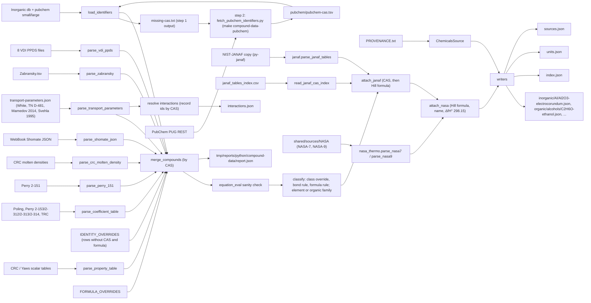

# Compound Data Specification (CalebBell/chemicals tables)

**Status:** Implemented (`python/src/chemical_formula/`, `chemicals_tables/`, `pubchem/`, `dataset_layout/`, `compound_data/`, see [Packages](#packages)). The backend methods of the planned equation types are the next step.
**Purpose:** Merge the CalebBell/chemicals data tables copied into `shared/sources/compound-data/chemicals/` into JSON datasets, one small file per compound. Inorganic compounds are placed by their main element and organic compounds by functional family, with an `index.json` linking them and a `units.json` listing the units. Every coefficient row is stored as a ready-to-use backend `EquationValue`.

Sources: CRC 95th ed., Perry 8th ed., Poling 5th ed., Yaws 2014, TRC 1994, Zabransky 1996, NIST WebBook Shomate and VDI Heat Atlas PPDS, plus the hand-transcribed transport parameters of White (Viscous Fluid Flow 3e), NASA TN D-481, Mamedov & Somuncu 2014 and Svehla 1995 (see [Transport parameters](#transport-parameters)).

The build also parses the NIST-JANAF copy with the `janaf` package and lists the matching table ids in each record (see [JANAF table ids](#janaf-table-ids)). Implementing the planned equation types in the backend is the next step (see [Planned equation types](#planned-equation-types)).

The JSON format is described by the backend interfaces in [utils/compound-data/](../../backend/src/common/thermal/utils/compound-data/index.ts); the unit of every value is in `units.json`.

---

## Decisions

- **Scope:** all compounds in the copied files.
- **Organic or inorganic:** only carbon compounds can be organic, and elemental carbon (graphite, C2–C5, C60) is not. The order of precedence is:
  - `CLASS_OVERRIDES` (`compound_data/constants/class_overrides.py`, by CAS, each with a reason): the pseudohalogen hydrogen acids HCN, DCN, HNCO and HNCS are inorganic, and tetranitromethane is organic;
  - otherwise the bond rule on the SMILES (`chemical_formula.organic_bonds.has_organic_bond`, RDKit): organic when a carbon is bonded to H (D, T) or to a halogen, or, without a metal in the structure, bonded to another carbon (cyanogen, carbon suboxide and subsulfide), bonded to an N that carries H (urea, guanidine, melamine), or in a ring with at least two carbons (cyanuric triazide). So halocarbons (CCl4, freons, perfluorocarbons) and deuterated organics are organic, while carbonates, bicarbonates (NaHCO3), cyanides, cyanates, thiocyanates, carbides (B4C, whose single carbon sits in a boron cage) and acetylides (LaC2), metal oxalates, metal carbonyls, CO, CO2 and CS2 are inorganic;
  - otherwise (no SMILES) the formula rule (`classify_compound`): organic when there is no metal and the formula has H, a halogen or more than one carbon (C2N, C2O radicals).
  - The report lists `classOverridden` (with what the bond rule said) and `classFromFormula`.
- **Inorganic grouping:** by the main element (`chemical_formula.main_element`). H is ignored unless nothing else is left, and O too unless only F is left besides it. Of the rest, metals come before non-metals and metalloids, then the least electronegative element (Pauling) wins:
  - oxides go to their metal, not to oxygen: Al2O3 → `Al`, TiO2 → `Ti`, Fe2O3 → `Fe`, SiO2 → `Si`;
  - NH3, N2H4, NH4Cl, HNO3 → `N`; H2SO4 → `S`; HCl → `Cl`; CO2 → `C`; SiC → `Si`;
  - salts and mixed oxides go to the least electronegative metal: CaCO3 → `Ca`, MgAl2O4 → `Mg`, Na3AlF6 → `Na`, Al2TiO5 → `Ti`;
  - metal wins over metalloid: Mo2B → `Mo`, PbTe → `Pb`;
  - H2O, H2O2 and OF2 → `O`; H2 → `H`.
- **Organic grouping:** by functional family, found from the SMILES string with RDKit SMARTS patterns. This adds `rdkit` to the python container. Without a SMILES (or without a match), the family comes from the formula when the formula alone fixes it (`formula_family`: halocarbons, CnH2n+2 alkanes, ethene, ethyne; see [Organic families](#organic-families)).
- **One file per compound:** `inorganic/<Element>/<formula>-<name>.json` holds every record of one Hill formula (several CAS, polymorphs); `organic/<family>/<formula>-<name>.json` holds one record, since isomers (ethanol, dimethyl ether) differ in name and family. See [File layout](#file-layout).
- **Formulas:** `hill` (Hill notation: C, H, then alphabetical; without C all alphabetical: `O2Ti`, `H3N`) is the lookup key (`byFormula`). `displayFormula` is what people read and what names the files. For inorganic compounds it uses the IUPAC element order (`chemical_formula.iupac_formula`: Red Book 2005 IR-4.4.2.1, Table VI, electropositive first). For organic compounds it is the Hill formula, which is the usual notation for organics. Three conventional placements are added to Table VI:
  - halogen oxides, their acids and the metal halates put the halogen before O: ClO2, HClO4, KClO3, AgBrO3 (strict 2005 order gives O2Cl). Oxyhalides keep O first: TiOCl2, CrO2Cl2, POCl3;
  - oxoacids, acid salts and pseudohalogen acids put H right after the metals: HNO3, H2SO4, NaHCO3, KH2PO4, HCN. Ammonium-type N keeps N first: NH4Cl, NH4NO3 → N2H4O3;
  - hydroxides put H after O: NaOH, Ba(OH)2 → BaO2H2.

  Examples: TiO2, TiI, TiF4, ZnB4O9, Al2SiO5, Al6Si2O13, MgAl2O4, NH3, N2H4, SiC, XeF2. Element counts carry no structure, so hydrates and double salts are not rebuilt (LiCl·H2O → LiH2OCl).
- **Coefficients:** every coefficient row is stored in the backend form `EquationValue` = `{type, ref, page?, vars, min, max, k?}` (see [equation-value.interface.ts](../../backend/src/common/thermal/interfaces/equation-value.interface.ts)).
  - `vars` hold the source's verbatim numbers.
  - `k` converts the result to the backend unit, as the existing entries do (e.g. CO2 Perry7 Aly-Lee uses `k: 1e-3`).
- **Molten density:** stored as a backend `linear` equation, plus the verbatim row in `raw`.
- **Perry rows without a range:** 29 rows, the 13 monatomic-gas rows with Cp = 4.97 cal/(mol K) and 16 salts and hydrates (CuSO4·5H2O, H2S2O7, ...). They are kept as `raw` only, with no equation.
- **Tables with no backend type yet:** stored now under new type names (see [Planned equation types](#planned-equation-types)). The backend methods come in the next step.
- **Links to other datasets:** only ids are written: NIST-JANAF table ids (`janaf`, see [JANAF table ids](#janaf-table-ids)) and NASA-7 / NASA-9 species keys (`nasa7`, `nasa9`, matched by formula and checked by ΔfH°(298.15), see [NASA species keys](#nasa-species-keys)). The polynomials stay in their own datasets.
- **Missing ranges:**
  - VDI liquid properties take Tm..Tc from the VDI rows of the same CAS.
  - VDI gas properties get `min/max = null`, so `min` and `max` are nullable in the dataset.

---

## Verified equation mapping (backend vs chemicals)

Backend types come from [equation-type.dto.ts](../../backend/src/common/thermal/dto/equation-type.dto.ts) and are dispatched in [common.ts](../../backend/src/common/thermal/utils/common.ts) `Common.equation`. The chemicals forms come from the docstrings of `heat_capacity.py`, `volume.py` and `dippr.py`.

- **Perry 2-151, solid/liquid/gas Cp, in cal/(mol K)** (`Perrys Table 2-151.tsv`).
  - The chemicals function `Perry_151` computes Cp = 4.184·(a + b·T + c/T² + d·T²).
  - In the TSV, 50 rows have a `/T^2` term and 8 rows have a `*T^2` term. **No row has both**, so every row fits an existing type.
  - Rows with no `*T^2` term become backend `linearHyperbolic` (a + b·T + d/T²), with `vars {a, b, d: <"/T^2 term">}` and `k: 4.184`. In the backend's naming, `d` is the 1/T² coefficient.
  - Rows with a `*T^2` term become backend `quadratic` (a + b·T + c·T²), with `vars {a, b, c: <"*T^2 term">}` and `k: 4.184`. These are 8 rows: MnCO3, MnO2, Mn2O3, MnO, SO2 g, HI g, MnS, Mn3O4.
  - 29 rows have no Tmin or Tmax: the monatomic gases K, H, Ne, Kr, Hg, Na, Ar, Cs (twice), He, Xe, Rn and Li, all with Cp = 4.97 cal/(mol K) = 5/2·R, and 16 salts and hydrates. The backend needs numeric `min` and `max`, so these rows are kept in `raw` and listed in the report.
  - The `Ful CAS` column is wrong for some rows (Ne is filed under 79-24-3, nitroethane; CoS under 463-58-1, carbonyl sulfide). See the detach rule in [Records](#records).
  - Phases map as follows: c and gls go to `solid` (the subphase is kept, e.g. glass), l to `liquid`, g to `gas`.
  - Check: `Perry_151(300, 4.8, 0.00322, 0, 0) = 24.124944` (chemicals docstring) must equal the `linearHyperbolic` result.
- **CRC molten density, in kg/m3** (`CRC Inorganics densties of molten compounds and salts.tsv`).
  - The chemicals function `CRC_inorganic` computes ρ = ρ0 − k·(T − Tm).
  - Stored as backend `linear` (a + b·T), with `vars {a: rho0 + k·Tm, b: -k}`, `min: Tm`, `max: Tmax` and `raw {rho0, k, Tm, Tmax}`.
  - Check: `CRC_inorganic(300, 2370.0, 2.687, 239.08) = 2206.30796`.
- **Poling databank, ideal-gas Cp** (`PolingDatabank.tsv`, ref `Poling5`).
  - The chemicals function `Poling` computes Cp = R·(a0 + a1·T + a2·T² + a3·T³ + a4·T⁴).
  - Stored as backend `quartic`, with `vars {a: a0, b: a1, c: a2, d: a3, e: a4}`, `k: R` (the R value chemicals uses), `min/max: Tmin/Tmax`, phase gas.
  - The scalar columns Cpg and Cpl become `heatCapacity298` values.
- **Perry 2-153, DIPPR Eq. 100, liquid Cp in J/(kmol K)** (`Perry_Table_2-153_DIPPR_100.tsv`, ref `Perry8`).
  - Stored as backend `quartic`, with `vars {a: A, ..., e: E}`, `k: 1e-3`, phase liquid.
- **Perry 2-312 and 2-314, DIPPR Eq. 102: vapor viscosity in Pa·s and vapor thermal conductivity in W/(m K)** (ref `Perry8`).
  - Stored as backend `dipprN102`, with `vars {c1..c4}`, no `k`, phase gas. This is the same form as the existing [c3h8.ts](../../backend/src/common/thermal/compound/gas/c3h8.ts) entries.
  - Check: the C3H8 rows must reproduce the backend values `c1 4.9054e-8, c2 0.90125` (viscosity) and `c1 -1.12, c2 0.10972, c3 -9834.6, c4 -7535800` (conductivity).

---

## Planned equation types

These tables have no backend type yet. They are stored now in the same `EquationValue` shape, under new `type` names.

### Backend equations to add

The next step adds, for each type:
- an `EquationTypeDto` value;
- a `type/*.ts` vars type;
- an `equation-methods/*` class with `calculate`, `integral` and `calculateAverage`;
- a case in `Common.equation`.

The full backend specification (formulas, integrals, edge cases, test values) is [NEW_EQUATION_TYPES_SPEC.md](../services/NEW_EQUATION_TYPES_SPEC.md). Its vars names are the ones this dataset writes. DIPPR forms use `c1..cn`; Shomate and PPDS use lowercase `a..e`, mapped from the source columns `A..E`.

The list below is the summary used by this dataset.

- **`dipprN114`** (Perry 2-153 DIPPR 114, liquid Cp, J/(kmol K)):
  - Formula: f(T) = c1²/τ + c2 − 2·c1·c3·τ − c1·c4·τ² − c3²·τ³/3 − c3·c4·τ⁴/2 − c4²·τ⁵/5, with τ = 1 − T/Tc.
  - `vars {Tc, c1, c2, c3, c4}` (from A, B, C, D), `k: 1e-3`, ref `Perry8`.
  - The table has no Tc column. `Tc` comes from the Yaws Collection row of the same CAS, cited in `tcRef`. All 11 rows have one, and every Tmax is below it.
  - Analytic integral exists. Chemicals function: `EQ114`.
- **`trcCp`** (TRC ideal-gas Cp, about 1960 compounds):
  - Formula: Cp/R = a0 + (a1/T²)·exp(−a2/T) + a3·y² + (a4 − a5/(T − a7)²)·y⁸, with y = (T − a7)/(T + a6) for T > a7, else 0.
  - `vars {a0..a7, I, J}`, `k: R`, `min/max` = Tmin/Tmax, ref `TRC1994`. I and J are the integration constants for H and S.
  - The file's `Hfg` column becomes the scalar `enthalpyFormation298` (gas).
  - Chemicals functions: `TRCCp`, `TRCCp_integral`.
- **`shomate`** (NIST WebBook Shomate, piecewise, solid/liquid/gas):
  - Formula: Cp = a + b·T + c·T² + d·T³ + e/T², in J/(mol K).
  - `vars {ranges: [{Tmin, Tmax, a, b, c, d, e}]}` (from A..E), laid out like the `nasa9` ranges. `min`/`max` = first Tmin / last Tmax. Ref `NISTWebBook` [32].
  - The coefficients are taken as chemicals stores them, already converted to T in K. The WebBook itself publishes them with t = T/1000. Check: `Shomate(500, ...) = 35.21836175` for water vapour.
  - The JSON's phase index 0/1/2 maps to solid/liquid/gas. The link points to the CAS key line in `webbook_shomate_coefficients.json`.
  - Analytic integral exists.
- **`zabranskySpline`** (Zabransky liquid Cp, piecewise):
  - Formula: Cp/R = a1 + a2·θ + a3·θ² + a4·θ³, with θ = T/100.
  - `vars {ranges: [{Tmin, Tmax, a1..a4}]}`, `k: R`. Rows are grouped per CAS and data type. Ref `Zabransky1996`.
  - Rows are chained in file order while each Tmin equals the previous Tmax. A gap or an overlap starts a new equation and is reported; 702-79-4 has overlapping alternative fits (classes III and IV).
  - `ref` cites the first row of the chain; `uncertainty` is one class, or the per-range list when the classes differ.
  - Analytic integral exists.
- **`zabranskyQuasiPolynomial`** (Zabransky liquid Cp):
  - Formula: Cp/R = a1·ln(1 − Tr) + a2/(1 − Tr) + a3 + a4·Tr + a5·Tr² + a6·Tr³.
  - `vars {Tc, a1..a6}`, `k: R`, ref `Zabransky1996`.
  - `dataType` keeps `sat`, `p` or `C` (along the saturation line, at constant pressure, or averaged). `uncertainty` keeps the class (I to IV).
  - Analytic integral exists.
- **`dipprN101`** (Perry 2-313, liquid viscosity, Pa·s):
  - Formula: f(T) = exp(c1 + c2/T + c3·ln(T) + c4·T^c5).
  - `vars {c1..c5}` (from C1..C5), ref `Perry8`.
  - No analytic integral, so it needs numerical integration, as `dipprN102` does.
- **VDI PPDS** (ref `VDI2010`, VDI Heat Atlas 2nd ed., 2010):
  - **Liquid viscosity, `ppds9`:** μ = e·exp(a·s^(1/3) + b·s^(4/3)), with s = (c − T)/(T − d), `vars {a..e}` (from A..E), Pa·s.
  - **Liquid density, `ppds10`:** ρ = ρc + a·τ^0.35 + b·τ^(2/3) + c·τ + d·τ^(4/3), `vars {Tc, rhoc, a, b, c, d}`, kg/m3. Check: `volume_VDI_PPDS(300, 126.19, 313, ...) = 313.0`.
  - **Enthalpy of vaporization, `ppds12`:** ΔHvap = R·Tc·(a·τ^(1/3) + b·τ^(2/3) + c·τ + d·τ² + e·τ⁶), `vars {Tc, a..e}` (from A..E), J/mol.
  - **Surface tension, `dipprN106`:** σ = c1·τ^(c2 + c3·Tr + c4·Tr² + c5·Tr³), `vars {Tc, c1..c5}` (from A..E), N/m.
  - **Vapor pressure, `wagner25`:** ln(P) = ln(Pc) + (a·τ + b·τ^1.5 + c·τ^2.5 + d·τ⁵)/Tr, `vars {Tc, Pc, a, b, c, d}`, Pa.
- **`sutherland`** (White Tables 1-2, 1-3, A-6; gas viscosity and thermal conductivity):
  - Formula: y = y0·(T/T0)^1.5·(T0 + S)/(T + S).
  - `vars {y0, T0, S}` (y0 = μ0 [Pa s] or k0 [W/(m K)]), `min/max` = the 2 % range of Tables 1-2 / 1-3 (`error: 2`), `null` for Table A-6. Ref `White3`.
  - Analytic integral exists (y0·T0^-1.5·(T0 + S)·∫T^1.5/(T + S) dT).
- **`powerLaw`** (same tables):
  - Formula: y = y0·(T/T0)^n.
  - `vars {y0, T0, n}`, `min/max` = the range of the printed error (`error` = ± %), `null` for Table A-6. Ref `White3`.
  - Analytic integral exists.
  - **Plain polynomials:** gas viscosity, gas thermal conductivity and liquid thermal conductivity are a + b·T + c·T² + d·T³ + e·T⁴. They map to the **existing** `quartic` type.
  - **VDI ranges:**
    - Liquid properties get `min = Tm` and `max = Tc` from the VDI surface-tension and boiling-temperature rows of the same CAS. Both rows come from the same book, and the row used is cited in `rangeRef`.
    - Gas properties have no limits in the source (chemicals: "Provides no temperature limits"). They get `min/max = null` and no `rangeRef`. The backend loader maps null to ±Infinity, which means no clamping (see [NEW_EQUATION_TYPES_SPEC.md](../services/NEW_EQUATION_TYPES_SPEC.md#ranges-that-are-not-set)).
- **Not included:** `CRCHeatCapacitySolids.tsv`. It holds Cp values at fixed temperatures (200, 250, ... K), not coefficients, so it is left for a possible tabulated type later.

---

## Data flow



---

## Scalar tables (stored as `PropertyValue`, SI units)

Property names follow the backend where a name exists (`enthalpyFormation298`, `gibbsEnergy298`, and `Mr` in kg/mol). The others are camelCase.

- **CRC 95th ed.** (new reference `CRC95`):
  - `Misc/Physical Constants of Inorganic Compounds.csv`: meltingPoint, boilingPoint, density.
  - `Phase Change/CRC Handbook Heat of Fusion.tsv`: heatOfFusion.
  - `Heat Capacity/CRC Standard Thermodynamic Properties of Chemical Substances.tsv`: enthalpyFormation298, gibbsEnergy298, entropy298 and heatCapacity298, each per phase (solid, liquid, gas).
  - `Density/CRC Solid Inorganic Constant Densities.tsv`: molarVolume.
- **Yaws 2014** (new reference `Yaws2014`):
  - Collection: criticalTemperature, criticalPressure, criticalVolume, acentricFactor.
  - `Yaws Hf S0 (g)`: enthalpyFormation298 and entropy298 for the gas phase.
  - Boiling Points: boilingPoint.
- **Lennard-Jones parameters** (`Viscosity/PolingLJ.tsv`, ref `Poling5`, 75 rows; `Viscosity/MagalhaesLJ.tsv`, ref `Magalhaes2013`, 322 rows): collisionDiameter σ (source Å × 1e-10 → m, rounded to 12 significant digits) and epsilonToKb ε/k_B [K], tagged `potential: "lennardJones"` (`PropertyColumn.extra`). Poling's `Air` row has CAS 132259-10-0, which PubChem gives to Hoe 166, so it lands on that record (see the report's PubChem section).
- **Identifiers:**
  - CAS is resolved through `Inorganic db.tsv`, then `pubchem small`, then `pubchem large`, then the PubChem cache (see [PubChem identifiers](#pubchem-identifiers)), then the source's own formula column. Only CAS numbers that appear in the tables are loaded.
  - The PubChem compound id is kept as `pubchemCid` (the `Inorganic db` uses negative ids for compounds PubChem does not have; those give none).
  - The formula is cleaned of footnote prefixes (Perry `22 SO2` becomes `SO2`) and of trailing spaces.
  - `Mr` = MW / 1000.

---

## Transport parameters

`shared/sources/transport-parameters.json` is a hand transcription (printed units, with `sources`, per-table `columns`, notes and one object per printed row). `compound_data.parsers.transport_parameters.parse_transport_parameters` turns it into source entries that merge by CAS like the chemicals rows. Each table has its own file key, so every value cites `[RefKey, line, fileKey]` with the line of the row's opening `{`; `sources.json` lists the keys with `path` = the file and `url: null`.

| Table id | File key | Ref | Stored as |
|---|---|---|---|
| `white-table-1-2` | `white12` | `White3` (`originalRef: NBS1955`) | gas viscosity `powerLaw` + `sutherland` |
| `white-table-1-3` | `white13` | `White3` | gas thermal conductivity `powerLaw` + `sutherland` |
| `white-table-a-6` | `whiteA6` | `White3` | gas viscosity `sutherland` / `powerLaw` from the SI columns, `min/max = null` |
| `white-table-a-7` | `whiteA7` | `White3` (`originalRef: Svehla1962`) | `collisionDiameter`, `epsilonToKb`, `potential: lennardJones` |
| `itean1961-table-3` | `itean1961T3` | `Itean1961` (NASA TN D-481 Table III) | σ, ε/k, `stockmayerDelta`, `dipoleMoment` [C m], `potential: stockmayer` |
| `mamedov2014-table-1` | `mamedov2014T1` | `Mamedov2014` | σ, ε/k, `potential: lennardJones`, `basis: secondVirial` |
| `svehla1995-table-1` | `svehla1995T1` | `Svehla1995` (NASA TM-4647 Table I) | `transport` block + potential parameters; pairs → `interactions.json` |

- **Equations:** White's power law and Sutherland law become the planned types `powerLaw` and `sutherland` (see [Planned equation types](#planned-equation-types)) under `equations.viscosity.gas` / `equations.thermalConductivity.gas`. `error` is the printed ± % (2 for the Sutherland range). Tables 1-2 / 1-3 print SI; Table A-6 prints °R and slug/(ft h), so its precomputed `si` columns are used.
- **Potential parameters:** every σ (Å × 1e-10 → m) and ε/k goes to `collisionDiameter` / `epsilonToKb` with `potential` (`lennardJones`, `stockmayer`, `correspondingStates`) next to `ref`, so values fitted to different potentials are never mixed up. New scalar properties: `stockmayerDelta` δ = μ²/(2εσ³), `dipoleMoment` (D × 3.33564e-30 → C m), `rhoStar`, `V0Star` (corresponding states, Boushehri et al. 1987). Mamedov's values are fitted to second virial coefficients (`basis: secondVirial`); its 4 benzene mixture rows are skipped and reported (`transportMixtureSkipped`).
- **Svehla 1995 Table I** (how the NASA Lewis transport fits were obtained):
  - A pure-species viscosity or conductivity row with a CAS becomes `transport.<viscosity | thermalConductivity>` on the record: `{methods, matchTemperatureK?, ref}`, the methods in printed order with σ in m and `epsilonToK` renamed `epsilonToKb` (units: `units.json` → `transport`).
  - The σ, ε/k, δ, ρ*, V0* of its `lennardJones` / `stockmayer` / `correspondingStates` methods are also written as properties, with `potential`, `basis`, `citation` (the printed source) and `TminK` next to `ref`.
  - All other rows (binary diffusion, ion and electron pairs, H6F6) go to `interactions.json` with `ids` (the record of each species by CAS or `otherCas`, `null` for the electron, ions and H6F6). A CAS without record is reported as `transportInteractionNoRecord`.
- The CLI options are `--transport-file` (default `shared/sources/transport-parameters.json`) and `--no-transport`; a missing file logs a warning.

---

## Prerequisites (the user runs these)

Done, except the `PROVENANCE.txt` edition fix and `SHA256SUMS` update below.

- Add these files to `shared/sources/compound-data/chemicals/`. They come from the source repository [CalebBell/chemicals](https://github.com/CalebBell/chemicals) at the commit recorded in `PROVENANCE.txt`, and keep their repo paths:
  - `Identifiers/chemical identifiers pubchem small.tsv`
  - `Heat Capacity/PolingDatabank.tsv`
  - `Heat Capacity/Perry_Table_2-153_DIPPR_100.tsv` and `Perry_Table_2-153_DIPPR_114.tsv`
  - `Heat Capacity/TRC Thermodynamics of Organic Compounds in the Gas State.tsv`
  - `Heat Capacity/Zabransky.tsv`
  - `Heat Capacity/webbook_shomate_coefficients.json`
  - `Viscosity/Table 2-312 ...tsv` and `Table 2-313 ...tsv`
  - `Thermal Conductivity/Table 2-314 ...tsv`
  - the 8 `VDI PPDS *.tsv` files in `Viscosity/`, `Thermal Conductivity/`, `Density/`, `Phase Change/`, `Interface/` and `Vapor Pressure/`
  - `dev/data/janaf/janaf_tables_index.csv` (JANAF table → CAS, used to attach the JANAF table ids)
  - `Viscosity/PolingLJ.tsv` and `Viscosity/MagalhaesLJ.tsv` (Lennard-Jones σ and ε/k)
- The NIST-JANAF copy in `shared/sources/compound-data/nist-janaf/` (see [JANAF_PARSER_SPEC.md](JANAF_PARSER_SPEC.md)). Without it the build runs without JANAF ids and logs a warning.
- The NASA sources in `shared/sources/NASA/` (`nasa7-origin.dat`, `nasa9-origin.dat`, `nasa9-new.dat`, see [NASA_THERMO_PARSER_SPEC.md](NASA_THERMO_PARSER_SPEC.md)). Without them the build runs without NASA keys and logs a warning.
- `make compound-data-pubchem` (network, about 20–30 minutes the first time) fills `shared/sources/compound-data/pubchem/pubchem-cas.tsv`. Without it the build runs without PubChem identifiers and logs a warning.
- Update `SHA256SUMS`.
- Change "Perry ... 7th ed." in `PROVENANCE.txt` to the 8th edition (chemicals `heat_capacity.py` lines 822 and 850-854).
- Add `rdkit` to [python/pyproject.toml](../../python/pyproject.toml), rebuild the image, and check that `import rdkit` works on Python 3.14. The `python_packages` volume hides new image packages, so also run `docker-compose run --rm python pip install rdkit==2026.9.1` (or recreate the volume).

---

## Output: `shared/processed/compound-data/`

The build clears the folder first (the `inorganic/` and `organic/` folders and the top-level `.json` files; anything else is kept with a warning), so files of renamed or dropped compounds do not linger.

```
shared/processed/compound-data/
├── index.json          every compound with its file, plus byFormula / byElement / byFamily / byOtherCas
├── units.json          unit of every property, equation result, Mr and temperature
├── sources.json        repository, commit, license, the file keys of ref: [RefKey, line, fileKey], JANAF and NASA links
├── unresolved.json     source rows whose CAS or formula could not be resolved
├── interactions.json   Svehla 1995 transport data of species pairs, with the record ids of both species
├── inorganic/
│   ├── Al/Al2O3-electrocorundum.json, Al/Al-aluminum.json, ...
│   ├── C/CO2-carbon-dioxide.json, C/HCN-hydrogen-cyanide.json, ...   (30 inorganic carbon compounds)
│   ├── N/NH3-ammonia.json, N/N2H4-hydrazine.json, N/HNO3-nitric-acid.json, ...
│   ├── Na/NaHCO3-sodium-bicarbonate.json, ...
│   └── Ti/TiO2-titanium-dioxide.json, Ti/TiF4-..., ...
└── organic/
    ├── alcohols/C2H6O-ethanol.json, ...
    ├── ethers/C2H6O-dimethyl-ether.json, ...
    └── halogenated/CCl4-carbon-tetrachloride.json, C2F6-..., ...
```

The compound files carry no units, no source links and no `generatedAt` (a rebuild only changes files whose data changed). `units.json` lists the unit of every value; the backend interfaces ([compound-data-properties.interface.ts](../../backend/src/common/thermal/utils/compound-data/compound-data-properties.interface.ts), [compound-data-equations.interface.ts](../../backend/src/common/thermal/utils/compound-data/compound-data-equations.interface.ts)) document the same units. Each value cites its source row as `ref: [RefKey, line, fileKey]`, and `sources.json` resolves the file key.

### File layout

- **Folder:** `inorganic/<main element>/` or `organic/<first family>/` (`unclassified` when neither the SMILES nor the formula gives a family).
- **One file:** inorganic, every record of one Hill formula; organic, one record.
- **Name:** `<displayFormula>-<name slug>.json` (`dataset_layout.compound_file_name`). The slug is the record name in lowercase ASCII words joined by `-`, Greek letters spelled out (`α` → `alpha`), cut at 80 characters on a word boundary; a name that only repeats the formula is dropped (`Ne.json`). An inorganic file is named after its record with the lowest CAS (numerically), so `TiO2-titanium-dioxide.json` holds five TiO2 CAS numbers. The formula keeps its case, so `CO` and `Co` never meet.
- **Collisions:** paths are compared case-insensitively (macOS and Windows checkouts); colliding files get their CAS (or record id) appended. A full build has none.

### Compound file

`entries` are keyed by CAS (`noCas` for the record without CAS; its record id if one formula ever has two), ordered by CAS. The CAS, Hill formula and elements are not repeated inside an entry, `formula` is written only when it differs from the Hill key (isotopes, charges: `C2D4O`), and null or empty fields are left out. Example `inorganic/Al/Al2O3-electrocorundum.json` (abridged, from a real build):

```json
{
  "class": "inorganic", "group": "Al", "displayFormula": "Al2O3", "hill": "Al2O3", "elements": ["Al", "O"],
  "entries": {
        "1344-28-1": {
          "name": "electrocorundum", "Mr": 0.10196, "smiles": "O=[Al]O[Al]=O", "inchikey": "TWNQGVIAIRXVLR-UHFFFAOYSA-N",
          "identifierRef": [1213, "idPubchemSmall"],
          "properties": {
            "meltingPoint": [{"value": 2327.15, "variant": "α", "ref": ["CRC95", 301, "crcConstants"]}],
            "enthalpyFormation298": [{"value": -1675700, "phase": "solid", "variant": "α", "ref": ["CRC95", 1374, "crcStdThermo"]}]
          },
          "equations": {"...": "..."},
          "janaf": ["Al-096", "Al-097", "Al-098", "Al-099", "Al-100", "Al-101"]
        },
        "39377-45-2": {
          "name": "aluminium oxide", "Mr": 0.10196, "smiles": "[O-2].[O-2].[O-2].[Al+3].[Al+3]", "inchikey": "...",
          "identifierRef": [63145, "idPubchemLarge"],
          "equations": {
            "heatCapacity": {
              "solid": {"def": 0, "values": [
                {"type": "linearHyperbolic", "ref": ["Perry8", 459, "perry151"],
                 "vars": {"a": 22.08, "b": 0.008971, "d": -522500}, "min": 273, "max": 1973, "k": 4.184, "error": 3}]}
            }
          }
        }
  }
}
```

Entry fields: `name` (identifier name, else the first source label), `Mr` [kg/mol], `smiles` (structure line notation, e.g. `CCO`; used for the organic families), `inchikey` (hashed IUPAC InChI, a lookup key for PubChem and other databases), `pubchemCid` (PubChem compound id; page `sources.json` → `pubchem.compoundUrl`), `families`, `identifierRef`, `otherCas`, `properties`, `equations`, `raw`, `transport` (see [Transport parameters](#transport-parameters)), `janaf`, `nasa7`, `nasa9`. Compounds that no identifier source knows have no `Mr`, `smiles`, `inchikey`, `pubchemCid` or `identifierRef`.

### units.json

Built by `compound_data.compound_units`: scalar property units come from the `PropertyColumn` of each table spec and of `TRANSPORT_COLUMNS` (the build fails if two columns of one property disagree), equation result units and the `transport` method field units (`sigma` m, `epsilonToKb` K, `TminK` K, ...) from `compound_data/constants/units.py`. Raw rows keep their source unit in `values.unit`.

```json
{
  "$comment": "Units of shared/processed/compound-data (SI). Raw rows keep their source unit in values.unit.",
  "Mr": "kg/mol",
  "temperature": "K",
  "properties": {"acentricFactor": "1", "boilingPoint": "K", "criticalPressure": "Pa", "density": "kg/m3", "...": "..."},
  "equations": {"heatCapacity": "J/(mol K)", "viscosity": "Pa s", "thermalConductivity": "W/(m K)", "...": "..."},
  "transport": {"sigma": "m", "epsilonToKb": "K", "delta": "1", "TminK": "K", "matchTemperatureK": "K", "...": "..."}
}
```

`sources.json` (abridged):

```json
{
  "generatedAt": "...",
  "repository": "https://github.com/CalebBell/chemicals",
  "sourceCommit": "e79047588b30cfabc564c79fb26d760c746877d7",
  "sourceTree": "https://github.com/CalebBell/chemicals/tree/e79047588b30cfabc564c79fb26d760c746877d7",
  "license": "MIT",
  "lineUrl": "{url}#L{line}",
  "files": {
    "perry151": {"name": "Perry 2-151", "path": "chemicals/Heat Capacity/Perrys Table 2-151.tsv", "ref": "Perry8",
                 "url": "https://github.com/CalebBell/chemicals/blob/<commit>/chemicals/Heat%20Capacity/Perrys%20Table%202-151.tsv"}
  },
  "janaf": {
    "ref": "NISTJANAF",
    "repository": "https://github.com/n-takumasa/py-janaf",
    "sourceCommit": "c8ed6be3ba31a61835061091bd3c521270b484ec",
    "dataset": "shared/processed/JANAF/index.json",
    "tableUrl": "https://github.com/n-takumasa/py-janaf/blob/<commit>/src/janaf/data/{id}.txt",
    "nistUrl": "https://janaf.nist.gov/tables/{id}.html"
  },
  "nasa": {
    "nasa7": {"ref": "NASA7", "dataset": "shared/processed/NASA/nasa7.json", "sources": ["shared/sources/NASA/nasa7-origin.dat"]},
    "nasa9": {"ref": "NASA9", "dataset": "shared/processed/NASA/nasa9.json",
              "sources": ["shared/sources/NASA/nasa9-origin.dat", "shared/sources/NASA/nasa9-new.dat"]}
  },
  "pubchem": {
    "api": "https://pubchem.ncbi.nlm.nih.gov/rest/pug",
    "cache": "shared/sources/compound-data/pubchem/pubchem-cas.tsv",
    "compoundUrl": "https://pubchem.ncbi.nlm.nih.gov/compound/{cid}"
  }
}
```

With the PubChem cache, `files` also has `idPubchemRest` (`path` = the cache, `url: null`: the cache is local, so use `pubchemCid` for a link). With the transport parameters, `files` also has the 7 transport table keys (`path` = `shared/sources/transport-parameters.json`, `url: null`).

Perry files Al2O3 under 39377-45-2 (a PubChem ionic entry) and CRC under 1344-28-1. Both CAS are in the identifier databases, so both entries stay in `inorganic/Al/Al2O3-electrocorundum.json` (named after 1344-28-1, the lower CAS). Both appear in `index.json` `byFormula.Al2O3`, and the report lists them in `sharedFormulas`. The JANAF CAS index gives 1344-28-1 for all six Al2O3 tables, so only that record has `janaf`.

### Links to the source repository

- Every `PropertyValue`, `EquationValue` and `raw` entry has `ref: [RefKey, line, fileKey]`. The RefKey is the short key of [REFERENCES.md](../REFERENCES.md); the line is 1-based in the source file (for the Shomate JSON, the line of the CAS key).
- Rows used from other tables are cited the same way: `tcRef` (DIPPR 114 Tc from Yaws) and `rangeRef` (VDI liquid Tm/Tc).
- The identifiers (formula, MW, SMILES) carry `identifierRef: [line, fileKey]` (the identifier databases have no RefKey).
- `sources.json` maps each file key (`TableSpec.key` in `constants/source_tables.py`) to the table name, repo path, RefKey and file URL pinned to the commit in `PROVENANCE.txt`. The row URL is `lineUrl` = `{url}#L{line}`.
- Per-row details sit next to `ref`: `variant` (polymorph from a CRC label such as `Aluminum oxide (α)`, or the Perry 2-151 subphase, `glass` for Perry `gls` rows), `error` (Perry %, footnoted cells stay text such as `"1a"`; White ± %), `dataType` and `uncertainty` (Zabransky), `potential`, `basis`, `citation`, `TminK` and `originalRef` (transport parameters; `originalRef` is the RefKey White took the table from).
- The build report keeps the full form (table, label, line, URL) for every conflict and issue.

`ChemicalsSource` builds the URLs as `{repository}/blob/{commit}/{path}#L{line}`, with the path percent-encoded. If `PROVENANCE.txt` has no commit, it falls back to `master` and logs a warning, the same rule as `JanafSource`.

### JANAF table ids

The build parses the NIST-JANAF copy (`shared/sources/compound-data/nist-janaf/`) with the `janaf` package (`parse_janaf_tables`, `read_janaf_source`) and writes only the table ids into the records (`janaf`), not the values. The tables are in `shared/processed/JANAF/` (`make janaf-parse`); `index.json` there maps an id to its file. That dataset uses the same folder layout (main element / organic family, one file per compound, `index.json`, `units.json`, `sources.json`); the class and organic family of a carbon compound come from this dataset's `index.json`, so run `make compound-data-build` before `make janaf-parse`. It also uses the same refs system: each table has `ref: [RefKey, line, tableId]`, resolved by its own `sources.json` ([JANAF_PARSER_SPEC.md](JANAF_PARSER_SPEC.md#refs-and-sourcesjson)).

Matching, per table:
1. **CAS:** the chemicals `dev/data/janaf/janaf_tables_index.csv` row of the table gives a CAS. The CSV has no table id, so rows match tables by (Hill formula, state, name); CSV formulas are normalised to Hill (`H14B10` → `B10H14`), and a JANAF name with a trailing formula group (`Aluminum Bromide ((AlBr3)2)`) also matches the short CSV name. When the CAS is a record with the same Hill formula, the table goes to that record only.
2. **Formula:** otherwise (no CSV row, CAS not in the records, or a CAS record with another formula), the table goes to every record with its Hill formula. A JANAF formula is plain symbol-count pairs, so `Mo1O2.750` is MoO2.75, not an adduct.
3. **New record:** a formula without any record gets one, keyed by the CSV CAS when its tables share one unused CAS, else `formula:<Hill>`. It has the JANAF name and formula and no values.

Ions (`Al1+`, 177 tables) and deuterium species (15 tables) are skipped. The report lists `janafIon`, `janafIsotope`, `janafCasFormulaMismatch` (CSV CAS whose record has another formula, e.g. AlBO2 vs pubchem AlBH2O2), `janafCasRowUnmatched` (CSV rows with no table, e.g. Sodium Carbonate written as CNaO3), `janafSharedFormula` (formula fallback onto several records) and `janafRecordCreated`. The CLI options are `--janaf-dir` and `--no-janaf`.

### NASA species keys

The build parses the NASA sources in `shared/sources/NASA/` with the `nasa_thermo` package (the same files and merge order as `make nasa-parse`: `nasa7-origin.dat`; `nasa9-origin.dat` then `nasa9-new.dat`, the later file wins) and writes only the species keys into the records (`nasa7`, `nasa9`; all phases, e.g. `["H2O", "H2O(L)", "H2O(s)"]`). The species are in `shared/processed/NASA/nasa7.json` / `nasa9.json` (`species[key]`); `backend/data/nasa/` is a copy with the same keys.

Matching, per species (`compound_data/nasa_links.py`):
1. **Formula:** the Hill formula of the element slots the parser now reads (`elements`, see [NASA_THERMO_PARSER_SPEC.md](NASA_THERMO_PARSER_SPEC.md)). Records whose name marks them deuterated (`methanol-d3`, `furan-d4`) are not candidates: the chemicals formulas of some of them have H for D. Ions, the electron, D/T species, fractional formulas (`Air`, `Jet-A` stays as C12H23 without a record) and unparsed keys are skipped.
2. **Name:** a key suffix after the comma (`C4H10,isobutane`, `C8H10,ethylbenz`) narrows the candidates to the records whose name or source labels match it: lower-case letters and digits, `n-` dropped, `tr2-` read as `trans-2-`, equal or a prefix of 4+ characters (NASA-7 names are cut at 18 characters: `C8H18(L),n-octa`).
3. **ΔfH°(298.15):** the enthalpy of the fit at 298.15 K (H° = ΔfH° at 298.15 K in both formats; none when 298.15 K is outside the fit) is compared with the record's `enthalpyFormation298` of the same phase (gas; liquid for `(L)`; solid for other condensed keys), any of its values:
   - within `HF_TOLERANCE` (5 kJ/mol): one agreeing record is linked; several only when all are inorganic (one compound under two CAS), else `Ambiguous`;
   - within `HF_TOLERANCE_SINGLE` (20 kJ/mol; older NASA-7 and CRC values differ that much): the closest record, when the candidates are inorganic or there is only one;
   - otherwise `HfMismatch`, never linked.
4. **No ΔfH° to compare:** inorganic candidates are linked unless the key is a numbered duplicate (`Fe(a)#2`); an organic record only when it is the single name match or the single record of the formula, else `Unchecked`.

The check matters because `nasa9-new.dat` replaces some `nasa9-origin.dat` keys with other species: NASA-9 `CO2` (+49.6 kJ/mol), `O2` (singlet) and `C6H6` (fulvene) are reported as `nasa9HfMismatch` and stay off carbon dioxide, oxygen and benzene, matching the comments in the backend gas compounds.

The report has, per dataset (`nasa7…` / `nasa9…`), the counts `Species`, `Skipped`, `Linked` (species linked), `LinkedUnchecked` (linked without a ΔfH° check), `Records`, and the sections `NoRecord` (formula without record: radicals, Mo oligomers), `Ambiguous` (with the agreeing ids), `HfMismatch` (NASA and record values) and `Unchecked`. The CLI options are `--nasa-dir` and `--no-nasa`.

### PubChem identifiers

The chemicals identifier files are a partial PubChem sample: 3,976 CAS numbers of the tables are missing (methane, biphenyl, Al4C3), so their rows went to `unresolved.json` ("formula not found") or became records without `Mr`/`smiles`. PubChem is slow to query, so it is a separate second step with its own package (`pubchem`) and a local cache; the build never goes online.

- **Step 1** (`make compound-data-build`): the build uses whatever the cache holds and writes `tmp/reports/python/compound-data/missing-cas.txt`, the CAS numbers no chemicals identifier file has (one per line, `#` header; independent of the cache, so `--retry` can re-query).
- **Step 2** (`make compound-data-pubchem`, `scripts/fetch_pubchem_identifiers.py`, then step 1 again): reads the list (runs step 1 first when it is missing), skips cached CAS numbers and queries `{api}/compound/name/{CAS}/property/MolecularFormula,MolecularWeight,SMILES,InChIKey,IUPACName,Title/JSON`, one request per CAS. The cache is saved every 50 lookups, on Ctrl+C and when the run stops, so the next run resumes. `--retry notFound ambiguous` re-queries cached statuses, `--limit N` caps a run. The client is adapted from `legacy/python_scripts/data_enrichment/pubchem_api_client.py`, with `urllib` instead of `requests` (not in the image).
- **Politeness** ([PubChem dynamic request throttling](https://pubchem.ncbi.nlm.nih.gov/docs/dynamic-request-throttling): at most 5 requests per second, 400 per minute):
  - requests are spaced by `--delay` (0.25 s);
  - every answer's `X-Throttling-Control` header (request count, request time and service status, each Green / Yellow / Red / Black) sets the spacing by its worst status: Yellow ≥ 1 s, Red ≥ 5 s, Green back to `--delay`;
  - Black or HTTP 403 stops the run at once (exit code 2);
  - 503 (server busy), 429, other 5xx and network failures pause the whole run for `Retry-After`, else 60, 120, 240 s, raise the spacing to ≥ 1 s and ask for the same CAS again; still refused after 3 pauses → the run stops (exit code 2). A refused CAS is never skipped in favour of the next one;
  - other 4xx answers are logged and not cached.
- **Cache** `shared/sources/compound-data/pubchem/pubchem-cas.tsv` (gitignored like the rest of `shared/sources/compound-data/`), sorted by CAS, header `CAS status CID formula MW SMILES InChIKey IUPACName title candidates retrieved`.
- **Statuses:** PubChem resolves a CAS through its synonyms, so one CAS can give several compounds.
  - `ok`: one compound, or several with one Hill formula (the first uncharged one is used; `candidates` lists all as `CID:formula`);
  - `ambiguous`: compounds with different formulas; not used;
  - `charged`: the CAS names only an ion (Perry's Mg 22537-22-0 → `Mg+2`); not used;
  - `notFound` (calcium carbide 75-20-7).
- **Build:** `ok` rows are the last identifier source (after the chemicals files), with `identifierRef: [line, "idPubchemRest"]` and `pubchemCid`. A PubChem identity can contradict a row's own formula, and the detach rule then handles it: Perry's Al 3303-34-2 is L-alanyl-L-leucine in PubChem, so the Perry row becomes `formula:Al` and the unidentified rule moves it onto 7429-90-5. CLI options `--pubchem-cache` and `--no-pubchem`; without the cache the build logs a warning.

### Equations

- `equations.<property>.<phase>` has the backend `{def, values}` shape, so a value can go straight to `Common.equation(type).calculate(T, vars, min, max, k)`.
- `def` is the first entry, in source priority order, whose type the backend already implements. The priority order is Perry, then Poling, then VDI, then CRC. A planned type never becomes `def` until the backend supports it.
- `ref` is the source row tuple, not the backend `RefKey`; the backend loader takes `ref[0]`. The other extra keys (`variant`, `error`, `dataType`, `uncertainty`, `tcRef`, `rangeRef`, and `raw` for molten density) are provenance only.
- `index.json` `equationTypes` lists every `type` used, and whether each one is `implemented` or `planned`.

### Records

- No values are averaged. Every source row is kept; `variant` tells polymorphs apart where the source names them.
- Records without a CAS get the id `formula:<F>`. Records whose formula can't be resolved go to `unresolved.json`.
- **Identity overrides:** `IDENTITY_OVERRIDES` (keyed by file key and line, each with a cited reason) gives CAS, formula, `variant` and SMILES to the rows that have neither CAS nor formula:
  - Poling 367 "hydrogen, normal" and 368 "deuterium, normal" (chemicals pseudo-CAS 2099474000-00-0 and 2099437000-00-0, which fail the CAS check digit) → 1333-74-0 H2 and 7782-39-0 D2 with `variant: "normal"` (3:1 ortho/para; Cpg 28.83 vs 28.84 and 29.2 vs 29.19 J/(mol K) of the plain rows);
  - Zabransky 2 "Pentaethoxyuranium" (CASRN `None`, not in PubChem) → `formula:C10H25O5U`, U(OC2H5)5, with SMILES `CCO[U](OCC)(OCC)(OCC)OCC` for the family.
- **Detach rule:** a row with its own formula (Perry 2-151, CRC heat of fusion) whose formula contradicts its CAS goes to `formula:<F>` instead, with the conflict reported (`resolution: "detached"`). Contradiction means other elements, or counts that are not proportional (`AlCl3·6H2O` vs pubchem `AlCl3H2O`). The CAS formula is the override, else the identifier formula, else the first source formula of that CAS. Proportional formulas (As2S3 / As4S6) and unparseable ones ("Pcl3") keep the CAS.
- **Unidentified rule:** a record without identifier moves onto the single identified record with the same Hill formula, when the formula is inorganic, has no carbon and no isotopes or charge (on both sides: `D2` never joins hydrogen). Unidentified means a CAS that no identifier source knows (and no override; Perry files many elements and salts under CAS numbers of nothing, Mg under 22537-22-0), or no CAS at all (detached rows such as Perry's Al, the Perry monatomic gases `formula:Ne`, `formula:Sn`). A moved CAS goes to the target's `otherCas` and to `index.json` `byOtherCas`. An unknown CAS is not wrong by itself (the identifier sources miss real compounds), so organic and carbon-containing formulas (isomers: biphenyl/acenaphthene, C4F10) and formulas with zero or several identified records are kept and reported (`unknownCasKept` / `noCasKept`, with the candidates).
- `Mr` is left out when the formula is overridden, because the identifier MW belongs to the wrong formula.
- Isotopes (`[18O]`, `D`, `T`) count as their element.
- `FORMULA_OVERRIDES` is keyed by CAS, and each override has a cited reason, e.g. `12004-39-6 -> Al2TiO5` (CRC name "Aluminum titanate", pubchem synonym "al2tio5"; pubchem's own formula is Al2O7Ti2).

### Index file

`index.json` holds:
- `generatedAt`, `count` and `equationTypes`;
- `compounds`, keyed by record id (the CAS, or `formula:<F>`), one entry per compound with its location (`file`, `hill`, `entry`: the record is at `file` → `entries[entry]`), `displayFormula`, `formula` when it differs from `hill`, name, class, group, families, refs (with `NISTJANAF` when it has JANAF ids, `NASA7` / `NASA9` when it has NASA keys), which properties and equation phases it has, the properties of its `transport` block, `janaf`, `nasa7`, `nasa9` and `otherCas`; null and empty fields are left out;
- the lookups `byFormula`, `byElement` (sorted keys), `byFamily` and `byOtherCas` (moved CAS → record id).

It holds no property values.

### Report

`tmp/reports/python/compound-data/report.json` is a working file, not part of `shared/`. It lists:
- `counts`;
- `formulaConflicts` (overrides, detached rows, proportional or unparseable source formulas) and `sharedFormulas` (inorganic formulas under more than one CAS);
- `unknownCasMoved` / `noCasMoved` (source id, CAS, formula, name, target id) and `unknownCasKept` / `noCasKept` (with the identified candidates), see the unidentified rule;
- `identityOverride` (rows given an identity by `IDENTITY_OVERRIDES`, with the reason);
- `classOverridden` (carbon compounds classed by `CLASS_OVERRIDES`, with the reason and the bond rule's answer as `bondRule`) and `classFromFormula` (carbon compounds without a usable SMILES, classed by the formula rule: CAS, formula, name, class);
- `familyFromFormula` (organic records whose family comes from `formula_family`: CAS, formula, name, family);
- `pubchemNotFound`, `pubchemAmbiguous` (with candidates) and `pubchemCharged`, and the counts `casMissing` (the CAS numbers in `missing-cas.txt`, next to the report), `casResolvedPubchem`, `pubchemOk`, `pubchemNotFetched` (CAS missing from the cache: run `make compound-data-pubchem`);
- `perryNoRange`, Perry rows without a range;
- `noRange`, coefficient rows without Tmin/Tmax (7 Poling rows, stored with `min/max = null`);
- `vdiLiquidNoRange`, VDI liquid rows whose CAS has no VDI Tm/Tc row (stored with `min/max = null`);
- `zabranskyNoCas` (Pentaethoxyuranium, given an identity by `IDENTITY_OVERRIDES`) and `zabranskySplineSplit`;
- `equationIssues`: non-positive or non-finite values at `min`, `max` or 298.15 K, `maxAtOrAboveTc` for `dipprN114` and `zabranskyQuasiPolynomial`, and formulas that cannot be evaluated. Zeros at T ≥ Tc are expected for `ppds12` and `dipprN106` and are not reported;
- `checks`: one check point per equation (mid-range, else 298.15 K) with the `evaluate_equation` value, for the backend implementation of the planned types;
- `transportMixtureSkipped` (Mamedov benzene mixture rows), `transportInteractionNoRecord` (a pair species whose CAS has no record), `transportUnknownTable`, and the counts `transportEntries`, `transportRecords` (records with a `transport` block) and `transportInteractions`;
- the JANAF sections listed in [JANAF table ids](#janaf-table-ids) and the NASA sections listed in [NASA species keys](#nasa-species-keys).

---

## Organic families

- `ORGANIC_FAMILIES` is an ordered set of SMARTS patterns, from specific to general: carboxylic-acids, esters, amides, nitriles, nitro, aldehydes, ketones, phenols, alcohols, amines, ethers, sulfur, organosilicon, organometallic, halogenated, aromatics, alkynes, alkenes, alkanes. With the general families first, ethanol would land in alkanes.
- Carboxylic acids include their salts (`[O-]`: sodium acetate, ammonium oxalate; there is no metal–carbon bond, so they are not organometallic). Alkenes include cumulenes (allene C=C=C, ketene C=C=O).
- A record's `families` lists every family that matches. The folder comes from the first match.
- Without a SMILES, or with no match, `chemical_formula.formula_family` gives the family when every structure of the formula would get the same first match:
  - only without N, and without O unless the compound has one carbon and no H, because then none of the O/N families can match;
  - then S → sulfur, Si → organosilicon, an element outside H, B, C, N, O, F, Si, P, S, Cl, Br, I → organometallic, F/Cl/Br/I → halogenated (CCl3F, CF2, C2Cl4F2; CF8S → sulfur);
  - hydrocarbons: CnH2n+2 → alkanes, C2H4 → alkenes, C2H2 → alkynes.
  - These records are listed in the report as `familyFromFormula`. A test checks that `formula_family` agrees with the SMARTS on sample structures.
- The rest (radicals such as CH3, C2H, CHO; diazomethane; guanidine; carbon suboxide) go to `organic/unclassified/`.

---

## Files

### Packages

Five packages under `python/src/`, one export per file. Dependencies point one way: `chemical_formula` ← `chemicals_tables`, `pubchem`, `dataset_layout` ← `compound_data`; `pubchem` needs only `chemical_formula`, `dataset_layout` nothing, and `chemicals_tables` knows nothing of PubChem or the output. The `janaf` package uses `chemical_formula` and `dataset_layout` too; `compound_data` also uses `janaf` and `nasa_thermo` (the parsers of the linked datasets).

- **`chemical_formula/`**, formula parsing and classification:
  - `formula_cleaner.py` `clean_formula`, `formula_elements.py` `formula_elements` (adducts, isotopes, charges; `ELEMENTS`, `ISOTOPES`), `hill_formula.py` `hill_formula`;
  - `formula_text.py` `formula_text` (counts in a given order), `iupac_formula.py` `iupac_formula` with `constants/element_sequence.py` `ELEMENT_SEQUENCE` (Table VI);
  - `main_element.py` `main_element` with `constants/electronegativity.py` `PAULING_ELECTRONEGATIVITY` and `constants/element_groups.py` (`NONMETALS`, `HALOGENS`, `HYDROGENS`), `compound_class.py` `classify_compound`, and `organic_bonds.py` `has_organic_bond` (RDKit, not imported by the package `__init__`);
  - `organic_family.py` `OrganicFamilyClassifier` with `constants/organic_families.py` `ORGANIC_FAMILIES` and `UNCLASSIFIED` (RDKit; not imported by the package `__init__`, so `pubchem` and `janaf` do not load RDKit), and `formula_family.py` `formula_family` (family from the formula alone, no RDKit; used by the merger, the JANAF-only records and the JANAF placement).
- **`dataset_layout/`**, the folder and file layout shared with the JANAF dataset: `compound_file_name.py` `compound_file_name` / `name_slug`, `unique_file_paths.py` `unique_file_paths` (case-insensitive collisions), `clear_dataset_dir.py` `clear_dataset_dir`.
- **`chemicals_tables/`**, the CalebBell/chemicals tables → source entries:
  - models: `source_link.py` `SourceLink`, `property_value.py` `PropertyValue`, `equation_value.py` `EquationValue` (type, ref, vars, min, max, k, source, raw), `raw_value.py` `RawValue`, `transport_value.py` `TransportValue` (Svehla methods, match temperature), `source_entry.py` `SourceEntry` (one parsed value before merging), `identifier.py` `Identifier`, `table_spec.py` `TableSpec`, `coefficient_spec.py` `CoefficientSpec` (columns mapped to vars, type, k, property, phase, Tmin/Tmax columns, ref), `property_column.py`, `chemicals_source.py` `ChemicalsSource` (whose `file_url(path, line)` percent-encodes the path);
  - constants: `constants/equation_type.py` `EquationType` (a StrEnum with the existing `equation-type.dto.ts` values plus the planned ones), `constants/planned_equation_types.py` `PLANNED_EQUATION_TYPES` (dipprN114, trcCp, shomate, zabranskySpline, zabranskyQuasiPolynomial, dipprN101, ppds9, ppds10, ppds12, dipprN106, wagner25, sutherland, powerLaw), `constants/source_tables.py` `SOURCE_TABLES`, `constants/coefficient_tables.py` `COEFFICIENT_TABLES` (Poling, Perry 2-153 DIPPR 100/114, 2-312, 2-313, 2-314, TRC), `constants/gas_constant.py` `GAS_CONSTANT`, `constants/identity_overrides.py` `IDENTITY_OVERRIDES`;
  - parsers: `parsers/property_table.py` `parse_property_table`, `parsers/coefficient_table.py` `parse_coefficient_table`, `parsers/perry_151.py` `parse_perry_151` (linearHyperbolic or quadratic per row), `parsers/crc_molten_density.py` `parse_crc_molten_density`, `parsers/shomate_json.py` `parse_shomate_json` (per-phase `ranges`, line of each CAS key), `parsers/zabransky.py` `parse_zabransky` (spline rows per CAS and data type → one piecewise equation; quasi-polynomial rows → single equations), `parsers/vdi_ppds.py` `parse_vdi_ppds` (8 files, liquid ranges from the VDI Tm/Tc rows), `parsers/identifiers.py` `load_identifiers`, `parsers/provenance.py` `read_chemicals_source`, `parsers/tsv_reader.py`, `parsers/number.py` (integers stay integers), `parsers/cas.py`;
  - logic: `source_entries.py` `parse_source_entries` (all parsers + identity overrides), `identity_override.py` `IdentityOverride`, `identity_resolver.py` `apply_identity_overrides`, `label_variant.py` `label_variant` (trailing `(...)` of a source label), `report_issue.py`;
  - `equation_eval.py` `evaluate_equation`, a Python copy of the backend `calculate` formulas for existing and planned types. It clamps T to min/max when they are set, then applies `k`. It is used by the tests and the sanity report, and is the reference for the next step's TypeScript methods.
- **`pubchem/`**, polite PUG REST lookups (step 2), independent of the build:
  - `pubchem_client.py` `PubchemClient` (pacing, throttling, pauses), `pubchem_throttle.py` `throttle_level`, `pubchem_response.py` `PubchemResponse` (status, JSON, `X-Throttling-Control`, `Retry-After`), `pubchem_blocked_error.py` `PubchemBlockedError`, `pubchem_transient_error.py` `PubchemTransientError`;
  - `pubchem_result.py` `PubchemResult` (status classification, cache row, `name`);
  - `parsers/cas_list.py` `read_cas_list`, `parsers/pubchem_cache.py` `read_pubchem_cache`, `pubchem_cache_writer.py` `write_pubchem_cache`;
  - `constants/pubchem.py` (API, properties, cache path and columns, statuses, pacing).
- **`compound_data/`**, merge and output (step 1):
  - `builder.py` `build_compound_data` (parse → identifiers → merge → checks → JANAF → NASA → interaction ids; `BuildResult.missing_cas`, `BuildResult.nasa`, `BuildResult.transport_tables`, `BuildResult.interactions`);
  - `parsers/transport_parameters.py` `parse_transport_parameters` with `constants/transport_source.py` (`TRANSPORT_TABLES`, `ORIGINAL_REFS`, `TRANSPORT_COLUMNS`, `POTENTIALS`), see [Transport parameters](#transport-parameters);
  - `merger.py` `merge_compounds` (with the detach and unidentified rules), `compound_record.py` `CompoundRecord`, `formula_override.py` with `constants/formula_overrides.py` `FORMULA_OVERRIDES`, `constants/source_priority.py` `SOURCE_PRIORITY`, `class_override.py` `ClassOverride` with `constants/class_overrides.py` `CLASS_OVERRIDES`;
  - `pubchem_identifiers.py` `load_pubchem_identifiers` (cache rows → `Identifier`), `constants/pubchem_source.py` (`PUBCHEM_TABLE`, `MISSING_CAS_FILE`);
  - `janaf_links.py` `attach_janaf`, `parsers/janaf_cas_index.py` `read_janaf_cas_index`, `constants/janaf_cas_index.py` `JANAF_CAS_INDEX`;
  - `nasa_links.py` `attach_nasa`, `nasa7_species`, `nasa9_species` (`NasaSpecies`: key, elements, phase, H°(298.15) of the fit), `constants/nasa_source.py` (file names, datasets, `HF_TOLERANCE`, `HF_TOLERANCE_SINGLE`);
  - `equation_check.py` `check_equations`;
  - `compound_file.py` `CompoundFile`, `compound_files.py` `compound_files` (records → files, see [File layout](#file-layout)), `compound_units.py` `compound_units` with `constants/units.py`;
  - `writers.py` `write_compound_json`, `write_unresolved`, `write_compound_index`, `write_compound_units`, `write_compound_sources`, `write_interactions` and `write_missing_cas`, following the pattern of [janaf/writers.py](../../python/src/janaf/writers.py), with `allow_nan=False`.
- **Equation property names:** heatCapacity, viscosity, thermalConductivity, density, enthalpyVaporization, surfaceTension and vaporPressure. The VDI enthalpy of vaporization, surface tension and vapor pressure are stored under the `liquid` phase.

### CLI and Make

- CLI `python/src/scripts/build_compound_data.py`, with arguments `--source-dir`, `--janaf-dir`, `--no-janaf`, `--nasa-dir` (default `shared/sources/NASA`), `--no-nasa`, `--pubchem-cache`, `--no-pubchem`, `--transport-file` (default `shared/sources/transport-parameters.json`), `--no-transport`, `--out-dir` (cleared after a successful build, before writing), `--report-dir` and `-v`.
- CLI `python/src/scripts/fetch_pubchem_identifiers.py`, with arguments `--cas-file` (default `reports/compound-data/missing-cas.txt`), `--cache`, `--retry STATUS...`, `--limit`, `--delay`, `--save-every` and `-v`; exit code 2 when PubChem blocks or stays busy, 130 on Ctrl+C.
- Make file `scripts/make.d/11-compound-data.mk`, with targets `compound-data-build` (step 1), `compound-data-pubchem` (step 2, then step 1 again) and `compound-data-test` (all five test folders).

---

## Reference registration (per docs/PYTHON_CODE_STANDARDS.md section 7)

- **New references:**
  - `[37] CRC95`: Haynes, Bruno, Lide, CRC Handbook of Chemistry and Physics, 95th ed., 2014.
  - `[38] Yaws2014`: Yaws, Thermophysical Properties of Chemicals and Hydrocarbons, 2nd ed., Gulf 2014. This is a different book from `Yaws1999`.
  - `[39] Zabransky1996`: Zabransky, Ruzicka, Majer, Domalski, *Heat Capacity of Liquids: Critical Review and Recommended Values*, AIP 1996.
  - `[40] TRC1994`: *Thermodynamics of Organic Compounds in the Gas State*, TRC/CRC 1994. Chemicals cites Kabo and Roganov, Vol. II; confirm the authors against the book.
  - `[41] VDI2010`: VDI Heat Atlas, 2nd ed., Springer 2010, PPDS coefficients.
  - `[42] Magalhaes2013`: Magalhães, Lito, Da Silva, Silva, J. Supercrit. Fluids 76 (2013) 94–114, Lennard-Jones σ and ε/k from viscosity data (`MagalhaesLJ.tsv`).
  - `[43] Svehla1962` (NASA TR R-132, the original of White Table A-7), `[44] Itean1961` (NASA TN D-481, Stockmayer force constants), `[45] Svehla1995` (NASA TM-4647, Table I) and `[46] Mamedov2014` (Mamedov & Somuncu, Lennard-Jones parameters from second virial coefficients): the transport parameters.
  - `White3` [20]: Tables 1-2, 1-3, A-6 and A-7.
- **Existing references to extend:**
  - `Perry8` [34]: add Tables 2-151, 2-153 (DIPPR 100 and 114) and 2-313.
  - `Poling5` [7]: mention the chemicals copy of the databank and the Lennard-Jones table (Appendix B, `PolingLJ.tsv`).
  - `NISTWebBook` [32]: mention the chemicals Shomate JSON.
- **Where to register:** [shared/references/references.json](../../shared/references/references.json), then `make references-generate` (it writes the backend and Python `RefKey` / `REFERENCES_META` and the [docs/REFERENCES.md](../REFERENCES.md) table).
- Every new row names the machine-readable source, "CalebBell/chemicals, `chemicals/<path>`, URL: https://github.com/CalebBell/chemicals", the same way the `Perry8` row does.
- The backend equation code is unchanged in this step.

---

## Tests (fixtures built from real rows)

One folder per package: `python/tests/chemical_formula/` (formulas, classes, main element, families), `dataset_layout/` (file names, collisions, clearing), `chemicals_tables/` (parsers, provenance, equation types and eval, identity overrides; `chemicals_fixtures.py` is shared with `compound_data/` through its conftest), `pubchem/` (client, results, cache, CAS list) and `compound_data/` (merging, writers, JANAF links, PubChem identifiers).


- **Equation mapping** (checked against the chemicals docstrings and the backend):
  - Perry_151 at 300 K gives 24.124944 through linearHyperbolic with k 4.184.
  - The MnO row goes to quadratic.
  - A row with no range gets no equation.
  - CRC_inorganic(300, 2370.0, 2.687, 239.08) gives 2206.30796 through linear.
  - The Poling docstring example matches quartic with k = R.
  - The Perry 2-312 and 2-314 C3H8 rows reproduce the vars in `c3h8.ts`.
- **Planned types:** `evaluate_equation` must reproduce the chemicals functions. chemicals isn't a dependency, so the expected values are copied into the fixtures:
  - `EQ114` for ammonia;
  - `TRCCp` for methanal;
  - `Shomate(500, ...) = 35.21836175` for water vapour;
  - Zabransky spline and quasi-polynomial;
  - `EQ101` for formaldehyde;
  - `PPDS9`;
  - `volume_VDI_PPDS(300, 126.19, 313, ...) = 313.0`;
  - `PPDS12`;
  - `EQ106`;
  - `Wagner`;
  - `sutherland` and `powerLaw` for White's air row (μ(400 K) ≈ 2.29e-5 Pa s, y0 at T0, clamping).
- **Ranges:**
  - A Shomate entry with 2 ranges picks the right range.
  - A VDI liquid entry takes Tm/Tc from the cited row.
  - A VDI gas entry has `min/max = null`.
- **Type sync:** every `EquationType` value is either in `equation-type.dto.ts` (the test reads the TS file) or in `PLANNED_EQUATION_TYPES`, never both. Once the backend adds a type, the test forces it out of the planned set. `compose.yml` mounts `backend/src/common/thermal/dto` read-only at `/app/backend-dto` for this test.
- **Grouping and organic rule:**
  - Main element: Al2O3 → Al, TiO2 → Ti, NH3 / N2H4 → N, H2SO4 → S, MgAl2O4 → Mg, Mo2B → Mo, H2O / OF2 → O, H2 → H (27 cases).
  - Ca and Cl are not read as C.
  - Formula rule: CH4, CCl4, C2F6, C2N2, C3O2, C2O organic; CO2, CS2, CN, CaCO3, CaC2, B4C, NaHCO3, K4Fe(CN)6, C60 inorganic; D counts as H; a structure answer wins, except for elemental carbon.
  - Bond rule (`has_organic_bond`): methane, deuterated methane, CCl4, C2F6, phosgene, tetracyanoethylene, urea, melamine, sodium acetate, cyanuric triazide, cyanogen, carbon suboxide and subsulfide organic; CO2, CO, CS2, NaHCO3, KCN, MgCO3·3H2O, LaC2, calcium oxalate, calcium cyanamide, Ni(CO)4, boron carbide inorganic.
  - Merger: HCN is inorganic by override (reported in `classOverridden` with the bond rule's `true`), a CCl4 row without SMILES is organic, reported in `classFromFormula`, and `halogenated` from its formula (reported in `familyFromFormula`).
- **IUPAC formula** (`iupac_formula`): Table VI order (TiO2, TiI, TiF4, ZnB4O9, Al2SiO5, TiOCl2, SiC, XeF2, NH3, HCl, AlH3, OF2, S2Cl2), halogen oxides and halates (ClO2, HClO4, ClO3F, KClO4, AgBrO3, not CrO2Cl2), oxoacids and acid salts (HNO3, H2SO4, NaHCO3, KH2PO4, HCN, ammonium N2H4O3), hydroxides (NaOH, MgO2H2), D after H.
- **Families:**
  - ethanol is alcohols;
  - benzene is aromatics;
  - acetic acid, sodium acetate and ammonium oxalate are carboxylic-acids;
  - ethyl acetate is esters;
  - methane is alkanes, ethyne alkynes, allene and ketene alkenes, cyanogen nitriles;
  - `formula_family`: CH4, C16H34, CD4 alkanes, C2H4 alkenes, C2H2 alkynes, CCl3F, CF2, CBr, CFO halogenated, CF8S sulfur, organosilicon and organometallic formulas; None for CH3, C2H, CHO, C3H6, amines, acyl chlorides, CHP, diazomethane and B4C; it agrees with the SMARTS on 12 sample structures.
- **Identifiers:** CAS resolution precedence, the 12004-39-6 override and its conflict entry, and Perry formula cleaning (`22 SO2`).
- **Merging:** all values are kept, and `def` follows source priority. Unidentified rule: an inorganic row with unknown CAS moves onto the single identified record (`otherCas`), a detached row (no CAS) too, without `otherCas`; an organic isomer (dimethyl ether vs ethanol), a `D2` row next to hydrogen and a formula without identified record are kept and reported. `pubchemCid` comes from the identifier, `smiles` from an identity override when there is no identifier.
- **Identity overrides** (`chemicals_tables/test_identity_overrides.py`): normal H2 with `variant`, pentaethoxyuranium with SMILES, other rows untouched; CID parsing of the chemicals files (`-1` → none).
- **PubChem** (`pubchem/test_pubchem_result.py`, `pubchem/test_pubchem_client.py`): `PubchemResult` statuses (single, same formula → first, different formulas → ambiguous, ion → charged, neutral preferred over the ion, empty → notFound) and `name`; cache round trip sorted by CAS; CAS list comments and duplicates; throttling level (worst status, missing header); client URL, 404, Yellow/Red slow down and Green restores, 503 and network failure pause 60/120 s then ask the same CAS again, `Retry-After`, busy answers raise the spacing, still busy after 3 pauses stops, 403 / Black stop at once without pausing, other 4xx not cached.
- **PubChem in the build** (`compound_data/test_pubchem_identifiers.py`): `ok` row → `Identifier` (`[line, "idPubchemRest"]`, compound URL), charged row → none; only `ok` rows of missing CAS, with status counts and issues; the `sources.json` `pubchem` block; `missing-cas.txt` read back by `read_cas_list`.
- **Writers and index:** compound file paths and the root files, file fields (`class`, `group`, `displayFormula`, `hill`, `elements`, `entries[cas | noCas]`) without meta or `generatedAt`, no `id`/`cas`/`hill`/`elements` or empty fields inside entries, every index entry resolves through `file`/`entry`, `byOtherCas`, sorted `byElement`, no NaN.
- **Layout:** three Bi2O3 CAS in one file named after the lowest CAS, ethanol and dimethyl ether in their own family files, `Ti/TiO2-…` and `N/NH3-…`, and the carbon classes in files: `C/HCN-…`, `Na/NaHCO3-…`, `amides/CH4N2O-urea`, `halogenated/CCl4-…`.
- **Units:** `units.json` content, and every property and equation property of the index has a unit.
- **Repository links:**
  - Every `ref`, `identifierRef`, `tcRef` and `rangeRef` names a file key listed in `sources.json`, with the same RefKey.
  - `sources.json` has `repository`, `sourceCommit`, `sourceTree`, unique file keys and `%20`-encoded URLs pinned to the commit.
  - Provenance parsing reads the repository and commit, and falls back to `master` with a warning.
- **Lennard-Jones** (`chemicals_tables/test_parsers.py`): Poling and Magalhães rows give collisionDiameter 3.758e-10 m (exact after scaling) and epsilonToKb with `potential: "lennardJones"` and `[Poling5, line, "polingLJ"]` / `[Magalhaes2013, line, "magalhaesLJ"]`.
- **Transport parameters** (`compound_data/test_transport_parameters.py`, fixture file with one row per kind): row lines point at the row's `{`; White power law and Sutherland with range, `error` and `originalRef`; Table A-6 from the SI columns without range; A-7, TN D-481 and Mamedov values in SI with `potential` / `basis`, the mixture row reported; Svehla pure rows → `TransportValue` (σ in m, `epsilonToKb`) plus potential properties with `citation` and `TminK`, pairs and electron rows → interactions; interaction ids by CAS and `otherCas` with `transportInteractionNoRecord`; the committed file parses with every table known and valid CAS check digits. `test_writers.py`: the record `transport` block, index `transport`, `interactions.json`, the transport keys in `sources.json` (every ref resolves) and the transport units.
- **NASA keys** (`test_nasa_links.py`): CO2 with a wrong ΔfH° reported and `CO2#2` linked, gas and liquid keys checked against their own phase, an isomer picked by ΔfH°, two agreeing organic records ambiguous, the 20 kJ/mol tolerance for inorganic and single candidates (not for radical isomers), name suffixes (`n-butane` / `isobutane`, truncated `n-octa`, `tr2-butene`), deuterated records skipped, unchecked links (inorganic without ΔfH° yes, numbered duplicates and organic isomers no), ions / electron / D / `Air` / unparsed keys skipped, a formula without record, H°(298.15) of NASA-7 and NASA-9 CH4 fits (−74.6 kJ/mol), record and index fields, refs, the `sources.json` `nasa` block and a missing NASA folder.
- **JANAF ids** (`test_janaf_links.py`): CAS match to one record, formula fallback onto every record, CAS formula mismatch, new records (with the CSV CAS or `formula:<Hill>`), ions and deuterium skipped, `Mo1O2.750`, CSV Hill normalisation, the builder reading a JANAF copy, and the `sources.json` `janaf` block.

---

## Docs

- This spec, plus an entry in [docs/scripts/README.md](README.md).
- A "Compound data" section in [python/README.md](../../python/README.md), next to the JANAF one, covering source, output and make targets.

---

## Verification

1. `make compound-data-test`.
2. `make compound-data-build` (step 1, offline; writes `missing-cas.txt`).
3. `make compound-data-pubchem` (step 2: first run about 45 minutes for 3,976 CAS numbers, later runs only query new ones; rebuilds at the end). If it stops with exit code 2, PubChem refused requests: wait and run it again.
4. Spot-check with `rg --no-ignore`:
   - Al2O3 `1344-28-1` has CRC meltingPoint 2327.15. Al2O3 `39377-45-2` (Perry's CAS) has a Perry solid `linearHyperbolic` with `d: -522500` and `k: 4.184`.
   - MnO has `quadratic`.
   - C3H8 viscosity `dipprN102` equals `c3h8.ts`.
   - Water (`7732-18-5`) has gas `shomate` with 2 ranges (500–1700 and 1700–6000 K) and liquid `shomate` 298–500 K.
   - Methanal has a gas `trcCp` 50–3000 K.
   - Ethanol is in `organic/alcohols/C2H6O-ethanol.json`; TiO2 in `inorganic/Ti/TiO2-titanium-dioxide.json` (`displayFormula` TiO2, `hill` O2Ti), ammonia and hydrazine in `inorganic/N/NH3-ammonia.json` and `N2H4-hydrazine.json`.
   - `inorganic/C/` has 30 files (CO, CO2, CS2, HCN, HNCO, elemental carbon and fullerenes, ...); boron carbide is `inorganic/B/B4C-boron-carbide.json`; CCl4 and C2F6 are in `organic/halogenated/`, methane and ethane in `organic/alkanes/`, acetylene in `organic/alkynes/`, NaHCO3 in `inorganic/Na/`, calcium oxalate in `inorganic/Ca/`; the report has 5 `classOverridden`, 64 `classFromFormula` and 42 `familyFromFormula`, and `organic/unclassified/` holds 30 records (radicals, diazomethane, guanidine).
   - The report lists the 29 Perry rows without a range.
   - Al2O3 `1344-28-1` has `janaf` Al-096..Al-101 (CAS match) and `39377-45-2` has none; TiO2 `13463-67-7` has O-042, O-044, O-045, O-046.
   - `inorganic/Al/Al-aluminum.json` `entries` has only `7429-90-5`, with `otherCas: ["3303-34-2"]` and the Perry solid/liquid Cp; with the current PubChem cache (1,207 CAS) the report has 23 `unknownCasMoved` and 84 `unknownCasKept` (15,802 records in 15,707 files).
   - Methane `74-82-8` has `collisionDiameter` 3.758e-10 m (Poling) and 3.58484e-10 m (Magalhães); 327 records have Lennard-Jones values.
   - NASA keys: methane `["CH4"]` in both; water `["H2O", "H2O(L)", "H2O(s)"]`; n-butane / isobutane get `C4H10,n-butane` / `C4H10,isobutane`; carbon dioxide has NASA-7 `CO2` and no NASA-9 key, oxygen no NASA-9 key, benzene NASA-9 only `C6H6(L)` (the NASA-9 `CO2`, `O2`, `C6H6` are in `nasa9HfMismatch`). Counts: NASA-7 932 species → 660 records (712 unchecked), NASA-9 1,706 → 1,152 (861 unchecked); 4 / 121 ambiguous, 10 / 369 ΔfH° mismatches.
   - Transport: 423 entries, 64 records with a `transport` block, 45 interactions (19 with a `null` id: electron, ions, H6F6), 4 `transportMixtureSkipped`. Nitrogen `7727-37-9` has gas viscosity `powerLaw` (y0 1.663e-5, n 0.67, 220–1500 K, `error: 3`) and `sutherland` (S 107, 100–1500 K), `transport.viscosity` with `matchTemperatureK: 2200`, and a `correspondingStates` `rhoStar` 0.108; argon has White A-7 σ 3.542e-10 m (`originalRef: Svehla1962`) and Mamedov σ 3.4e-10 m (`basis: secondVirial`).
   - `sources.json` lists 39 file keys (with the 7 transport keys), the `janaf` and the `nasa` blocks; `units.json` has every property of the index; no compound file has `generatedAt`, `units`, `tables` or `source` blocks.
   - A second build leaves no stale files (the output folder is cleared first).
