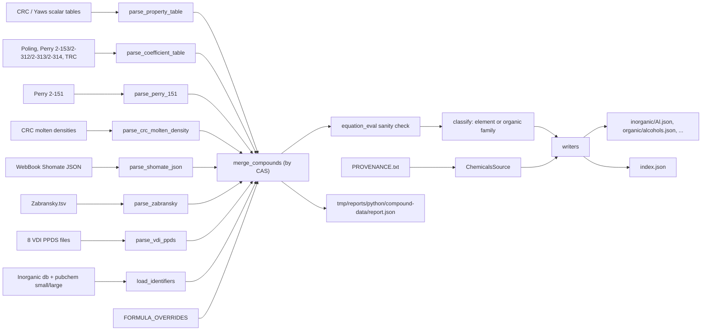

# Compound Data Specification (CalebBell/chemicals tables)

**Status:** Planned, not implemented yet.
**Purpose:** Merge the CalebBell/chemicals data tables copied into `shared/sources/compound-data/chemicals/` into JSON datasets. Inorganic compounds are grouped by element and organic compounds by functional family, with an `index.json` linking them. Every coefficient row is stored as a ready-to-use backend `EquationValue`.

Sources: CRC 95th ed., Perry 8th ed., Poling 5th ed., Yaws 2014, TRC 1994, Zabransky 1996, NIST WebBook Shomate and VDI Heat Atlas PPDS.

Merging JANAF data into these records is a later step (see [Next step: JANAF merge](#next-step-janaf-merge)). Implementing the planned equation types in the backend is the step after this one (see [Planned equation types](#planned-equation-types)).

---

## Decisions

- **Scope:** all compounds in the copied files.
- **Organic or inorganic:** a compound is organic if its formula contains both C and H. Everything else (CO2, CaCO3, SiC, CS2, ...) is inorganic.
- **Inorganic grouping:** by the alphabetically first element of the formula. This is the JANAF prefix rule, so Al2O3 goes to `Al.json` and TiO2 to `O.json`.
- **Organic grouping:** by functional family, found from the SMILES string with RDKit SMARTS patterns. This adds `rdkit` to the python container.
- **Coefficients:** every coefficient row is stored in the backend form `EquationValue` = `{type, ref, page?, vars, min, max, k?}` (see [equation-value.interface.ts](../../backend/src/common/thermal/interfaces/equation-value.interface.ts)).
  - `vars` hold the source's verbatim numbers.
  - `k` converts the result to the backend unit, as the existing entries do (e.g. CO2 Perry7 Aly-Lee uses `k: 1e-3`).
- **Molten density:** stored as a backend `linear` equation, plus the verbatim row in `raw`.
- **Perry rows without a range:** these are the 12 monatomic gases with Cp = 4.97 cal/(mol K). They are kept as `raw` only, with no equation.
- **Tables with no backend type yet:** stored now under new type names (see [Planned equation types](#planned-equation-types)). The backend methods come in the next step.
- **Missing ranges:**
  - VDI liquid properties take Tm..Tc from the VDI rows of the same CAS.
  - VDI gas properties get `min/max = null`, so `min` and `max` are nullable in the dataset.

---

## Verified equation mapping (backend vs chemicals)

Backend types come from [equation-type.dto.ts](../../backend/src/common/thermal/dto/equation-type.dto.ts) and are dispatched in [common.ts](../../backend/src/common/thermal/utils/common.ts) `Common.equation`. The chemicals forms come from the docstrings of `heat_capacity.py`, `volume.py` and `dippr.py`.

- **Perry 2-151, solid/liquid/gas Cp, in cal/(mol K)** (`Perrys Table 2-151.tsv`).
  - The chemicals function `Perry_151` computes Cp = 4.184·(a + b·T + c/T² + d·T²).
  - In the TSV, 50 rows have a `/T^2` term and 8 rows have a `*T^2` term. **No row has both**, so every row fits an existing type.
  - Rows with no `*T^2` term become backend `linearHyperbolic` (a + b·T + d/T²), with `vars {a, b, d: <"/T^2 term">}` and `k: 4.184`. In the backend's naming, `d` is the 1/T² coefficient.
  - Rows with a `*T^2` term become backend `quadratic` (a + b·T + c·T²), with `vars {a, b, c: <"*T^2 term">}` and `k: 4.184`. These are 8 rows: MnCO3, MnO2, Mn2O3, MnO, SO2 g, HI g, MnS, Mn3O4.
  - 12 rows have no Tmin or Tmax. These are the monatomic gases K, H, Ne, Kr, Hg, Na, Ar, Cs, He, Xe, Rn and Li, all with Cp = 4.97 cal/(mol K) = 5/2·R. The backend needs numeric `min` and `max`, so these rows are kept in `raw` and listed in the report.
  - Phases map as follows: c and gls go to `solid` (the subphase is kept, e.g. glass), l to `liquid`, g to `gas`.
  - Check: `Perry_151(300, 4.8, 0.00322, 0, 0) = 24.124944` (chemicals docstring) must equal the `linearHyperbolic` result.
- **CRC molten density, in kg/m3** (`CRC Inorganics densties of molten compounds and salts.tsv`).
  - The chemicals function `CRC_inorganic` computes ρ = ρ0 − k·(T − Tm).
  - Stored as backend `linear` (a + b·T), with `vars {a: rho0 + k·Tm, b: -k}`, `min: Tm`, `max: Tmax` and `raw {rho0, k, Tm, Tmax}`.
  - Check: `CRC_inorganic(300, 2370.0, 2.687, 239.08) = 2206.30796`.
- **Poling databank, ideal-gas Cp** (`PolingDatabank.tsv`, ref `Poling5`).
  - The chemicals function `Poling` computes Cp = R·(a0 + a1·T + a2·T² + a3·T³ + a4·T⁴).
  - Stored as backend `quartic`, with `vars {a: a0, b: a1, c: a2, d: a3, e: a4}`, `k: R` (the R value chemicals uses), `min/max: Tmin/Tmax`, phase gas.
  - The scalar columns Cpg and Cpl become `heatCapacity298` values.
- **Perry 2-153, DIPPR Eq. 100, liquid Cp in J/(kmol K)** (`Perry_Table_2-153_DIPPR_100.tsv`, ref `Perry8`).
  - Stored as backend `quartic`, with `vars {a: A, ..., e: E}`, `k: 1e-3`, phase liquid.
- **Perry 2-312 and 2-314, DIPPR Eq. 102: vapor viscosity in Pa·s and vapor thermal conductivity in W/(m K)** (ref `Perry8`).
  - Stored as backend `dipprN102`, with `vars {c1..c4}`, no `k`, phase gas. This is the same form as the existing [c3h8.ts](../../backend/src/common/thermal/compound/gas/c3h8.ts) entries.
  - Check: the C3H8 rows must reproduce the backend values `c1 4.9054e-8, c2 0.90125` (viscosity) and `c1 -1.12, c2 0.10972, c3 -9834.6, c4 -7535800` (conductivity).

---

## Planned equation types

These tables have no backend type yet. They are stored now in the same `EquationValue` shape, under new `type` names.

### Backend equations to add

The next step adds, for each type:
- an `EquationTypeDto` value;
- a `type/*.ts` vars type;
- an `equation-methods/*` class with `calculate`, `integral` and `calculateAverage`;
- a case in `Common.equation`.

The full backend specification (formulas, integrals, edge cases, test values) is [NEW_EQUATION_TYPES_SPEC.md](../services/NEW_EQUATION_TYPES_SPEC.md). Its vars names are the ones this dataset writes. DIPPR forms use `c1..cn`; Shomate and PPDS use lowercase `a..e`, mapped from the source columns `A..E`.

The list below is the summary used by this dataset.

- **`dipprN114`** (Perry 2-153 DIPPR 114, liquid Cp, J/(kmol K)):
  - Formula: f(T) = c1²/τ + c2 − 2·c1·c3·τ − c1·c4·τ² − c3²·τ³/3 − c3·c4·τ⁴/2 − c4²·τ⁵/5, with τ = 1 − T/Tc.
  - `vars {Tc, c1, c2, c3, c4}` (from A, B, C, D), `k: 1e-3`, ref `Perry8`.
  - Analytic integral exists. Chemicals function: `EQ114`.
- **`trcCp`** (TRC ideal-gas Cp, about 1960 compounds):
  - Formula: Cp/R = a0 + (a1/T²)·exp(−a2/T) + a3·y² + (a4 − a5/(T − a7)²)·y⁸, with y = (T − a7)/(T + a6) for T > a7, else 0.
  - `vars {a0..a7, I, J}`, `k: R`, `min/max` = Tmin/Tmax, ref `TRC1994`. I and J are the integration constants for H and S.
  - The file's `Hfg` column becomes the scalar `enthalpyFormation298` (gas).
  - Chemicals functions: `TRCCp`, `TRCCp_integral`.
- **`shomate`** (NIST WebBook Shomate, piecewise, solid/liquid/gas):
  - Formula: Cp = a + b·T + c·T² + d·T³ + e/T², in J/(mol K).
  - `vars {ranges: [{Tmin, Tmax, a, b, c, d, e}]}` (from A..E), laid out like the `nasa9` ranges. `min`/`max` = first Tmin / last Tmax. Ref `NISTWebBook` [32].
  - The coefficients are taken as chemicals stores them, already converted to T in K. The WebBook itself publishes them with t = T/1000. Check: `Shomate(500, ...) = 35.21836175` for water vapour.
  - The JSON's phase index 0/1/2 maps to solid/liquid/gas. The link points to the CAS key line in `webbook_shomate_coefficients.json`.
  - Analytic integral exists.
- **`zabranskySpline`** (Zabransky liquid Cp, piecewise):
  - Formula: Cp/R = a1 + a2·θ + a3·θ² + a4·θ³, with θ = T/100.
  - `vars {ranges: [{Tmin, Tmax, a1..a4}]}`, `k: R`. Rows are grouped per CAS and data type. Ref `Zabransky1996`.
  - Analytic integral exists.
- **`zabranskyQuasiPolynomial`** (Zabransky liquid Cp):
  - Formula: Cp/R = a1·ln(1 − Tr) + a2/(1 − Tr) + a3 + a4·Tr + a5·Tr² + a6·Tr³.
  - `vars {Tc, a1..a6}`, `k: R`, ref `Zabransky1996`.
  - `source.dataType` keeps `sat`, `p` or `C` (along the saturation line, at constant pressure, or averaged). `source.uncertainty` keeps the class (I to IV).
  - Analytic integral exists.
- **`dipprN101`** (Perry 2-313, liquid viscosity, Pa·s):
  - Formula: f(T) = exp(c1 + c2/T + c3·ln(T) + c4·T^c5).
  - `vars {c1..c5}` (from C1..C5), ref `Perry8`.
  - No analytic integral, so it needs numerical integration, as `dipprN102` does.
- **VDI PPDS** (ref `VDI2010`, VDI Heat Atlas 2nd ed., 2010):
  - **Liquid viscosity, `ppds9`:** μ = e·exp(a·s^(1/3) + b·s^(4/3)), with s = (c − T)/(T − d), `vars {a..e}` (from A..E), Pa·s.
  - **Liquid density, `ppds10`:** ρ = ρc + a·τ^0.35 + b·τ^(2/3) + c·τ + d·τ^(4/3), `vars {Tc, rhoc, a, b, c, d}`, kg/m3. Check: `volume_VDI_PPDS(300, 126.19, 313, ...) = 313.0`.
  - **Enthalpy of vaporization, `ppds12`:** ΔHvap = R·Tc·(a·τ^(1/3) + b·τ^(2/3) + c·τ + d·τ² + e·τ⁶), `vars {Tc, a..e}` (from A..E), J/mol.
  - **Surface tension, `dipprN106`:** σ = c1·τ^(c2 + c3·Tr + c4·Tr² + c5·Tr³), `vars {Tc, c1..c5}` (from A..E), N/m.
  - **Vapor pressure, `wagner25`:** ln(P) = ln(Pc) + (a·τ + b·τ^1.5 + c·τ^2.5 + d·τ⁵)/Tr, `vars {Tc, Pc, a, b, c, d}`, Pa.
  - **Plain polynomials:** gas viscosity, gas thermal conductivity and liquid thermal conductivity are a + b·T + c·T² + d·T³ + e·T⁴. They map to the **existing** `quartic` type.
  - **VDI ranges:**
    - Liquid properties get `min = Tm` and `max = Tc` from the VDI surface-tension and boiling-temperature rows of the same CAS. Both rows come from the same book, and they are cited in `source.rangeFrom` with file, line and URL.
    - Gas properties have no limits in the source (chemicals: "Provides no temperature limits"). They get `min/max = null` and `source.rangeSource: "none"`. The backend loader maps null to ±Infinity, which means no clamping (see [NEW_EQUATION_TYPES_SPEC.md](../services/NEW_EQUATION_TYPES_SPEC.md#ranges-that-are-not-set)).
- **Not included:** `CRCHeatCapacitySolids.tsv`. It holds Cp values at fixed temperatures (200, 250, ... K), not coefficients, so it is left for a possible tabulated type later.

---

## Data flow



---

## Scalar tables (stored as `PropertyValue`, SI units)

Property names follow the backend where a name exists (`enthalpyFormation298`, `gibbsEnergy298`, and `Mr` in kg/mol). The others are camelCase.

- **CRC 95th ed.** (new reference `CRC95`):
  - `Misc/Physical Constants of Inorganic Compounds.csv`: meltingPoint, boilingPoint, density.
  - `Phase Change/CRC Handbook Heat of Fusion.tsv`: heatOfFusion.
  - `Heat Capacity/CRC Standard Thermodynamic Properties of Chemical Substances.tsv`: enthalpyFormation298, gibbsEnergy298, entropy298 and heatCapacity298, each per phase (solid, liquid, gas).
  - `Density/CRC Solid Inorganic Constant Densities.tsv`: molarVolume.
- **Yaws 2014** (new reference `Yaws2014`):
  - Collection: criticalTemperature, criticalPressure, criticalVolume, acentricFactor.
  - `Yaws Hf S0 (g)`: enthalpyFormation298 and entropy298 for the gas phase.
  - Boiling Points: boilingPoint.
- **Identifiers:**
  - CAS is resolved through `Inorganic db.tsv`, then `pubchem small`, then `pubchem large`, then the source's own formula column. Only CAS numbers that appear in the tables are loaded.
  - The formula is cleaned of footnote prefixes (Perry `22 SO2` becomes `SO2`) and of trailing spaces.
  - `Mr` = MW / 1000.

---

## Prerequisites (the user runs these)

- Add these files to `shared/sources/compound-data/chemicals/`. They come from the source repository [CalebBell/chemicals](https://github.com/CalebBell/chemicals) at the commit recorded in `PROVENANCE.txt`, and keep their repo paths:
  - `Identifiers/chemical identifiers pubchem small.tsv`
  - `Heat Capacity/PolingDatabank.tsv`
  - `Heat Capacity/Perry_Table_2-153_DIPPR_100.tsv` and `Perry_Table_2-153_DIPPR_114.tsv`
  - `Heat Capacity/TRC Thermodynamics of Organic Compounds in the Gas State.tsv`
  - `Heat Capacity/Zabransky.tsv`
  - `Heat Capacity/webbook_shomate_coefficients.json`
  - `Viscosity/Table 2-312 ...tsv` and `Table 2-313 ...tsv`
  - `Thermal Conductivity/Table 2-314 ...tsv`
  - the 8 `VDI PPDS *.tsv` files in `Viscosity/`, `Thermal Conductivity/`, `Density/`, `Phase Change/`, `Interface/` and `Vapor Pressure/`
  - `dev/data/janaf/janaf_tables_index.csv` (needed for the JANAF merge)
- Update `SHA256SUMS`.
- Change "Perry ... 7th ed." in `PROVENANCE.txt` to the 8th edition (chemicals `heat_capacity.py` lines 822 and 850-854).
- Add `rdkit` to [python/pyproject.toml](../../python/pyproject.toml), rebuild the image, and check that `import rdkit` works on Python 3.14.

---

## Output: `shared/processed/compound-data/`

Files:
- `inorganic/<Element>.json`
- `organic/<family>.json`
- `unresolved.json`
- `index.json`

Example group file:

```json
{
  "source": "CalebBell/chemicals data tables", "repository": "https://github.com/CalebBell/chemicals",
  "sourceCommit": "e79047588b30cfabc564c79fb26d760c746877d7",
  "sourceTree": "https://github.com/CalebBell/chemicals/tree/e79047588b30cfabc564c79fb26d760c746877d7",
  "license": "MIT",
  "tables": {
    "Perry 2-151": {"path": "chemicals/Heat Capacity/Perrys Table 2-151.tsv", "ref": "Perry8",
                    "url": "https://github.com/CalebBell/chemicals/blob/e79047588b30cfabc564c79fb26d760c746877d7/chemicals/Heat%20Capacity/Perrys%20Table%202-151.tsv"}
  },
  "units": {"heatCapacity": "J/(mol K)", "viscosity": "Pa s", "thermalConductivity": "W/(m K)", "density": "kg/m3"},
  "generatedAt": "...", "class": "inorganic", "group": "Al", "count": 123,
  "compounds": {
    "1344-28-1": {
      "id": "1344-28-1", "cas": "1344-28-1", "formula": "Al2O3", "name": "aluminum oxide",
      "elements": ["Al", "O"], "Mr": 0.10196, "smiles": "...", "inchikey": "...", "families": [],
      "properties": {
        "meltingPoint": [{"value": 2327.15, "unit": "K", "ref": "CRC95",
          "source": {"table": "CRC inorganic constants", "label": "Aluminum oxide (α)", "line": 123,
                     "url": "https://github.com/CalebBell/chemicals/blob/<commit>/chemicals/Misc/Physical%20Constants%20of%20Inorganic%20Compounds.csv#L123"}}],
        "enthalpyFormation298": [{"value": -1675700, "unit": "J/mol", "phase": "solid", "ref": "CRC95",
          "source": {"table": "CRC standard thermodynamic", "label": "Aluminum oxide (α)", "line": 1374,
                     "url": "https://github.com/CalebBell/chemicals/blob/<commit>/chemicals/Heat%20Capacity/CRC%20Standard%20Thermodynamic%20Properties%20of%20Chemical%20Substances.tsv#L1374"}}]
      },
      "equations": {
        "heatCapacity": {
          "solid": {"def": 0, "values": [
            {"type": "linearHyperbolic", "ref": "Perry8", "vars": {"a": 22.08, "b": 0.008971, "d": -522500},
             "min": 273, "max": 1973, "k": 4.184,
             "source": {"table": "Perry 2-151", "label": "Al2O3", "line": 459,
                        "url": "https://github.com/CalebBell/chemicals/blob/<commit>/chemicals/Heat%20Capacity/Perrys%20Table%202-151.tsv#L459",
                        "subphase": null, "error": "3"}}]}
        },
        "density": {"liquid": {"def": 0, "values": []}}
      }
    }
  }
}
```

### Links to the source repository

Links appear at four levels, always pinned to the commit recorded in `PROVENANCE.txt`:
1. Every group file and `index.json` carry `repository`, `sourceCommit`, `sourceTree` (the repo browsed at that commit) and `license`.
2. The meta `tables` map lists every source table used, with its repo path and a link to the file at that commit.
3. Every `PropertyValue`, `EquationValue` and `raw` entry has `source.url`, a link to the exact line (`#L<line>`).
   - For the Shomate JSON, this is the line of the CAS key.
   - A VDI range taken from another row also carries `source.rangeFrom.url`.
4. The identifiers (formula, MW, SMILES) carry `identifierSource.url`, a link to the line in `Inorganic db.tsv` or the pubchem file they came from.

`ChemicalsSource` builds all URLs as `{repository}/blob/{commit}/{path}#L{line}`, with the path percent-encoded. If `PROVENANCE.txt` has no commit, it falls back to `master` and logs a warning, the same rule as `JanafSource`.

### Equations

- `equations.<property>.<phase>` has the backend `{def, values}` shape, so a value can go straight to `Common.equation(type).calculate(T, vars, min, max, k)`.
- `def` is the first entry, in source priority order, whose type the backend already implements. The priority order is Perry, then Poling, then VDI, then CRC. A planned type never becomes `def` until the backend supports it.
- The extra keys `source` (and `raw` for molten density) are provenance only.
- `index.json` meta lists every `type` used, and whether each one is `implemented` or `planned`.

### Records

- No values are averaged. Every source row is kept, with `label`, the source's own name (which tells polymorphs apart).
- Records without a CAS get the id `formula:<F>`. Records whose formula can't be resolved go to `unresolved.json`.
- `FORMULA_OVERRIDES` is keyed by CAS, and each override has a cited reason, e.g. `12004-39-6 -> Al2TiO5` (CRC name "Aluminum titanate", pubchem synonym "al2tio5"; pubchem's own formula is Al2O7Ti2).

### Index file

`index.json` holds:
- meta and `count`;
- `compounds`, one entry per compound with formula, name, class, group, file, families, refs, and which equation properties and phases it has;
- the lookups `byFormula`, `byElement` (sorted keys) and `byFamily`.

It holds no property values.

### Report

`tmp/reports/python/compound-data/report.json` is a working file, not part of `shared/`. It lists:
- formula conflicts between sources;
- Perry rows without a range;
- VDI liquid rows whose CAS has no VDI Tm/Tc row (stored with `min/max = null`);
- Zabransky rows with CAS `None` (left in `unresolved.json`);
- equations that give non-positive or non-finite values at `min`, `max` or 298.15 K (from the `equation_eval` check).

---

## Organic families

- `ORGANIC_FAMILIES` is an ordered set of SMARTS patterns: alkanes, alkenes, alkynes, aromatics, alcohols, phenols, ethers, aldehydes, ketones, carboxylic-acids, esters, amines, amides, nitriles, nitro, halogenated, sulfur, organosilicon, organometallic.
- A record's `families` lists every family that matches. The file comes from the first match.
- Organics without a SMILES, or with no match, go to `organic/unclassified.json`.

---

## Files

### Package

New package `python/src/compound_data/`, with one export per file.

- **Models:**
  - `source_link.py` `SourceLink`
  - `property_value.py` `PropertyValue`
  - `equation_value.py` `EquationValue` (type, ref, vars, min, max, k, source, raw)
  - `identifier.py` `Identifier`
  - `compound_record.py` `CompoundRecord`
  - `table_spec.py` `TableSpec`
  - `coefficient_spec.py` `CoefficientSpec` (columns mapped to vars, type, k, property, phase, Tmin/Tmax columns, ref)
  - `chemicals_source.py` `ChemicalsSource`, whose `file_url(path, line)` percent-encodes the path
- **Constants:**
  - `constants/equation_type.py` `EquationType`, a StrEnum with the existing `equation-type.dto.ts` values plus the planned ones
  - `constants/planned_equation_types.py` `PLANNED_EQUATION_TYPES` (dipprN114, trcCp, shomate, zabranskySpline, zabranskyQuasiPolynomial, dipprN101, ppds9, ppds10, ppds12, dipprN106, wagner25)
  - `constants/source_tables.py` `SOURCE_TABLES`
  - `constants/coefficient_tables.py` `COEFFICIENT_TABLES` (Poling, Perry 2-153 DIPPR 100/114, 2-312, 2-313, 2-314, TRC)
  - `constants/formula_overrides.py` `FORMULA_OVERRIDES`
  - `constants/organic_families.py` `ORGANIC_FAMILIES`
  - `constants/gas_constant.py` `GAS_CONSTANT`
- **Parsers:**
  - `parsers/property_table.py` `parse_property_table`
  - `parsers/coefficient_table.py` `parse_coefficient_table`
  - `parsers/perry_151.py` `parse_perry_151`, which picks linearHyperbolic or quadratic per row
  - `parsers/crc_molten_density.py` `parse_crc_molten_density`
  - `parsers/shomate_json.py` `parse_shomate_json`, which builds per-phase `ranges` and records the line of each CAS key
  - `parsers/zabransky.py` `parse_zabransky`, which groups spline rows per CAS and data type into one piecewise equation. Quasi-polynomial rows become single equations.
  - `parsers/vdi_ppds.py` `parse_vdi_ppds`, which maps the 8 files to their types and fills liquid ranges from the VDI Tm/Tc rows
  - `parsers/identifiers.py` `load_identifiers`
  - `parsers/provenance.py` `read_chemicals_source`
- **Logic:**
  - `equation_eval.py` `evaluate_equation`, a Python copy of the backend `calculate` formulas for existing and planned types. It clamps T to min/max when they are set, then applies `k`. It is used by the tests and the sanity report, and is the reference for the next step's TypeScript methods.
  - `formula_elements.py` `formula_elements`
  - `compound_class.py` `classify_compound`
  - `organic_family.py` `OrganicFamilyClassifier`
  - `merger.py` `merge_compounds`
  - `writers.py` `write_compound_json` and `write_compound_index`, following the pattern of [janaf/writers.py](../../python/src/janaf/writers.py), with `allow_nan=False`

### CLI and Make

- CLI `python/src/scripts/build_compound_data.py`, with arguments `--source-dir`, `--out-dir`, `--report-dir` and `-v`.
- Make file `scripts/make.d/11-compound-data.mk`, with targets `compound-data-build` and `compound-data-test`.

---

## Reference registration (per docs/PYTHON_CODE_STANDARDS.md section 7)

- **New references:**
  - `[37] CRC95`: Haynes, Bruno, Lide, CRC Handbook of Chemistry and Physics, 95th ed., 2014.
  - `[38] Yaws2014`: Yaws, Thermophysical Properties of Chemicals and Hydrocarbons, 2nd ed., Gulf 2014. This is a different book from `Yaws1999`.
  - `[39] Zabransky1996`: Zabransky, Ruzicka, Majer, Domalski, *Heat Capacity of Liquids: Critical Review and Recommended Values*, AIP 1996.
  - `[40] TRC1994`: *Thermodynamics of Organic Compounds in the Gas State*, TRC/CRC 1994. Chemicals cites Kabo and Roganov, Vol. II; confirm the authors against the book.
  - `[41] VDI2010`: VDI Heat Atlas, 2nd ed., Springer 2010, PPDS coefficients.
- **Existing references to extend:**
  - `Perry8` [34]: add Tables 2-151, 2-153 (DIPPR 100 and 114) and 2-313.
  - `Poling5` [7]: mention the chemicals copy of the databank.
  - `NISTWebBook` [32]: mention the chemicals Shomate JSON.
- **Where to register** (all five places):
  - [docs/REFERENCES.md](../REFERENCES.md)
  - [ref-key.enum.ts](../../backend/src/common/thermal/enum/ref-key.enum.ts)
  - [ref-key.dto.ts](../../backend/src/common/thermal/dto/ref-key.dto.ts)
  - [ref_key.py](../../python/src/references/ref_key.py)
  - [references_meta.py](../../python/src/references/references_meta.py)
- Every new row names the machine-readable source, "CalebBell/chemicals, `chemicals/<path>`, URL: https://github.com/CalebBell/chemicals", the same way the `Perry8` row does.
- The backend equation code is unchanged in this step.

---

## Tests (`python/tests/compound_data/`, fixtures built from real rows)

- **Equation mapping** (checked against the chemicals docstrings and the backend):
  - Perry_151 at 300 K gives 24.124944 through linearHyperbolic with k 4.184.
  - The MnO row goes to quadratic.
  - A row with no range gets no equation.
  - CRC_inorganic(300, 2370.0, 2.687, 239.08) gives 2206.30796 through linear.
  - The Poling docstring example matches quartic with k = R.
  - The Perry 2-312 and 2-314 C3H8 rows reproduce the vars in `c3h8.ts`.
- **Planned types:** `evaluate_equation` must reproduce the chemicals functions. chemicals isn't a dependency, so the expected values are copied into the fixtures:
  - `EQ114` for ammonia;
  - `TRCCp` for methanal;
  - `Shomate(500, ...) = 35.21836175` for water vapour;
  - Zabransky spline and quasi-polynomial;
  - `EQ101` for formaldehyde;
  - `PPDS9`;
  - `volume_VDI_PPDS(300, 126.19, 313, ...) = 313.0`;
  - `PPDS12`;
  - `EQ106`;
  - `Wagner`.
- **Ranges:**
  - A Shomate entry with 2 ranges picks the right range.
  - A VDI liquid entry takes Tm/Tc from the cited row.
  - A VDI gas entry has `min/max = null`.
- **Type sync:** every `EquationType` value is either in `equation-type.dto.ts` (the test reads the TS file) or in `PLANNED_EQUATION_TYPES`, never both. Once the backend adds a type, the test forces it out of the planned set.
- **Grouping and organic rule:**
  - Al2O3 goes to Al, TiO2 to O, NaCl to Cl.
  - Ca and Cl are not read as C.
  - CO2 is inorganic and CH4 organic.
- **Families:**
  - ethanol is alcohols;
  - benzene is aromatics;
  - acetic acid is carboxylic-acids;
  - ethyl acetate is esters.
- **Identifiers:** CAS resolution precedence, the 12004-39-6 override and its conflict entry, and Perry formula cleaning (`22 SO2`).
- **Merging:** all values are kept, and `def` follows source priority.
- **Writers and index:** file paths, `#L` URLs with `%20`, sorted `byElement`, no NaN.
- **Repository links:**
  - Every value, equation, raw entry and identifier has a `source.url` starting with `{repository}/blob/{sourceCommit}/chemicals/`.
  - Meta `repository`, `sourceCommit` and `sourceTree` are present in every file.
  - Provenance parsing reads the repository and commit, and falls back to `master` with a warning.

---

## Docs

- This spec, plus an entry in [docs/scripts/README.md](README.md).
- A "Compound data" section in [python/README.md](../../python/README.md), next to the JANAF one, covering source, output and make targets.

---

## Next step: JANAF merge

- `dev/data/janaf/janaf_tables_index.csv` (CAS, JANAF formula, name, state) is used together with `shared/processed/JANAF/index.json`.
- Together they add a `janaf` link list (table id, phase, file) to each record.
- The links point to the py-janaf files and NIST pages, as in [JANAF_PARSER_SPEC.md](JANAF_PARSER_SPEC.md).

---

## Verification

1. `make compound-data-test`.
2. `make compound-data-build`.
3. Spot-check with `rg --no-ignore`:
   - Al2O3 `1344-28-1` has CRC meltingPoint 2327.15, and a Perry solid `linearHyperbolic` with `d: -522500` and `k: 4.184`.
   - MnO has `quadratic`.
   - C3H8 viscosity `dipprN102` equals `c3h8.ts`.
   - Water (`7732-18-5`) has gas `shomate` with 2 ranges (500–1700 and 1700–6000 K) and liquid `shomate` 298–500 K.
   - Methanal has a gas `trcCp` 50–3000 K.
   - Ethanol is in `organic/alcohols.json`.
   - The report lists the 12 Perry rows without a range.
