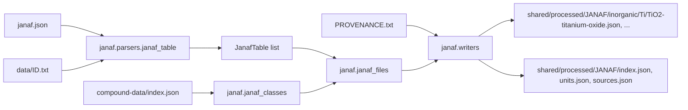

# JANAF Parser Specification

**Status:** Implemented.
**Purpose:** Convert the NIST-JANAF thermochemical tables (py-janaf copy) into one JSON file per compound, in the folder layout of the compound-data dataset.

---

## Inputs and output

- **Tables:** `shared/sources/compound-data/nist-janaf/py-janaf/data/<ID>.txt`, 1796 files that use tabs between columns.
  - Line 1 holds the name, formula and phase, e.g. `Titanium Oxide (TiO2)<TAB>O2Ti1(cr,l)`.
  - Line 2 holds the column headers.
- **Index:** `shared/sources/compound-data/nist-janaf/py-janaf/janaf.json`, as `{display: [...], index: ["Al-001", ...]}`.
- **Provenance:** `shared/sources/compound-data/nist-janaf/PROVENANCE.txt`. The py-janaf repository URL (`py-janaf: https://github.com/n-takumasa/py-janaf.git`) and the commit hash are read from it and written once, to `sources.json`.
- **Compound index:** `shared/processed/compound-data/index.json` (`--compound-index`), for the class and family of the carbon compounds. Run `make compound-data-build` first; without it the class comes from the formula rule and every organic table goes to `organic/unclassified/`, with a warning.
- **Output:** `shared/processed/JANAF/`, one file per compound (see [File layout](#file-layout)): `Al-096` goes to `inorganic/Al/Al2O3-aluminum-oxide.json`, TiO₂ `O-045` to `inorganic/Ti/TiO2-titanium-oxide.json`, NH₃ to `inorganic/N/NH3-ammonia.json`.
- **Root files:** `index.json` lists every table with the file it is in, plus lookups by formula, element and family (see [Index file](#index-file)); `units.json` gives the units of the row columns; `sources.json` holds the repository, commit, license and the URL templates that resolve every table `ref` (see [Refs and sources.json](#refs-and-sourcesjson)).
- **Clearing:** every run parses all tables, then clears the output folder (`dataset_layout.clear_dataset_dir`: the `inorganic/` and `organic/` folders and the top-level `*.json` files; anything else is kept, with a warning) and writes it again, so renamed or moved compounds leave no stale files.

The output follows the compound-data conventions ([COMPOUND_DATA_SPEC.md](COMPOUND_DATA_SPEC.md)): the same folder layout and file naming; compound files carry no provenance, units, `generatedAt` or metadata blocks; each table cites its source as `ref: [RefKey, line, fileKey]`; null and empty fields are left out; the JSON format is described by the backend interfaces in [backend/src/common/thermal/utils/janaf/](../../backend/src/common/thermal/utils/janaf/).

The source folder also holds `nist/<ID>.txt`, the original files downloaded from `https://janaf.nist.gov/tables/<ID>.txt`. The py-janaf copies hold the same data with two fixes:
- `INFINITE` is written as `+inf`.
- In the rows where NIST's files lost the minus signs and tabs in the last three columns (ΔfH, ΔfG, log Kf), py-janaf restores them. The minus signs are py-janaf's inference ("sign consistent with the sign immediately following").

T, Cp, S, the H−H(298) column and the transition rows are identical in both copies. Values are cited as NIST-JANAF 4th ed., by table ID.



---

## File layout

```
shared/processed/JANAF/
  index.json  units.json  sources.json
  inorganic/
    Al/Al2O3-aluminum-oxide.json   (Al-096..Al-101: all phases of Al2O3)
    Ti/TiO2-titanium-oxide.json    (O-042..O-046)
    N/NH3-ammonia.json  N/N2H4-hydrazine.json
    Ti/Ti+-titanium-ion.json       (ions get their own file)
    C/CO2-carbon-dioxide.json  C/HCN-hydrogen-cyanide.json
    other/e--electron-gas.json
  organic/
    aldehydes/CH2O-formaldehyde.json
    halogenated/CCl4-tetrachloromethane.json
    unclassified/...
```

- **One file per compound:** the tables with the same Hill formula (from the JANAF formula, with the ion charge appended) share one file, so a file holds all phases and polymorphs of a compound.
- **Class:** a compound without C, and elemental carbon, is inorganic. For the other carbon compounds the class is that of the compound-data record whose `janaf` lists the table id, else that of the record with the same neutral Hill formula (`janaf.JanafClasses`, any class), so both datasets agree (HCN, CO2, CS2, B4C inorganic; CCl4, C2F6, C2N2 organic). Without a record, the compound-data formula rule decides: organic when there is no metal and some H, a halogen or more than one carbon. An ion takes the class of its neutral formula.
- **Inorganic** tables go to `inorganic/<main element>/`, by `chemical_formula.main_element`, the same rule as compound-data: metals before nonmetals, then the lowest Pauling electronegativity; O is ignored when another element than H, O and F is present, H always (D and T count as H). So oxides go to their metal or nonmetal (Al2O3 → Al, TiO2 → Ti, SiO2 → Si), hydrides to the other element (NH3, N2H4 → N), H2O and OF2 → O.
- **Organic** tables go to `organic/<family>/`. The family is that of the compound-data record whose `janaf` lists the table id, else that of the record with the same neutral Hill formula. When that is `unclassified` or there is no record, `chemical_formula.formula_family` gives the family if the formula alone fixes it (CCl3, CF2, CF+ → halogenated; CH4 → alkanes; C2H2 → alkynes); otherwise `unclassified` (radicals such as CH3, C2H, CHO). An ion takes the family of its neutral formula.
- Formulas that are not element counts (`e1-`, the electron gas) go to `inorganic/other/`.
- **File name:** `<displayFormula>-<slug>.json` (`dataset_layout.compound_file_name`). `displayFormula` is the compound-data one: the IUPAC formula for inorganic compounds (`chemical_formula.iupac_formula`: TiO2, NH3, HNO3, KClO3, NaOH) and the Hill formula for organic ones, with the ion charge appended. The slug is made from the shortest table name of the compound, without a trailing formula group (`Aluminum Oxide` of `Aluminum Oxide, Alpha`; `Barium Hydroxide` of `Barium Hydroxide (Ba(OH)2)`): ASCII lowercase, Greek letters spelled out, other characters → `-`, at most 80 characters. Names that collide case-insensitively get the first table id appended (`dataset_layout.unique_file_paths`); a full run has none.
- A full run writes 1,068 compound files in 56 folders.

---

## Output shape (one file)

```json
{
  "class": "inorganic",
  "group": "Ti",
  "displayFormula": "TiO2",
  "hill": "O2Ti",
  "tables": {
    "O-045": {
      "name": "Titanium Oxide", "formula": "TiO2",
      "janafFormula": "O2Ti1", "phase": "cr,l", "label": "O2Ti, Titanium Oxide (cr,l)",
      "ref": ["NISTJANAF", 1, "O-045"],
      "rows": [
        {"T": 0.0, "Cp": 0.0, "S": 0.0, "dH": -8.636, "dfH": -939.87, "dfG": -939.87},
        {"T": 298.15, "Cp": 55.103, "S": 50.292, "gef": 50.292, "dH": 0.0, "dfH": -944.747, "dfG": -889.406, "logKf": 155.82}
      ],
      "transitions": [{"T": 2130.0, "label": "CRYSTAL <--> LIQUID", "line": 24}]
    }
  }
}
```

- `class`, `group` (main element or family), `displayFormula` (names the file) and `hill` (the lookup key) say where the file is; both formulas carry the charge for ions; `tables` keeps the `janaf.json` order.
- Tables are keyed by table ID; the entry repeats no `id`.
- `formula`, `phase`, `label` and `transitions` are left out when null or empty.
- Row cells that are empty or infinite are left out (the 0 K row above has no `gef` and no `logKf`); `note` appears only on rows that have one.

### units.json

Column keys and units, from `janaf/constants/units.py` `JANAF_UNITS`; `$comment` defines every row field, from `janaf/constants/row_definitions.py` `JANAF_ROW_DEFINITIONS` (also documented in the backend `JanafRow` interface):

```json
{
  "$comment": [
    "Units of the rows in shared/processed/JANAF; standard state p° = 0.1 MPa (1 bar), Tr = 298.15 K.",
    "T: temperature",
    "Cp: standard molar heat capacity at constant pressure, Cp°",
    "S: standard molar entropy, S°",
    "gef: Gibbs energy function, -[G° - H°(Tr)]/T",
    "dH: enthalpy increment, H° - H°(Tr)",
    "dfH: standard molar enthalpy of formation from the elements in their reference states, ΔfH°",
    "dfG: standard molar Gibbs energy of formation from the elements in their reference states, ΔfG°",
    "logKf: decimal logarithm of the equilibrium constant of formation, log Kf",
    "note: text found in place of dfH, dfG and logKf (e.g. 'CRYSTAL <--> LIQUID', 'TRANSITION'); no unit"
  ],
  "rows": {"T": "K", "Cp": "J/(mol K)", "S": "J/(mol K)", "gef": "J/(mol K)",
           "dH": "kJ/mol", "dfH": "kJ/mol", "dfG": "kJ/mol", "logKf": "1"}
}
```

- `$comment` is a header line followed by one `"<column>: <definition>"` line per row field, in row order; `note` has a definition but no unit.
- `logKf` is dimensionless.

### Parsing rules

- `+inf` and `INFINITE` become `None` and are left out of the JSON. The writer keeps `allow_nan=False`, as `nasa_thermo/writers.py` does.
- If column 6 is not a number (e.g. `CRYSTAL <--> LIQUID`, `TRANSITION`, or any other text), the rest of the line becomes `note`. In that case the row has no `dfH`, `dfG` or `logKf`.
- A row whose note contains `<-->` is added to `transitions`, with the 1-based `line` of the row in the table file.
- The `TRANSITION` row is kept in `rows`: it holds the values just after the transition.
- Empty cells are left out. Lines that don't start with a number are skipped, with a debug log.
- Tables appear in the order of `janaf.json`. A file missing from the index, or an index entry without a file, gets a warning.

### Refs and sources.json

`shared/processed/JANAF/sources.json`:

```json
{
  "generatedAt": "...",
  "ref": "NISTJANAF",
  "repository": "https://github.com/n-takumasa/py-janaf",
  "sourceCommit": "c8ed6be3ba31a61835061091bd3c521270b484ec",
  "sourceTree": "https://github.com/n-takumasa/py-janaf/tree/c8ed6be3ba31a61835061091bd3c521270b484ec",
  "license": "0BSD",
  "lineUrl": "{url}#L{line}",
  "tableUrl": "https://github.com/n-takumasa/py-janaf/blob/c8ed6be3ba31a61835061091bd3c521270b484ec/src/janaf/data/{id}.txt",
  "nistUrl": "https://janaf.nist.gov/tables/{id}.html"
}
```

- A table `ref` is `[RefKey, line, fileKey]`, the same shape as compound-data refs. `RefKey` is `NISTJANAF` from [docs/REFERENCES.md](../REFERENCES.md); the full citation is kept there, not in the dataset. `line` is 1, the title line. The file key is the table ID: one table, one file.
- Link to the parsed data: replace `{id}` in `tableUrl` with the file key, then fill `lineUrl`. For `O-045` this gives `.../blob/<commit>/src/janaf/data/O-045.txt#L1`. A transition links the same way with its own `line`.
- `nistUrl` with the same ID gives the original NIST page.
- `repository` is the py-janaf URL from `PROVENANCE.txt`, without the `.git` ending. `license` is the py-janaf repository license (0BSD).
- Without a provenance file, `repository` falls back to `https://github.com/n-takumasa/py-janaf`, and `sourceCommit` is `null`; `sourceTree` and `tableUrl` then use `main`, with a warning.

---

## Index file

`shared/processed/JANAF/index.json` finds tables without opening the compound files. It holds no rows, no transitions and no provenance (that is in `sources.json`); null fields are left out.

```json
{
  "generatedAt": "...",
  "count": 1796,
  "tables": {
    "O-045": {
      "hill": "O2Ti", "displayFormula": "TiO2", "formula": "TiO2", "janafFormula": "O2Ti1", "name": "Titanium Oxide",
      "phase": "cr,l", "label": "O2Ti, Titanium Oxide (cr,l)",
      "class": "inorganic", "group": "Ti", "file": "inorganic/Ti/TiO2-titanium-oxide.json"
    }
  },
  "byFormula": { "O2Ti": ["O-042", "O-043", "O-044", "O-045", "O-046"] },
  "byElement": { "Ti": ["...", "O-045"], "O": ["..."] },
  "byFamily": { "aldehydes": ["C-050", "C-061"] }
}
```

- `tables` is sorted by table ID; `file` is relative to the dataset root, and the table is at `file` → `tables[id]`.
- `byFormula` is keyed by the Hill formula (with the charge for ions), the same key as the compound file, so it lists all phases of a compound.
- `byElement` lists each table under every element of its JANAF formula (`O2Ti1` gives `O` and `Ti`). Keys and lists are sorted.
- `byFamily` lists the organic tables per family folder.

---

## Files

New package [python/src/janaf/](../../python/src/janaf/), one export per file as in [python/src/nasa_thermo/](../../python/src/nasa_thermo/):
- `__init__.py`: package docstring with Refs, and `__all__`.
- `janaf_row.py`: `JanafRow` dataclass with `to_dict` (leaves out `None` cells).
- `janaf_transition.py`: `JanafTransition` dataclass with `T`, `label` and the source `line`.
- `janaf_table.py`: `JanafTable` dataclass with `table_id`, `name`, `formula`, `janaf_formula`, `phase`, `label`, `rows`, `transitions`, and the `prefix` and `ref` (`[RefKey, 1, table_id]`) properties.
- `janaf_formula.py`: `janaf_counts(janaf_formula)` (element counts without the charge; `None` for `e1-`) and `janaf_charge(janaf_formula)` (`+`, `-`, `2+`, ... or empty). The compound-data JANAF matching uses them too.
- `janaf_classes.py`: `JanafClasses` with `from_index(path)` (the compound-data `index.json`; warns and stays empty when it is missing) and `lookup(table_id, neutral_hill)` → (class, group) or `None`.
- `janaf_file.py`: `JanafFile` dataclass (`path`, `compound_class`, `group`, `hill`, `display_formula`, `tables`) with `to_dict`.
- `janaf_files.py`: `janaf_placement(table, classes)` → `JanafPlacement` (class, group, Hill and display formula with charge), `janaf_files(tables, classes)` → files sorted by path, `OTHER_GROUP`.
- `constants/units.py`: `JANAF_UNITS`; `constants/row_definitions.py`: `JANAF_ROW_DEFINITIONS` (the `units.json` `$comment` lines).
- `parsers/__init__.py`, `parsers/janaf_table.py`: `parse_janaf_table(path, label)`.
- `janaf_index.py`: `load_janaf_index(path) -> dict[str, str]`, mapping each ID to its display label.
- `janaf_source.py`: `JanafSource` dataclass with `repository`, `commit`, `license` (`0BSD`), the `tree_url` property, and methods `file_url(table_id)` and `nist_url(table_id)`. The compound-data build uses it too, for the `janaf` block of its own `sources.json`.
- `parsers/provenance.py`: `read_janaf_source(path) -> JanafSource`, which reads the `py-janaf:` and `commit:` lines of `PROVENANCE.txt`.
- `writers.py`:
  - `write_janaf_json(files, out_dir)` writes the compound files;
  - `write_janaf_index(files, out_dir, generated_at)` writes `index.json`;
  - `write_janaf_units(out_dir)` writes `units.json`;
  - `write_janaf_sources(out_dir, source, generated_at)` writes `sources.json`.

Shared with compound-data: [python/src/dataset_layout/](../../python/src/dataset_layout/) (`compound_file_name`, `unique_file_paths`, `clear_dataset_dir`) and `chemical_formula` (`hill_formula`, `iupac_formula`, `classify_compound`, `main_element`).

Backend interfaces in [backend/src/common/thermal/utils/janaf/](../../backend/src/common/thermal/utils/janaf/), exported from `utils/index.ts`: `JanafRef`, `JanafRow` (with the units), `JanafTransition`, `JanafTable`, `JanafCompoundFile`, `JanafIndexEntry`, `JanafIndexFile`, `JanafUnitsFile` and `JanafSourcesFile`.

CLI [python/src/scripts/parse_janaf.py](../../python/src/scripts/parse_janaf.py), a thin wrapper like [parse_nasa_thermo.py](../../python/src/scripts/parse_nasa_thermo.py). Arguments:
- `--data-dir`, `--index`, `--provenance`;
- `--compound-index` (default `shared/processed/compound-data/index.json`);
- `--out-dir` (default `shared/processed/JANAF`; cleared before writing);
- `-v`.

Make targets in [scripts/make.d/10-janaf.mk](../../scripts/make.d/10-janaf.mk):
- `janaf-parse` runs `docker-compose run --rm python python src/scripts/parse_janaf.py ...` with the default paths. Run `make compound-data-build` before it.
- `janaf-test` runs pytest on `/app/tests/janaf/` and `/app/tests/dataset_layout/`.

Tests in [python/tests/janaf/](../../python/tests/janaf/):
- **Parser test** with small fixtures built from real cases:
  - `Al-001`: reference table with a melting row and a TRANSITION row;
  - `Al-002`: crystal table with a transition row only;
  - `+inf` in the 0 K row;
  - a row with empty cells;
  - a comment line;
  - the transition `line`, also after a skipped line.
- **Placement test** (`test_janaf_files.py`): `janaf_counts` / `janaf_charge`; inorganic tables under their main element with the IUPAC display formula (TiO2 → Ti, NH3 → N, D2O → O, B4C → B, ...); the class and family from the record listing the table id, else from the record with the same Hill formula (HCN record → `inorganic/C`, `HCN`; CCl4 record → `organic/halogenated`), else the formula rule (CO2 inorganic, C2N2 organic); the formula family when the record is unclassified or missing (CCl3, CF+ → halogenated, C2H2 → alkynes, C2H6 → alkanes, also without the compound index), else `unclassified` (CH3, CHO); an ion taking the family of its neutral formula and getting its own file; the electron gas in `other`; the file named after the shortest name without the formula group.
- **Writer test:** compound file paths and root files, all phases of a formula in one file, the file fields (`class`, `group`, `displayFormula`, `hill`, `tables`) without meta, `ref` `["NISTJANAF", 1, "O-045"]`, null cells and empty fields left out, no NaN in the output.
- **Units test:** `units.json` content; `$comment` defines every row column plus `note`, in row order.
- **Sources test:** the full `sources.json`; the `O-045` ref resolving to `https://github.com/n-takumasa/py-janaf/blob/<commit>/src/janaf/data/O-045.txt#L1`; `main` without a commit.
- **Index test:** entries with `hill`, `displayFormula`, `class`, `group` and `file`, without transitions or null fields; `byFormula` keyed by Hill and grouping all phases; `byElement` listing TiO₂ under both `O` and `Ti`; `byFamily`; every entry resolving to its table through `file`.
- **Layout test** (`tests/dataset_layout/`): file name slugs, collisions, clearing.
- **Provenance test:** reads the repository and commit from a sample `PROVENANCE.txt`, strips the `.git` ending, and uses the fallback when the file is missing.

---

## Reference registration (per docs/PYTHON_CODE_STANDARDS.md section 7)

Add reference 36 `NISTJANAF` (Chase 1998, NIST-JANAF 4th ed., https://janaf.nist.gov). As with `Perry8`, the row also names the machine-readable copy: "py-janaf (n-takumasa), `src/janaf/data`. URL: https://github.com/n-takumasa/py-janaf". References are registered in [shared/references/references.json](../../shared/references/references.json); `make references-generate` writes the backend and Python `RefKey` / `REFERENCES_META` and the [docs/REFERENCES.md](../REFERENCES.md) table.

The `janaf` docstrings then cite `Refs: docs/REFERENCES.md  [36] NISTJANAF`.

---

## Docs

[python/README.md](../../python/README.md) gets the layout tree entries and a short "JANAF parser" section next to the NASA one: source, output, make targets.

---

## Verification

1. `make janaf-test`.
2. `make compound-data-build`, then `make janaf-parse`.
3. Spot-check with `rg --no-ignore`:
   - `inorganic/Ti/TiO2-titanium-oxide.json` holds O-042..O-046; `O-045` has `ref` `["NISTJANAF", 1, "O-045"]` and the transition `2130.0 CRYSTAL <--> LIQUID` at line 24;
   - `inorganic/Al/Al2O3-aluminum-oxide.json` `Al-101` has `2327.0 ALPHA <--> LIQUID` at line 28;
   - `inorganic/N/` has `NH3-ammonia.json` and `N2H4-hydrazine.json`; `organic/aldehydes/CH2O-formaldehyde.json` and `organic/halogenated/CCl4-tetrachloromethane.json` exist; `inorganic/C/` has 25 files (CO2, CS2, HCN, carbon clusters and ions, ...);
   - `sources.json` has the commit from `PROVENANCE.txt`; `units.json` has the 8 row columns;
   - the tables across all compound files add up to 1796 (1,068 files);
   - `index.json` has `count` 1796, `byElement.Ti` contains `O-045`, and every `file` exists;
   - a second run leaves no stale files.
