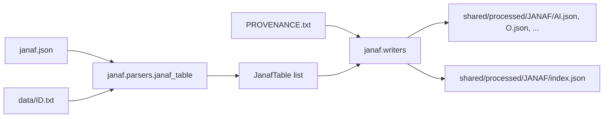

# JANAF Parser Specification

**Status:** Implemented.
**Purpose:** Convert the NIST-JANAF thermochemical tables (py-janaf copy) into JSON files grouped by JANAF ID prefix.

---

## Inputs and output

- **Tables:** `shared/sources/compound-data/nist-janaf/py-janaf/data/<ID>.txt`, 1796 files that use tabs between columns.
  - Line 1 holds the name, formula and phase, e.g. `Titanium Oxide (TiO2)<TAB>O2Ti1(cr,l)`.
  - Line 2 holds the column headers.
- **Index:** `shared/sources/compound-data/nist-janaf/py-janaf/janaf.json`, as `{display: [...], index: ["Al-001", ...]}`.
- **Provenance:** `shared/sources/compound-data/nist-janaf/PROVENANCE.txt`. The py-janaf repository URL (`py-janaf: https://github.com/n-takumasa/py-janaf.git`) and the commit hash are read from it and copied into each output file.
- **Output:** `shared/processed/JANAF/<prefix>.json`, grouped by JANAF ID prefix as NIST files them. So `Al-096` goes to `Al.json`, and TiO₂ `O-045` goes to `O.json`.
- **Index:** `shared/processed/JANAF/index.json` lists every table with the file it is in, plus lookups by formula and by element (see [Index file](#index-file)). It is written only when all prefixes are parsed.

The source folder also holds `nist/<ID>.txt`, the original files downloaded from `https://janaf.nist.gov/tables/<ID>.txt`. The py-janaf copies hold the same data with two fixes:
- `INFINITE` is written as `+inf`.
- In the rows where NIST's files lost the minus signs and tabs in the last three columns (ΔfH, ΔfG, log Kf), py-janaf restores them. The minus signs are py-janaf's inference ("sign consistent with the sign immediately following").

T, Cp, S, the H−H(298) column and the transition rows are identical in both copies. Values are cited as NIST-JANAF 4th ed., by table ID.



---

## Output shape (one file)

```json
{
  "ref": "NISTJANAF",
  "repository": "https://github.com/n-takumasa/py-janaf",
  "sourceCommit": "c8ed6be3ba31a61835061091bd3c521270b484ec",
  "units": {"T": "K", "Cp": "J/(mol K)", "S": "J/(mol K)", "gef": "J/(mol K)", "dH": "kJ/mol", "dfH": "kJ/mol", "dfG": "kJ/mol", "logKf": "-"},
  "generatedAt": "...",
  "prefix": "O",
  "count": 96,
  "tables": {
    "O-045": {
      "id": "O-045", "name": "Titanium Oxide", "formula": "TiO2",
      "janafFormula": "O2Ti1", "phase": "cr,l", "label": "O2Ti, Titanium Oxide (cr,l)",
      "sourceUrl": "https://github.com/n-takumasa/py-janaf/blob/c8ed6be3ba31a61835061091bd3c521270b484ec/src/janaf/data/O-045.txt",
      "nistUrl": "https://janaf.nist.gov/tables/O-045.html",
      "rows": [{"T": 298.15, "Cp": 55.103, "S": 50.292, "gef": 50.292, "dH": 0.0, "dfH": -944.747, "dfG": -889.406, "logKf": 155.82, "note": null}],
      "transitions": [{"T": 2130.0, "label": "CRYSTAL <--> LIQUID"}]
    }
  }
}
```

Column keys:
- `gef` is −[G−H(Tr)]/T.
- `dH` is H−H(Tr).
- Tr is 298.15 K.

### Parsing rules

- `+inf` and `INFINITE` become `null`. The writer keeps `allow_nan=False`, as `nasa_thermo/writers.py` does.
- If column 6 is not a number (e.g. `CRYSTAL <--> LIQUID`, `TRANSITION`, or any other text), the rest of the line becomes `note`. In that case `dfH`, `dfG` and `logKf` are `null`.
- A row whose note contains `<-->` is added to `transitions`.
- The `TRANSITION` row is kept in `rows`: it holds the values just after the transition.
- Empty cells become `null`. Lines that don't start with a number are skipped, with a debug log.
- Tables appear in the order of `janaf.json`. A file missing from the index, or an index entry without a file, gets a warning.

### Links

- `ref` is the `RefKey` of [docs/REFERENCES.md](../REFERENCES.md) (`NISTJANAF`). The full citation is kept there, not in the dataset.
- `repository` is the py-janaf URL from `PROVENANCE.txt`, without the `.git` ending.
- `sourceUrl` points to the exact py-janaf file at the recorded commit, so the link always shows the data that was parsed.
- `nistUrl` points to the original NIST page for the same table.
- Without a provenance file, `repository` falls back to `https://github.com/n-takumasa/py-janaf`, and `sourceUrl` uses `main` with a warning.

---

## Index file

`shared/processed/JANAF/index.json` finds tables without opening the per-prefix files. It holds no rows and no transitions.

```json
{
  "ref": "NISTJANAF",
  "repository": "https://github.com/n-takumasa/py-janaf",
  "sourceCommit": "c8ed6be3ba31a61835061091bd3c521270b484ec",
  "generatedAt": "...",
  "count": 1796,
  "tables": {
    "O-045": {
      "formula": "TiO2", "janafFormula": "O2Ti1", "name": "Titanium Oxide",
      "phase": "cr,l", "label": "O2Ti, Titanium Oxide (cr,l)", "file": "O.json"
    }
  },
  "byFormula": { "TiO2": ["O-042", "O-043", "O-044", "O-045"] },
  "byElement": { "Ti": ["...", "O-045"], "O": ["..."] }
}
```

- `tables` keeps the order in which the tables were parsed (`janaf.json` order).
- `byFormula` is keyed by the formula from the table title, or by the JANAF formula when the title has none. It lists all phases of a compound.
- `byElement` lists each table under every element of its JANAF formula (`O2Ti1` gives `O` and `Ti`), so TiO₂ is found under `Ti` although it is in `O.json`. Keys are sorted alphabetically.
- `--prefixes` runs parse only part of the tables, so they leave `index.json` unchanged.

---

## Files

New package [python/src/janaf/](../../python/src/janaf/), one export per file as in [python/src/nasa_thermo/](../../python/src/nasa_thermo/):
- `__init__.py`: package docstring with Refs, and `__all__`.
- `janaf_row.py`: `JanafRow` dataclass with `to_dict`.
- `janaf_transition.py`: `JanafTransition` dataclass.
- `janaf_table.py`: `JanafTable` dataclass with `id`, `name`, `formula`, `janaf_formula`, `phase`, `label`, `rows`, `transitions`, and a `prefix` property.
- `parsers/__init__.py`, `parsers/janaf_table.py`: `parse_janaf_table(path, label)`.
- `janaf_index.py`: `load_janaf_index(path) -> dict[str, str]`, mapping each ID to its display label.
- `janaf_source.py`: `JanafSource` dataclass with `repository`, `commit`, and methods `file_url(table_id)` and `nist_url(table_id)`.
- `parsers/provenance.py`: `read_janaf_source(path) -> JanafSource`, which reads the `py-janaf:` and `commit:` lines of `PROVENANCE.txt`.
- `writers.py`: `write_janaf_json(tables, out_dir, source)`, which groups by prefix and writes one file per prefix, adding `repository`, `sourceCommit` and the per-table `sourceUrl` and `nistUrl`; and `write_janaf_index(tables, out_dir, source)`, which writes `index.json`. A `JANAF_META` constant holds the ref key and units.

CLI [python/src/scripts/parse_janaf.py](../../python/src/scripts/parse_janaf.py), a thin wrapper like [parse_nasa_thermo.py](../../python/src/scripts/parse_nasa_thermo.py). Arguments:
- `--data-dir`, `--index`, `--provenance`;
- `--out-dir` (default `shared/processed/JANAF`);
- `--prefixes Al,O` (optional filter);
- `-v`.

Make targets in a new [scripts/make.d/10-janaf.mk](../../scripts/make.d/10-janaf.mk):
- `janaf-parse` runs `docker-compose run --rm python python src/scripts/parse_janaf.py ...` with the default paths and an optional `PREFIXES=`.
- `janaf-test` runs pytest on `/app/tests/janaf/`.

Tests in [python/tests/janaf/](../../python/tests/janaf/):
- **Parser test** with small fixtures built from real cases:
  - `Al-001`: reference table with a melting row and a TRANSITION row;
  - `Al-002`: crystal table with a transition row only;
  - `+inf` in the 0 K row;
  - a row with empty cells;
  - a comment line.
- **Writer test:** grouping by prefix, TiO₂ landing in `O.json`, no NaN in the output, `repository` and `sourceCommit` copied over, and `sourceUrl` for `O-045` equal to `https://github.com/n-takumasa/py-janaf/blob/<commit>/src/janaf/data/O-045.txt`.
- **Index test:** entries without transitions, with the right `file`; `byFormula` grouping all phases; `byElement` listing TiO₂ under both `O` and `Ti`, with sorted keys.
- **Provenance test:** reads the repository and commit from a sample `PROVENANCE.txt`, strips the `.git` ending, and uses the fallback when the file is missing.

---

## Reference registration (per docs/PYTHON_CODE_STANDARDS.md section 7)

Add reference 36 `NISTJANAF` (Chase 1998, NIST-JANAF 4th ed., https://janaf.nist.gov). As with `Perry8`, the row also names the machine-readable copy: "py-janaf (n-takumasa), `src/janaf/data`. URL: https://github.com/n-takumasa/py-janaf". Add it in all five places:
- [docs/REFERENCES.md](../REFERENCES.md);
- [backend/src/common/thermal/enum/ref-key.enum.ts](../../backend/src/common/thermal/enum/ref-key.enum.ts);
- [backend/src/common/thermal/dto/ref-key.dto.ts](../../backend/src/common/thermal/dto/ref-key.dto.ts);
- [python/src/references/ref_key.py](../../python/src/references/ref_key.py);
- [python/src/references/references_meta.py](../../python/src/references/references_meta.py).

The `janaf` docstrings then cite `Refs: docs/REFERENCES.md  [36] NISTJANAF`.

---

## Docs

[python/README.md](../../python/README.md) gets the layout tree entries and a short "JANAF parser" section next to the NASA one: source, output, make targets.

---

## Verification

1. `make janaf-test`.
2. `make janaf-parse`.
3. Spot-check with `rg --no-ignore`:
   - `O.json` `O-045` has the transition `2130.0 CRYSTAL <--> LIQUID`;
   - `Al.json` `Al-101` has `2327.0 ALPHA <--> LIQUID`;
   - the total `count` across files is 1796;
   - `index.json` has `count` 1796, and `byElement.Ti` contains `O-045`.
