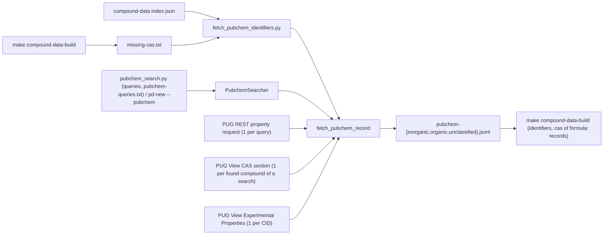

# PubChem Fetch and Search Specification

**Status:** Implemented.
**Purpose:** Ask PubChem about compounds and keep everything it answers, one file per compound class. Three callers write to the same files:

- **Fetch step:** step 2 of the compound data ([COMPOUND_DATA_SPEC.md](COMPOUND_DATA_SPEC.md#pubchem-identifiers)). It looks up the CAS numbers the build cannot identify, and searches by formula the records that have no CAS. The build reads the files offline.
- **On-demand search:** `make pubchem-search Q="CaAl2O4"` and `PubchemSearcher` look up a formula, a name or a CAS when a new compound is needed, for example for a new phase diagram (`make pd-new … PUBCHEM=1`).
- **Query list:** `make pubchem-search QUERY_FILE=shared/sources/pubchem-queries.txt` searches the 551 formulas that have no compound-data record ([COMPOUND_DATA_SPEC.md](COMPOUND_DATA_SPEC.md#pubchem-query-list)).

---

## Inputs and output

- **CAS list:** `tmp/reports/python/compound-data/missing-cas.txt`, written by `make compound-data-build`. It holds the CAS numbers no chemicals identifier file has (3,976), one per line with a `#` header.
  - CLI: `--cas-file`; inside the container the path is `reports/compound-data/missing-cas.txt`.
  - `make compound-data-pubchem` runs the build first when the list is missing.
- **Compound index:** `shared/processed/compound-data/index.json` (`--index`, required). It gives:
  - the class of every CAS (`compounds` and `byOtherCas`). A CAS the index does not know is `unclassified`; these are unresolved rows without a formula, such as calcium carbide 75-20-7.
  - the records without a CAS (`formula:Ag2S` …, 162). Their Hill formula is searched unless `--no-formulas` is given. The two fractional formulas `AlF3H7O3.5` and `MoO2.75` are skipped.
- **Output:** `shared/sources/compound-data/pubchem/` (`--out-dir`, `PUBCHEM_DIR`). It is gitignored like the rest of `shared/sources/compound-data/` and holds:
  - `pubchem-inorganic.jsonl`
  - `pubchem-organic.jsonl`
  - `pubchem-unclassified.jsonl`

  Each file has one JSON line per query (a CAS, a formula or a name) with everything PubChem gave for it; see [File format](#file-format).
- **Network:** PUG REST `https://pubchem.ncbi.nlm.nih.gov/rest/pug` and PUG View `https://pubchem.ncbi.nlm.nih.gov/rest/pug_view`, through `urllib` (`requests` is not in the image). The client is adapted from `legacy/python_scripts/data_enrichment/pubchem_api_client.py`.



## Running

### Fetch step

```bash
make compound-data-pubchem                                          # missing CAS + records without CAS, then rebuild
make compound-data-pubchem PUBCHEM_ARGS="--class inorganic unclassified"
make compound-data-pubchem PUBCHEM_ARGS="--all-cas --class organic"
```

The Make target passes `PUBCHEM_ARGS` to the CLI and runs `make compound-data-build` at the end. The CLI is `python/src/scripts/fetch_pubchem_identifiers.py`:

| Option | Default | Meaning |
|---|---|---|
| `--cas-file FILE` | `reports/compound-data/missing-cas.txt` | CAS list |
| `--out-dir DIR` | `PUBCHEM_DIR` | Folder of the class files |
| `--index FILE` | `shared/processed/compound-data/index.json` | Class of every CAS; records without a CAS |
| `--class CLASS...` | all | Only `inorganic`, `organic` and/or `unclassified` (CAS numbers and formulas) |
| `--all-cas` | off | Add every CAS of the compound data to the list |
| `--no-formulas` | off | Do not search the records without a CAS |
| `--no-experimental` | off | Skip the "Experimental Properties" requests |
| `--retry STATUS...` | none | Ask stored queries with these statuses again, e.g. `notFound ambiguous` |
| `--limit N` | none | At most N queries in this run |
| `--delay S` | `PUBCHEM_DELAY`, 1 | Seconds between requests |
| `--busy-pause S` | `PUBCHEM_BUSY_PAUSE`, 30 | First pause when PubChem is busy |
| `--max-wait MIN` | `PUBCHEM_MAX_WAIT`, 240 | Stop when pauses in a row exceed this |
| `--chunk-size N` | `PUBCHEM_CHUNK_SIZE`, 50 | Queries per chunk; progress is logged after each |
| `--chunk-pause S` | `PUBCHEM_CHUNK_PAUSE`, 10 | Pause between chunks |
| `-v` | off | DEBUG messages |

Exit codes:

| Code | Meaning |
|---|---|
| 0 | Done |
| 1 | CAS list or index missing, or `--chunk-size` below 1 |
| 2 | PubChem blocked this client or stayed busy longer than `--max-wait` |
| 130 | Ctrl+C |

Every run ends with a summary per class: the records stored (how many of them are formula or name searches), the counts per status, and the number of CIDs with experimental properties.

### On-demand search

```bash
make pubchem-search Q="CaAl2O4"
make pubchem-search Q="'Ca3SiO5' '12042-68-1' 'tricalcium silicate'"
make pubchem-search Q="CaAl2O4" PUBCHEM_ARGS="--refresh"
make pubchem-search QUERY_FILE=shared/sources/pubchem-queries.txt
```

The CLI is `python/src/scripts/pubchem_search.py QUERY... [--query-file FILE] [--by cas|formula|name] [--class CLASS] [--out-dir DIR] [--no-experimental] [--refresh] [--delay S] [--busy-pause S] [--max-wait MIN] [-v]`.

- **Query file:** one query per line; `#` starts a comment. Progress is logged every 50 queries. An interrupted run loses at most the query in progress, and stored searches are reused, so running it again resumes.
- **Query kind:** guessed from the text unless `--by` is given:
  - a CAS with a valid check digit is a CAS query;
  - text without spaces that starts like a formula and that `chemical_formula` reads is a formula query (`2KCN·Zn(CN)2` → `formula:C4K2N4Zn`). Fractional counts (`K3AlF6·3.5H2O`, `Cu0.75Fe2.25O4`) are refused: PubChem cannot search them;
  - anything else is a name query.
- **Output per query:** the status, CID, CAS, title, formula and molecular weight (plus the candidates when the status is not `ok`). Then the "Melting Point", "Boiling Point", "Density" and "Decomposition" strings of the chosen compound (`PUBCHEM_SUMMARY_HEADINGS`, at most 6 each, as the sources print them) and its PubChem URL:

  ```text
  formula:O2Ti → ok  CID 26042  CAS 13463-67-7  Titanium dioxide  O2Ti  79.866 g/mol
    Melting Point: 3380 °F (decomposes) (NTP, 1992) | 1855 °C | 3326-3362 °F | 1843 °C
    https://pubchem.ncbi.nlm.nih.gov/compound/26042
  ```

- **Storage:** the records go to the class files. The class comes from `--class`, otherwise from the found formula. The fetch step then skips them, and the next build reads them.
- **Reuse:** a complete stored record is shown without asking PubChem. `--refresh` asks again.
- **Exit codes:** 0 done; 1 when there are no queries, a `--by formula` text is not a formula, or PubChem refused a request; 2 blocked; 130 Ctrl+C.

From Python, `PubchemSearcher(out_dir=PUBCHEM_DIR, client=None, experimental=True)`:

- `search(text, by=None, compound_class=None, refresh=False)` returns the complete `PubchemRecord` (experimental bodies included), or None when PubChem refused the request;
- `fetch(query)` does the same for a built `PubchemQuery`;
- `stored(key)` reads a record without asking PubChem;
- `compact()` drops superseded lines.

The stored records are read once, on the first search. `record_summary(record)`, `record_headline(record)` and `experimental_values(record, heading)` (`pubchem_record_summary.py`) give the text shown above.

**New phase diagrams:** `make pd-new SYSTEM=… PUBCHEM=1` (CLI `extract_phase_diagram.py new … --pubchem`) searches by formula each component that compound-data lacks. It prints the summary and puts `PubChem CID … (CAS …), melting point: …` into the notes of the proposed `compounds.json` entry ([phase-diagrams/WORKFLOW.md](phase-diagrams/WORKFLOW.md#new-ternary-system)).

### What is asked

`fetch_pubchem_record(client, query, compound_class=None, stored=None, experimental=True, refresh=False)` builds or completes the record of one query, and asks PubChem only what is missing:

1. **Property request:** made when no record is stored, when the stored answer was made with another URL (another property list), when `refresh` is set, or (fetch step) when the status is in `--retry`.
2. **CAS section:** for an `ok` formula or name search whose chosen compound has no CAS section in the record yet.
3. **Experimental request:** for every CID in `experimental_cids` that has no experimental item yet, unless `--no-experimental`. This includes CIDs of records stored by an earlier run with `--no-experimental`.

Everything else is skipped, so an interrupted or stopped run is resumed by running it again. `stored` must be a full record: a record read light (`light=True`) raises `ValueError`, because its experimental bodies would be lost on writing.

## Requests

### Property request (PUG REST)

- **CAS:** find every CID PubChem associates with the registry number, then load properties:
  1. `{PUBCHEM_API}/compound/name/{CAS}/property/<PUBCHEM_PROPERTIES>/JSON` (synonym index) — enough for most CAS numbers;
  2. on HTTP 404, collect CIDs from, in order, `compound/xref/RN/{CAS}/cids`, `substance/name/{CAS}/cids`, `substance/xref/RN/{CAS}/cids` (`PUBCHEM_CAS_LOOKUP`);
  3. `{PUBCHEM_API}/compound/cid/{cid,…}/property/…/JSON` for the union of those CIDs.
  The stored `properties.url` is the canonical resume URL (`…/compound/name/{CAS}/property/…/JSON#lookup=…`); `fetchedUrl` / `resolvedVia` record the HTTP call that returned the table (e.g. `compound/xref/RN+substance/name`).
- **Formula:** `{PUBCHEM_API}/compound/fastformula/{Hill}/property/…/JSON` returns every compound with exactly that formula, including ions and isotope variants. Ag2S gives 3; CaAl2O4 gives several duplicates.
- **Name:** `{PUBCHEM_API}/compound/name/{name}/property/…/JSON`, through the synonyms. A name can land on another compound than intended, so check the formula.

`PUBCHEM_PROPERTIES` is a short list (16), not every PUG REST tag — large lists often hit HTTP 504:

| Group | Properties |
|---|---|
| Identifiers (8) | `MolecularFormula`, `MolecularWeight`, `SMILES`, `ConnectivitySMILES`, `InChI`, `InChIKey`, `IUPACName`, `Title` |
| Mass and charge (3) | `ExactMass`, `MonoisotopicMass`, `Charge` |
| Descriptor (1) | `XLogP` |
| Formula ranking (4) | `IsotopeAtomCount`, `AnnotationTypeCount`, `LiteratureCount`, `PatentCount` (`PUBCHEM_RANKING`) |

This covers what the build needs (identifiers, mass, charge, SMILES) plus the fields formula search uses to drop isotopes and pick the best CID. A 404 (`PUGREST.NotFound`) is a valid answer and is stored. Records stored under an older, longer property URL are asked again on the next run.

### CAS section (PUG View)

A formula or name answer carries no CAS. For the chosen compound of an `ok` search, the CAS numbers come from:

`{PUBCHEM_VIEW_API}/data/compound/{CID}/JSON?heading=CAS`

This is the "Names and Identifiers → Other Identifiers → CAS" section: one value per depositing source. The result's CAS is the one most sources give, the first one on a tie. For Ag2S, CID 166738, that is 21548-73-2; the secondary 12249-63-7 is cited less.

### Experimental properties (PUG View)

The property request returns computed data only. For every CID of `experimental_cids`, a second request asks for the compound page section "Chemical and Physical Properties → Experimental Properties":

`{PUBCHEM_VIEW_API}/data/compound/{CID}/JSON?heading=Experimental+Properties`

- **Which CIDs:** for a CAS or name query, every CID of the answer, not only the one the build uses. For a formula query, only the formula matches (neutral, no isotopes).
- **History:** this is how `legacy/python_scripts/extract_experimental_properties.py` got melting points, but with the heading filter (NaCl: 48 KB instead of the whole 1.15 MB page).
- **Stored slim:** the compound log does **not** keep PubChem's nested `Information` / `ExtendedReference` / `Markup` / depositor essays. Each heading becomes `{heading, citation: [{text, values: [{spec?, number, unit}], refCode, refNumber, refPage?}]}`. **`text`** is the original printed string (unchanged). **`values`** are parsed magnitudes: optional **`spec`** (label/condition from the text, e.g. `Triple point`), then **number** and **unit** in separate fields (empty when none parse). No literature source text on the compound line — that lives in the references file. **`refPage`** is per citation row (one source, many pages).
- **Sources list:** `pubchem-references.jsonl` is a rateable catalog. Each line has a stable **`refNumber`** (1, 2, 3, … — position in this file), a unique **`refCode`**, and **`source`** (name / citation **without page**), plus optional `url` / ISBN / `sourceId`. No page on the source row. No content hash; if two different sources share the same stem, the later ones are `stem-2`, `stem-3`, ….
- **`refCode`:** informative stem — e.g. `CRCHandbook-ed95-2014`, `MerckIndex-2013`, `HSDB-6341`, `CAMEO-8234` (no page in the code). **`refNumber`:** index in `pubchem-references.jsonl` (not PubChem's depositor number). **`refPage`:** from the literature citation when present, on the citation row only.
- **Reading:** `view_strings(view_or_body, heading)` lists the original `text` strings under a heading (slim `values` or legacy `body`).
- **404:** that CID has no Experimental Properties section (`values: []`). Another CID of the same query may still have data and sources.
- **Legacy lines** that still hold a raw `body` are readable until re-fetched; new fetches always write slim `values`.

The other sections of the compound page (Safety and Hazards, Pharmacology, Literature, Patents …) are not requested: they are large and mostly regulatory.

## Politeness

[PubChem dynamic request throttling](https://pubchem.ncbi.nlm.nih.gov/docs/dynamic-request-throttling) allows at most 5 requests per second and 400 per minute. Every answer has an `X-Throttling-Control` header with a Green / Yellow / Red / Black status per counter: Request Count, Request Time (this client) and Service (the whole server).

- **Spacing:** requests are spaced by `--delay`. The worst status of the last answer sets the spacing: Yellow ≥ 1 s, Red ≥ 5 s (`PUBCHEM_THROTTLE_DELAYS`), Green back to `--delay`.
- **Progress:** every HTTP attempt logs one INFO line with local time, the request label (CAS, formula, or `CID … heading`), the outcome (`HTTP 200` / `HTTP 504` / network error), the duration of that call, and the current throttle level.
- **Blocked:** HTTP 403, or Black on a client counter (`PUBCHEM_CLIENT_COUNTERS`), stops the run at once (exit code 2).
- **Server overloaded:** Black on the Service counter (seen at 577–990 %) is not a block. A 200 or 404 answer is kept, and the next request first waits `--busy-pause` × `PUBCHEM_OVERLOADED_PAUSE_MULTIPLIER` (1, i.e. 30 s). An error answer is asked again after that pause.
- **Busy:** 503, 429, other 5xx and network failures pause the whole run. The pause is `Retry-After` when given, else `--busy-pause` × 1, 2, 4 … (at most × `PUBCHEM_BUSY_PAUSE_MAX_MULTIPLIER`, 4). The spacing rises to ≥ 1 s and the same request is made again: a refused request is never skipped in favour of the next one.
- **Max wait:** pauses in a row longer than `--max-wait` minutes in total stop the run (exit code 2). An answer from a server that is not busy resets the count.
- **Other 4xx** answers are logged and not stored.
- **Chunks:** the fetch step processes queries in chunks of `--chunk-size`, with `--chunk-pause` seconds between chunks.

## File format

One JSON line per query (`PubchemRecord.to_json`). A CAS query:

```json
{"cas": "7647-14-5", "class": "inorganic",
 "properties": {"retrieved": "2026-10-14T09:30:00+00:00", "httpStatus": 200,
                "url": "https://pubchem.ncbi.nlm.nih.gov/rest/pug/compound/name/7647-14-5/property/…/JSON",
                "body": {"PropertyTable": {"Properties": [{"CID": 5234, "MolecularFormula": "ClNa", …}]}}},
 "experimental": [{"cid": 5234, "retrieved": "2026-10-14T09:30:02+00:00", "httpStatus": 200,
                   "url": "https://pubchem.ncbi.nlm.nih.gov/rest/pug_view/data/compound/5234/JSON?heading=Experimental+Properties",
                   "values": [{"heading": "Melting Point",
                               "citation": [{"text": "801 °C",
                                             "values": [{"number": 801, "unit": "°C"}],
                                             "refCode": "CRCHandbook-ed95-2014",
                                             "refNumber": 1, "refPage": "4-58"}]}]}]}
```

Example with several magnitudes in one printed string:

```json
{"heading": "Melting Point",
 "citation": [{"text": "Red: Triple point = 590 °C; sublimation point = 431 °C",
               "values": [{"spec": "Red: Triple point", "number": 590, "unit": "°C"},
                          {"spec": "sublimation point", "number": 431, "unit": "°C"}],
               "refCode": "CRCHandbook-ed88-2007", "refNumber": 1, "refPage": "4-57"}]}
```


A formula or name query has `key` and `search` instead of `cas`, and the CAS section in `casNumbers`:

```json
{"key": "formula:Ag2S", "search": {"by": "formula", "text": "Ag2S", "hill": "Ag2S"}, "class": "inorganic",
 "properties": {…, "url": "https://pubchem.ncbi.nlm.nih.gov/rest/pug/compound/fastformula/Ag2S/property/…/JSON", …},
 "casNumbers": [{"cid": 166738, …, "url": "…/pug_view/data/compound/166738/JSON?heading=CAS", "body": {"Record": …}}],
 "experimental": [{"cid": 166738, "httpStatus": 404, "values": []}, …]}
```

`pubchem-references.jsonl` (same folder), one line per source (rateable list — no page):

```json
{"refNumber": 1, "refCode": "CRCHandbook-ed95-2014",
 "source": "Haynes, W.M. (ed.). CRC Handbook of Chemistry and Physics. 95th Edition. CRC Press LLC, Boca Raton: FL 2014"}
{"refNumber": 2, "refCode": "HSDB-6341", "source": "Hazardous Substances Data Bank (HSDB)",
 "url": "https://pubchem.ncbi.nlm.nih.gov/source/hsdb/6341", "sourceId": "6341"}
```

- **`key`:** the query key. Formula keys use the Hill formula (`formula:Al2CaO4` for `CaAl2O4`); name keys are lower case with single spaces (`name:tricalcium silicate`).
- **`search`:** `text` is what was asked; `hill` is present for formulas only.
- **`class`:** the class of the compound when it was fetched; it picks the file.
- **`properties`:** the property request. `retrieved` is the UTC time, `httpStatus` 200 or 404, `url` is the resume identity, and `body` is PubChem's JSON as sent (`PropertyTable`, or the `Fault` of a 404). Optional `fetchedUrl` / `resolvedVia` when a CAS used a fallback route.
- **`casNumbers`:** searches only; one item for the chosen compound, still with the raw PUG View `body` (CAS strings).
- **`experimental`:** one item per CID of `experimental_cids`, with slim `values` (not the raw page). Empty `values` for a 404 or with `--no-experimental`.
- **Not stored in the compound line:** full `Reference` / `ExtendedReference` / markup; those live in `pubchem-references.jsonl`. Response headers, status and the chosen compound are derived when the file is read.

### Writing and reading

- **Append:** a record is appended to its class file as soon as its requests are done (`append_pubchem_record`), so an interrupted run loses at most the query in progress. A line cut off by a killed run is closed with a newline before the next append.
- **Newest wins:** a key fetched again also has its older line, in the same file or in another one when its class changed. Over all class files, `read_pubchem_records` keeps the record with the newest `properties.retrieved`, then the later line. Unreadable lines are skipped with a warning.
- **Light reads:**
  - `read_pubchem_records(..., experimental=False)` keeps only the CID and status of each experimental item and marks the record `light`; `to_json` refuses such a record. The build and the fetch planning use these reads, because the files grow to hundreds of MB.
  - `read_pubchem_lines([(file, line), …])` reads the full records at those places, one pass per file, when a stored record is completed.
- **Compaction:** at the end of every run, including a stopped one, `compact_pubchem_files` rewrites the files that hold superseded or unreadable lines, through a temporary file. The searchers compact after they store something.

## Statuses

`PubchemResult.from_answer(query, answer, cas_numbers)` classifies an answer.

**CAS and name queries:**

- `ok`: one compound, or several with one Hill formula. The first uncharged one is used; `candidates` lists all as `CID:formula`.
- `ambiguous`: compounds with different formulas; not used by the build.
- `charged`: the query names only an ion (Perry's Mg 22537-22-0 → `Mg+2`); not used by the build.
- `notFound`: a 404 (calcium carbide 75-20-7).

**Formula queries:** the candidates are the neutral compounds (no `Charge`, no `+`/`-` suffix) without `IsotopeAtomCount` whose Hill formula is the asked one.

- `ok`:
  - one candidate; or
  - several candidates, when one is strictly ahead on `PUBCHEM_RANKING`: `AnnotationTypeCount`, then `LiteratureCount`, then `PatentCount`.
  - Checked live: Al2Cl6 → CID 13848146 with 70 articles, not the duplicates with 0; CaAl2O4 → CID 159415, CAS 12042-68-1; Ca3SiO5 → 12168-85-3; AlF → 13595-82-9.
- `ambiguous`:
  - several candidates of an organic formula (`classify_compound`), since isomers cannot be told apart by formula; or
  - several equally ranked candidates.
- `notFound`: no candidate. `candidates` then lists what PubChem had (the ions and isotope variants).

**CAS of the result:** a CAS query keeps the asked CAS. A formula or name result takes the most cited CAS of the chosen compound's `casNumbers` section, or None.

**How the build uses the records** ([COMPOUND_DATA_SPEC.md](COMPOUND_DATA_SPEC.md#pubchem-identifiers)):

- `ok` CAS records are its last identifier source, cited as `identifierRef: [line, "idPubchemRestInorganic"]` (likewise `idPubchemRestOrganic`, `idPubchemRestUnclassified`).
- `ok` formula records give the records without CAS their `cas`, `casRef` and `pubchemCid`.

## Files

The `pubchem/` package under `python/src/` depends only on `chemical_formula`; `compound_data` and the phase-diagram CLI use it. Each file has one export.

- **Client:**
  - `pubchem_client.py` `PubchemClient`: `answer(query)`, `view(cid, heading)`, `experimental(cid)` (slim), `cas_numbers(cid)`; pacing, throttling, pauses, and the `on_pause` hook.
  - `pubchem_throttle.py` `throttle_level`, `throttle_statuses`.
  - `pubchem_response.py` `PubchemResponse`: status, JSON, `X-Throttling-Control`, `Retry-After`.
  - `pubchem_blocked_error.py` `PubchemBlockedError`; `pubchem_transient_error.py` `PubchemTransientError`.
- **Queries and fetching:**
  - `cas_number.py` `is_cas`: format and check digit.
  - `pubchem_query.py` `PubchemQuery`: `cas`, `formula`, `name`, `parse`, `from_key`, `url`.
  - `pubchem_fetch.py` `fetch_pubchem_record`.
  - `pubchem_searcher.py` `PubchemSearcher`.
- **Models:**
  - `pubchem_record.py` `PubchemRecord`: one line of a class file, with `result`, `experimental_cids`, `missing_cids`, `missing_cas_cid` and `light`.
  - `pubchem_answer.py` `PubchemAnswer`: the property answer, with `properties` and `cids`.
  - `pubchem_view.py` `PubchemView`: slim experimental `values` or CAS / legacy `body`; `from_experimental_response`.
  - `experimental_value.py` `ExperimentalProperty` / `ExperimentalCitation` / `ExperimentalQuantity`: heading + `citation[]` with `text`, `values[{spec?,number,unit}]`, `refCode`, `refNumber`, `refPage`.
  - `pubchem_result.py` `PubchemResult`: the status classification, with `from_formula_search`, `formula_matches`, `name` and `answer`.
- **Text:**
  - `pubchem_view_text.py` `view_strings` (slim or legacy).
  - `pubchem_record_summary.py` `record_summary`, `record_headline`, `experimental_values`.
  - `parsers/experimental_properties.py` `parse_experimental`, `parse_quantities`, `ref_code`, `page_of`.
- **Files:**
  - `pubchem_paths.py` `pubchem_files`: class → file.
  - `parsers/pubchem_records.py` `iter_pubchem_records`, `read_pubchem_records`, `read_pubchem_lines`.
  - `pubchem_records_writer.py` `append_pubchem_record`, `compact_pubchem_files` (also references file).
  - `pubchem_references.py` `append_pubchem_references`, `read_pubchem_references`, `compact_pubchem_references`.
  - `parsers/cas_list.py` `read_cas_list`; `parsers/compound_classes.py` `read_compound_classes`; `parsers/formula_compounds.py` `read_formula_compounds`.
- **Constants:** `constants/pubchem.py`: the APIs, `PUBCHEM_PROPERTIES`, headings, query kinds, `PUBCHEM_RANKING`, summary headings, folder and file names (`PUBCHEM_REFERENCES_FILE`), classes, statuses, pacing.
- **CLI:**
  - `python/src/scripts/fetch_pubchem_identifiers.py`
  - `python/src/scripts/pubchem_search.py`
  - `python/src/scripts/extract_phase_diagram.py new --pubchem`
- **Make:**
  - `scripts/make.d/11-compound-data.mk`: targets `compound-data-pubchem`, `pubchem-search` (`Q=…` or `QUERY_FILE=…`).
  - `scripts/make.d/09-phase-diagrams.mk`: `pd-new PUBCHEM=1`.

## Tests

`python/tests/pubchem/`, run by `make compound-data-test`. HTTP is replaced by a scripted `fetch` or client, so no test goes online.

- **Results** (`test_pubchem_result.py`):
  - CAS statuses:
    - single compound;
    - same formula → the first;
    - different formulas → ambiguous;
    - ion → charged;
    - neutral preferred over the ion;
    - empty → notFound.
    - `name` falls back to the IUPAC name, and a result from a stored answer keeps that answer and its day.
  - Records: JSON round trip, a read without experimental bodies, `missing_cids`, `cids` of every compound.
  - Class files:
    - one per class;
    - appended and read back, with a cut-off line skipped and closed before the next append;
    - the newest record wins over files, and the later line wins a tie;
    - compaction keeps only the newest line per key.
  - CAS list comments and duplicates; compound classes include other CAS numbers and skip `formula:` keys.
- **Searches** (`test_pubchem_search.py`):
  - CAS check digit.
  - Query kinds: `parse`, a bad check digit, `--by`, fractional formulas refused, URLs, `from_key`.
  - Formula rule: ions and isotopes are not candidates; the best annotated of several wins; an equal rank is ambiguous; organic isomers are ambiguous; no neutral match is notFound.
  - CAS selection: the most cited CAS on the chosen compound's page; a name query takes it too.
  - Search records: JSON round trip, CAS records without search fields, `experimental_cids` = formula matches, `missing_cas_cid`.
  - Fetch: a new search asks answer, CAS and experimental properties; a complete record asks nothing; only missing CIDs are asked; refresh or another URL asks again; a light record is refused; the class comes from the found formula.
  - Searcher: stores once and reuses across instances; a stored record comes back with its bodies.
  - Text and files: `view_strings` (strings, and numbers with units), the summary lines, `read_pubchem_lines`, `read_formula_compounds`.
- **Client** (`test_pubchem_client.py`):
  - URLs and answers: the URL has all `PUBCHEM_PROPERTIES` fields; the formula URL; the full answer is attached (200, and the `Fault` of a 404); the experimental and CAS-section URLs; a 404 is kept.
  - Throttling: the worst status wins, statuses per counter, a missing header; Yellow and Red slow down, Green restores.
  - Pauses:
    - 503 and network failures pause, then ask the same request again;
    - `Retry-After` is honoured;
    - growth is capped by `busy_pause_max_multiplier`;
    - pauses in a row beyond `max_wait` stop the run, and an answer from a server that is not busy resets them;
    - `on_pause` runs before every pause.
  - Service Black keeps the answer and makes the next request wait `PUBCHEM_OVERLOADED_PAUSE_MULTIPLIER` × the busy pause; an error answer is asked again after it, and the wait counts towards `max_wait`.
  - 403, or Black on Request Count or Request Time, stops at once without pausing; other 4xx are not stored.
- **Build side:** `python/tests/compound_data/test_pubchem_identifiers.py`; see [COMPOUND_DATA_SPEC.md](COMPOUND_DATA_SPEC.md#tests-fixtures-built-from-real-rows).

## Docs

- This spec, plus the entries in [docs/scripts/README.md](README.md), [COMPOUND_DATA_SPEC.md](COMPOUND_DATA_SPEC.md#pubchem-identifiers) and [phase-diagrams/README.md](phase-diagrams/README.md).
- The compound data section of [python/README.md](../../python/README.md).

## Verification

1. `make compound-data-test`.
2. A small live run of the fetch step into a scratch folder:

   ```bash
   docker compose run --rm python sh -c 'python src/scripts/fetch_pubchem_identifiers.py --out-dir /tmp/pc --limit 3 && wc -l /tmp/pc/*'
   ```

   It writes 3 lines over the class files. An `ok` record has a `PropertyTable` with the `PUBCHEM_PROPERTIES` fields per compound and one experimental item per CID. A not-found CAS has a 404 and no experimental items.
3. Run it again in the same container. The stored queries are skipped (`3 stored`), the next 3 are fetched, and no key has two lines.
4. A live search into a scratch folder:

   ```bash
   docker compose run --rm python python src/scripts/pubchem_search.py CaAl2O4 Ag2S "tricalcium silicate" --out-dir /tmp/pc
   ```

   Expected: `formula:Al2CaO4 → ok  CID 159415  CAS 12042-68-1`, `formula:Ag2S → ok  CID 166738  CAS 21548-73-2`, and `name:tricalcium silicate → ok  CID 25523  CAS 12168-85-3` with `Melting Point: 2150 °C`. Run it again: nothing is asked and no record is stored.
5. `make compound-data-pubchem`. The full run takes hours: one property request per query, one CAS-section request per found compound of a search and one experimental request per CID, 1 s apart, plus the chunk pauses. If it stops with exit code 2, PubChem refused requests or stayed busy: wait and run it again; it resumes.
6. `make compound-data-build` logs `N of M CAS numbers resolved (K from PubChem)`. `report.json` counts `pubchemFormulaCas` / `pubchemCasExists`, and `sources.json` lists `idPubchemRest<Class>` for every class file and has the `pubchem` block.
