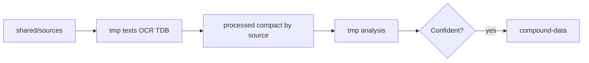

# Thermochemical staging (by source → analysis → compound-data)

**Purpose:** One **calculable** compact dataset per literature source, then
cross-source analysis, then compound-data only for confident rows.

## Layout (locked)

| Location | Contents |
|----------|----------|
| `shared/processed/minerals-thermodynamic/` | Root: **`index.json` only**; per-source subfolders with calculable JSON |
| `shared/sources/minerals-thermodynamic/` | Original PDFs / `.dat` (not part of staging commits) |
| `tmp/reports/python/minerals-thermodynamic/` | OCR, pdftotext, TDB text, raw ThermoML, analysis |

## Contract — every source (mandatory)

**No exceptions.** Every source that lands under `minerals-thermodynamic/<source>/`
uses the same shape and rules. Name lists, OCR dumps, and summary-only JSON are
rejected.

Required:

1. Primary file **`phases.json`** (compact, calculable), **except Robie**:
   `robie-hemingway-1995/<phaseId>.json` at the staging root (complete per-phase;
   no compact `phases.json`).
2. Top-level of `phases.json`: `source`, `convention`, `ref`, `nPhases`, `phases`.
3. Every retained phase has **numeric** fields usable in calculations
   (`Hf298` / `S298` / `G(T)` coeffs / `Cp` coeffs / `Tm` / series points, …).
4. Every number has `ref` (RefKey name) and, when known, page / table.
5. `convention`: `HSC` | `SER` | `formation_298` | `experimental_series`.
6. Per-phase `status`: `ok` | `partial` | `rejected` — only rows with numbers
   ship; rejects / working text go to **tmp**.
7. Raw text stays in **tmp**; processed holds only calculable JSON
   (`phases.json` or Robie `<phaseId>.json`).

Forbidden in `shared/processed/`:

- OCR / pdftotext dumps, TDB dumps, raw ThermoML copies
- Phase-name indexes without coefficients or 298 K values
- Invented Neumann–Kopp / snippet “fill” numbers
- Random sibling dumps (except Robie’s intentional `<phaseId>.json` layout)

## Pipeline



## Sources

| Folder | RefKey | Calculable content |
|--------|--------|--------------------|
| `holland-powell-ds633/` | `HollandPowell2011` | All `hp633ver.dat` EoS endmembers: H/GH/G0, S0, V0, Cp c1–c5 (HSC) |
| `abdul-2023/` | `Abdul2023` | Thesis TDB: Einstein G(T) solids + liquid L (SER) — **only** Abdul folder in processed |
| `robie-hemingway-1995/` | `RobieHemingway1995` | Per-phase `<phaseId>.json` (298 K + Cp + high-T); no compact `phases.json` |
| `koroleva-2017/` | `Koroleva2017` | Alkali silicate + borate S298/Hf298 (Tables 1–2) + regression eqs (6)(7)(10)(11) from Modal Surya OCR |
| `malan-2019/` | `Malan2019` | Fe2TiO5 Hf/S/Cp |
| `watanabe-2000/` | `Watanabe2000` | Cuspidine Tm, Hfus, heat-content fits |
| `jung-2009/` | `Jung2009AlTiO` | Al2TiO5 / Al4TiO8 + liquid MQM (Table 1 OCR) |
| `nagai-2009/` | `Nagai2009` | Experimental series points from ThermoML |
| `pankratz-1982/` | `Pankratz1982` | Mn/Ce/La/Y oxide 298 K rows (selected OCR) |
| `mao-2006/` | `Mao2006` | CAS solids (Table I) + ionic liquid G/L (Table III) from `mao-papers/Mao_2606.pdf` — **only** Mao folder in processed (`mao-2005` skipped; OCR dumps stay under tmp `mao-2006-cas/`) |
| `malan-2019/` | `Malan2019` | Fe2TiO5 298 K + Table 3 quasichemical/SS params (page-ocr) |
| `yazhenskikh-2007/` … `2009/` | `Yazhenskikh2007`… | Associate-species inventories (workshop OCR; no numeric L) |
| *(tmp only)* `abdul-2023-ccr` OCR | `Abdul2023` | CCR Table 8/9 cross-check — **not** written under processed (thesis TDB wins) |

## OCR policy

Follow [`OCR_POLICY.md`](./OCR_POLICY.md): **pdftotext / Tesseract** = fast
understanding of the PDF (Tesseract also when deep page segmentation is
required); **Modal/local Surya via `page-ocr`** = final text for parsers and
`phases.json`. Do not fall back to pdftotext for production datasets.

## Melt / assessment OCR (after USGS 2131)

Catalog: `python/src/thermodynamic_staging/ocr_jobs.py`. Existing
`page-NNNN.txt` dumps are skipped unless `FORCE=1`.

| Job id | PDF | Pages |
|--------|-----|-------|
| `yazhenskikh-2007` | `EYazhenskikh07.pdf` | 1–27 |
| `yazhenskikh-2008` | `Yazhenskikh_2008.pdf` | 1–19 |
| `yazhenskikh-2009` | `Yazhenskikh_2009.pdf` | 1–20 |
| `jung-2009` | Al₂O₃–Ti₂O₃–TiO₂ paper | 1–8 (reuses pages 2–4 if present) |
| `malan-2019` | Fe–Ti–V–O paper | 1–22 |
| `mao-2006-cas` | `mao-papers/Mao_2606.pdf` (JACS 2006 CAS) | 1–13 |
| `abdul-2023-ccr` | `1-s2.0-S0008884623002235-main.pdf` | 1–16 |
| `koroleva-2017` | `avdinvv,+05_Koroleva.pdf` | 1–10 |
| Mao Papers I–V (rest) | other PDFs in `mao-papers/` | all pages per file |

Yazhenskikh RefKeys are staging strings until added to `references.json`.

## Commands

```bash
make thermodynamic-staging-extract          # all compact datasets → processed
make thermodynamic-staging-ocr-list         # catalog + Mao Papers I–V folder
# After USGS 2131 OCR finishes:
make thermodynamic-staging-ocr-melt BACKEND=modal
make thermodynamic-staging-ocr-job JOB=yazhenskikh-2007 BACKEND=modal
make thermodynamic-staging-ocr-yazhenskikh BACKEND=modal
make thermodynamic-staging-ocr-malan BACKEND=modal
make thermodynamic-staging-ocr-abdul-ccr BACKEND=modal
make thermodynamic-staging-ocr-koroleva BACKEND=modal  # Tables 1–2 + eqs (6)(7)(10)(11)
make thermodynamic-staging-ocr-jung BACKEND=modal   # full paper; skips existing
make thermodynamic-staging-ocr-mao-papers BACKEND=modal  # needs PDFs in mao-papers/
make thermodynamic-staging-ocr-pankratz BACKEND=modal
make thermodynamic-staging-ocr-mao BACKEND=modal PAGE="…"  # kappa thesis only
make usgs2131-list-missing              # pages not yet OCR'd
make usgs2131-ocr-missing BACKEND=modal # skip existing dumps
make usgs2131-build                     # robie-hemingway-1995/<phaseId>.json
make compound-data-build                # chemicals catalogue + minerals-thermodynamic overlay
make thermodynamic-staging-test
```

## Compound-data (no separate overlay target)

`make compound-data-build` clears and rebuilds `shared/processed/compound-data/` from
chemicals/Yaws/…, then overlays every `status: ok` minerals-thermodynamic phase
(Robie, HP633, Abdul, Koroleva, Jung, Malan, Mao, Pankratz, Nagai, Watanabe).

- Formation / entropy / Gibbs / Tm / Hfus → scalar properties (SI)
- Holland–Powell Cp/V0, Abdul/Mao G(T), melt/SS models, Nagai series,
  Koroleva regressions → `raw` rows (ref + convention preserved)
- Stub files use `<displayFormula>-<name-slug>.json` (`dataset_layout.compound_file_name`)
- Skip overlay only: `make compound-data-build NO_MINERALS=1`
- Overlay summary → `tmp/reports/python/minerals-thermodynamic/build/compound-data-overlay.json`

