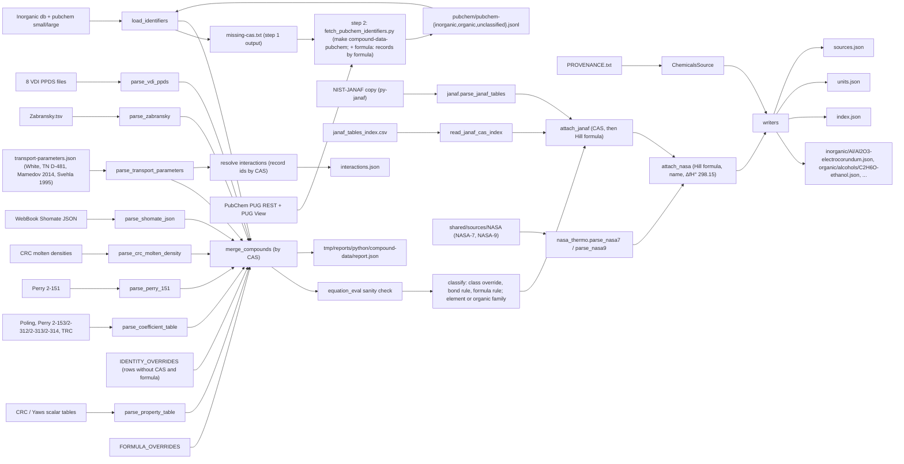

# Compound Data Equations, Types, and Data Flow

**Parent index:** [COMPOUND_DATA_SPEC.md](./COMPOUND_DATA_SPEC.md)

---

- **Scope:** all compounds in the copied files.
- **Organic or inorganic:** only carbon compounds can be organic, and elemental carbon (graphite, C2–C5, C60) is not. The order of precedence is:
  - `CLASS_OVERRIDES` (`compound_data/constants/class_overrides.py`, by CAS, each with a reason): the pseudohalogen hydrogen acids HCN, DCN, HNCO and HNCS are inorganic, and tetranitromethane is organic;
  - otherwise the bond rule on the SMILES (`chemical_formula.organic_bonds.has_organic_bond`, RDKit): organic when a carbon is bonded to H (D, T) or to a halogen, or, without a metal in the structure, bonded to another carbon (cyanogen, carbon suboxide and subsulfide), bonded to an N that carries H (urea, guanidine, melamine), or in a ring with at least two carbons (cyanuric triazide). So halocarbons (CCl4, freons, perfluorocarbons) and deuterated organics are organic, while carbonates, bicarbonates (NaHCO3), cyanides, cyanates, thiocyanates, carbides (B4C, whose single carbon sits in a boron cage) and acetylides (LaC2), metal oxalates, metal carbonyls, CO, CO2 and CS2 are inorganic;
  - otherwise (no SMILES) the formula rule (`classify_compound`): organic when there is no metal and the formula has H, a halogen or more than one carbon (C2N, C2O radicals).
  - The report lists `classOverridden` (with what the bond rule said) and `classFromFormula`.
- **Inorganic grouping:** by the main element (`chemical_formula.main_element`). H is ignored unless nothing else is left, and O too unless only F is left besides it. Of the rest, metals come before non-metals and metalloids, then the least electronegative element (Pauling) wins:
  - oxides go to their metal, not to oxygen: Al2O3 → `Al`, TiO2 → `Ti`, Fe2O3 → `Fe`, SiO2 → `Si`;
  - NH3, N2H4, NH4Cl, HNO3 → `N`; H2SO4 → `S`; HCl → `Cl`; CO2 → `C`; SiC → `Si`;
  - salts and mixed oxides go to the least electronegative metal: CaCO3 → `Ca`, MgAl2O4 → `Mg`, Na3AlF6 → `Na`, Al2TiO5 → `Ti`;
  - metal wins over metalloid: Mo2B → `Mo`, PbTe → `Pb`;
  - H2O, H2O2 and OF2 → `O`; H2 → `H`.
- **Organic grouping:** by functional family, found from the SMILES string with RDKit SMARTS patterns. This adds `rdkit` to the python container. Without a SMILES (or without a match), the family comes from the formula when the formula alone fixes it (`formula_family`: halocarbons, CnH2n+2 alkanes, ethene, ethyne; see [Organic families](#organic-families)).
- **One file per compound:** `inorganic/<Element>/<formula>-<name>.json` holds every record of one Hill formula (several CAS, polymorphs); `organic/<family>/<formula>-<name>.json` holds one record, since isomers (ethanol, dimethyl ether) differ in name and family. See [File layout](#file-layout).
- **Formulas:** `hill` (Hill notation: C, H, then alphabetical; without C all alphabetical: `O2Ti`, `H3N`) is the lookup key (`byFormula`). `displayFormula` is what people read and what names the files. For inorganic compounds it uses the IUPAC element order (`chemical_formula.iupac_formula`: Red Book 2005 IR-4.4.2.1, Table VI, electropositive first). For organic compounds it is the Hill formula, which is the usual notation for organics. Three conventional placements are added to Table VI:
  - halogen oxides, their acids and the metal halates put the halogen before O: ClO2, HClO4, KClO3, AgBrO3 (strict 2005 order gives O2Cl). Oxyhalides keep O first: TiOCl2, CrO2Cl2, POCl3;
  - oxoacids, acid salts and pseudohalogen acids put H right after the metals: HNO3, H2SO4, NaHCO3, KH2PO4, HCN. Ammonium-type N keeps N first: NH4Cl, NH4NO3 → N2H4O3;
  - hydroxides put H after O: NaOH, Ba(OH)2 → BaO2H2.

  Examples: TiO2, TiI, TiF4, ZnB4O9, Al2SiO5, Al6Si2O13, MgAl2O4, NH3, N2H4, SiC, XeF2. Element counts carry no structure, so hydrates and double salts are not rebuilt (LiCl·H2O → LiH2OCl).
- **Coefficients:** every coefficient row is stored in the backend form `EquationValue` = `{type, ref, page?, vars, min, max, k?}` (see [equation-value.type.ts](../../backend/src/common/thermal/types/equation-value.type.ts)).
  - `vars` hold the source's verbatim numbers.
  - `k` converts the result to the backend unit, as the existing entries do (e.g. CO2 Perry7 DIPPR 107 uses `k: 1e-3`).
- **Molten density:** stored as a backend `linear` equation, plus the verbatim row in `raw`.
- **Perry rows without a range:** 29 rows, the 13 monatomic-gas rows with Cp = 4.97 cal/(mol K) and 16 salts and hydrates (CuSO4·5H2O, H2S2O7, ...). They are kept as `raw` only, with no equation.
- **Tables with no earlier backend type:** stored under new type names, implemented in the backend with this dataset (see [New equation types](#new-equation-types)).
- **Links to other datasets:** NIST-JANAF table ids (`janaf`) and, from the same tables, melting and boiling points (see [JANAF table ids](#janaf-table-ids)). NASA-7 / NASA-9 species keys (`nasa7`, `nasa9`, matched by formula and checked by ΔfH°(298.15), see [NASA species keys](#nasa-species-keys)). CoolProp fluid names (`coolprop`, CAS match — [COOLPROP_LINKS.md](./COOLPROP_LINKS.md)). The polynomials stay in their own datasets. A NASA temperature bound is not used as a melting or boiling point.
- **Missing ranges:**
  - VDI liquid properties take Tm..Tc from the VDI rows of the same CAS.
  - VDI gas properties get `min/max = null`, so `min` and `max` are nullable in the dataset.

---

## Verified equation mapping (backend vs chemicals)

Backend types come from [equation-type.dto.ts](../../backend/src/common/thermal/dto/equation-type.dto.ts) and are dispatched in [common.ts](../../backend/src/common/thermal/utils/common.ts) `Common.equation`. The chemicals forms come from the docstrings of `heat_capacity.py`, `volume.py` and `dippr.py`.

- **Perry 2-151, solid/liquid/gas Cp, in cal/(mol K)** (`Perrys Table 2-151.tsv`).
  - The chemicals function `Perry_151` computes Cp = 4.184·(a + b·T + c/T² + d·T²).
  - In the TSV, 50 rows have a `/T^2` term and 8 rows have a `*T^2` term. **No row has both**, so every row fits an existing type.
  - Rows with no `*T^2` term become backend `maierKelley` (a + b·T + d/T²), with `vars {a, b, d: <"/T^2 term">}` and `k: 4.184`. In the backend's naming, `d` is the 1/T² coefficient.
  - Rows with a `*T^2` term become backend `quadratic` (a + b·T + c·T²), with `vars {a, b, c: <"*T^2 term">}` and `k: 4.184`. These are 8 rows: MnCO3, MnO2, Mn2O3, MnO, SO2 g, HI g, MnS, Mn3O4.
  - 29 rows have no Tmin or Tmax: the monatomic gases K, H, Ne, Kr, Hg, Na, Ar, Cs (twice), He, Xe, Rn and Li, all with Cp = 4.97 cal/(mol K) = 5/2·R, and 16 salts and hydrates. The backend needs numeric `min` and `max`, so these rows are kept in `raw` and listed in the report.
  - The `Ful CAS` column is wrong for some rows (Ne is filed under 79-24-3, nitroethane; CoS under 463-58-1, carbonyl sulfide). See the detach rule in [Records](#records).
  - Phases map as follows: c and gls go to `solid` (the subphase is kept, e.g. glass), l to `liquid`, g to `gas`.
  - Check: `Perry_151(300, 4.8, 0.00322, 0, 0) = 24.124944` (chemicals docstring) must equal the `maierKelley` result.
- **CRC molten density, in kg/m3** (`CRC Inorganics densties of molten compounds and salts.tsv`).
  - The chemicals function `CRC_inorganic` computes ρ = ρ0 − k·(T − Tm).
  - Stored as backend `linear` (a + b·T), with `vars {a: rho0 + k·Tm, b: -k}`, `min: Tm`, `max: Tmax` and `raw {rho0, k, Tm, Tmax}`.
  - Check: `CRC_inorganic(300, 2370.0, 2.687, 239.08) = 2206.30796`.
- **NIST molten salts** (reference `NISTMoltenSalts`, `shared/sources/NIST-molten-salts/`, former SRD 27). A pure salt is composition `100` and a name with no hyphen. The equation is liquid. Density is g/cm³ with `k: 1000` (kg/m³), surface tension is mN/m with `k: 0.001` (N/m), viscosity is mN·s/m² with `k: 0.001` (Pa·s). `P1`–`P4` are `linear`, `quadratic`, `cubic` and `quartic`. `+E`, a·exp(b / (8.31441·T)), and `E1`, a·exp(b / (8.31441·T) + c / T²), are `dipprN101` (`c3 = 0`; `E1` uses `c5 = -2`). `E2`, a single point (`DP`) and a composition isotherm (`I1`–`I4`) are not a temperature equation, so a pure salt does not store them. Electrical conductivity has no compound property. An empty property gets the equation. A property that already has one keeps it, and this equation is added when the type, the coefficients or the temperature range differ. The same equation is not copied again. `NISTMoltenSalts` is not in the equation priority list, so an earlier source stays `def`. A formula with no record is not given one. Several inorganic carbon-free records of one formula are all filled; several records of a carbon formula are `moltenFormulaAmbiguous`. File keys: `moltenSaltDensity`, `moltenSaltSurfaceTension`, `moltenSaltViscosity`. The printed coefficients and comment stay in `raw`.
- **Molten-salt mixtures** (`shared/processed/molten-salt-mixtures/mixtures.json`, the same reference). A hyphenated salt name is a mixture. It is not a compound and it has no CAS, so it is not a record in the compound dataset. `components` are the printed formulas and their Hill formulas. `composition` is mole percent of those components in that order. A cell such as `0-100 AgBr` is `{range, of}`: the isotherm's composition variable is the mole percent of the named component. `P1`–`P4`, `+E` and `E1` are the same temperature equations as a pure salt, at that composition. `I1`–`I4` are polynomials in that mole percent at one temperature (`min`) and have no `type`. `DP` is one value at `T`. `E2` keeps `dataType` and the printed coefficients. Electrical conductivity is included here, Ω⁻¹·cm⁻¹ with `k: 100` (S/m); its file key is `moltenSaltConductivity`. A pure salt (composition `100`, no hyphen) is not copied into this file. Data files: https://data.nist.gov/pdr/lps/ark:/88434/mds2-2298.
- **Poling databank, ideal-gas Cp** (`PolingDatabank.tsv`, ref `Poling5`).
  - The chemicals function `Poling` computes Cp = R·(a0 + a1·T + a2·T² + a3·T³ + a4·T⁴).
  - Stored as backend `quartic`, with `vars {a: a0, b: a1, c: a2, d: a3, e: a4}`, `k: R` (the R value chemicals uses), `min/max: Tmin/Tmax`, phase gas.
  - The scalar columns Cpg and Cpl become `heatCapacity298` values.
- **Perry 2-153, DIPPR Eq. 100, liquid Cp in J/(kmol K)** (`Perry_Table_2-153_DIPPR_100.tsv`, ref `Perry8`).
  - Stored as backend `quartic`, with `vars {a: A, ..., e: E}`, `k: 1e-3`, phase liquid.
- **Perry 2-312 and 2-314, DIPPR Eq. 102: vapor viscosity in Pa·s and vapor thermal conductivity in W/(m K)** (ref `Perry8`).
  - Stored as backend `dipprN102`, with `vars {c1..c4}`, no `k`, phase gas. This is the same form as the existing propane (`C3H8`) entry in [`GAS_REGISTRY`](../../backend/src/common/thermal/compound/gas/registry.ts).
  - Check: the C3H8 rows must reproduce the backend values `c1 4.9054e-8, c2 0.90125` (viscosity) and `c1 -1.12, c2 0.10972, c3 -9834.6, c4 -7535800` (conductivity).

---

## New equation types

These tables had no backend type before this dataset. They are stored in the same `EquationValue` shape, under new `type` names.

### Backend equations

The backend has, for each type:
- an `EquationTypeDto` value;
- a `type/*.ts` vars type;
- an `equation-methods/*` class with `calculate`, `integral` and `calculateAverage`;
- a case in `Common.equation`.

The full backend specification (formulas, integrals, edge cases, test values) is [NEW_EQUATION_TYPES_SPEC.md](../services/NEW_EQUATION_TYPES_SPEC.md). Its vars names are the ones this dataset writes. DIPPR forms use `c1..cn`; Shomate and PPDS use lowercase `a..e`, mapped from the source columns `A..E`.

The list below is the summary used by this dataset.

- **`dipprN114`** (Perry 2-153 DIPPR 114, liquid Cp, J/(kmol K)):
  - Formula: f(T) = c1²/τ + c2 − 2·c1·c3·τ − c1·c4·τ² − c3²·τ³/3 − c3·c4·τ⁴/2 − c4²·τ⁵/5, with τ = 1 − T/Tc.
  - `vars {Tc, c1, c2, c3, c4}` (from A, B, C, D), `k: 1e-3`, ref `Perry8`.
  - The table has no Tc column. `Tc` comes from the Yaws Collection row of the same CAS, cited in `tcRef`. All 11 rows have one, and every Tmax is below it.
  - Analytic integral exists. Chemicals function: `EQ114`.
- **`trcCp`** (TRC ideal-gas Cp, about 1960 compounds):
  - Formula: Cp/R = a0 + (a1/T²)·exp(−a2/T) + a3·y² + (a4 − a5/(T − a7)²)·y⁸, with y = (T − a7)/(T + a6) for T > a7, else 0.
  - `vars {a0..a7, I, J}`, `k: R`, `min/max` = Tmin/Tmax, ref `TRC1994`. I and J are the integration constants for H and S.
  - The file's `Hfg` column becomes the scalar `enthalpyFormation298` (gas).
  - Chemicals functions: `TRCCp`, `TRCCp_integral`.
- **`shomate`** (NIST WebBook Shomate, piecewise, solid/liquid/gas):
  - Formula: Cp = a + b·T + c·T² + d·T³ + e/T², in J/(mol K).
  - `vars {ranges: [{Tmin, Tmax, a, b, c, d, e}]}` (from A..E), laid out like the `nasa9` ranges. `min`/`max` = first Tmin / last Tmax. Ref `NISTWebBook` [32].
  - The coefficients are taken as chemicals stores them, already converted to T in K. The WebBook itself publishes them with t = T/1000. Check: `Shomate(500, ...) = 35.21836175` for water vapour.
  - The JSON's phase index 0/1/2 maps to solid/liquid/gas. The link points to the CAS key line in `webbook_shomate_coefficients.json`.
  - Analytic integral exists.
- **`zabranskySpline`** (Zabransky liquid Cp, piecewise):
  - Formula: Cp/R = a1 + a2·θ + a3·θ² + a4·θ³, with θ = T/100.
  - `vars {ranges: [{Tmin, Tmax, a1..a4}]}`, `k: R`. Rows are grouped per CAS and data type. Ref `Zabransky1996`.
  - Rows are chained in file order while each Tmin equals the previous Tmax. A gap or an overlap starts a new equation and is reported; 702-79-4 has overlapping alternative fits (classes III and IV).
  - `ref` cites the first row of the chain; `uncertainty` is one class, or the per-range list when the classes differ.
  - Analytic integral exists.
- **`zabranskyQuasiPolynomial`** (Zabransky liquid Cp):
  - Formula: Cp/R = a1·ln(1 − Tr) + a2/(1 − Tr) + a3 + a4·Tr + a5·Tr² + a6·Tr³.
  - `vars {Tc, a1..a6}`, `k: R`, ref `Zabransky1996`.
  - `dataType` keeps `sat`, `p` or `C` (along the saturation line, at constant pressure, or averaged). `uncertainty` keeps the class (I to IV).
  - Analytic integral exists.
- **`dipprN101`** (Perry 2-313, liquid viscosity, Pa·s):
  - Formula: f(T) = exp(c1 + c2/T + c3·ln(T) + c4·T^c5).
  - `vars {c1..c5}` (from C1..C5), ref `Perry8`.
  - No analytic integral, so it needs numerical integration, as `dipprN102` does.
- **VDI PPDS** (ref `VDI2010`, VDI Heat Atlas 2nd ed., 2010):
  - **Liquid viscosity, `ppds9`:** μ = e·exp(a·s^(1/3) + b·s^(4/3)), with s = (c − T)/(T − d), `vars {a..e}` (from A..E), Pa·s.
  - **Liquid density, `ppds10`:** ρ = ρc + a·τ^0.35 + b·τ^(2/3) + c·τ + d·τ^(4/3), `vars {Tc, rhoc, a, b, c, d}`, kg/m3. Check: `volume_VDI_PPDS(300, 126.19, 313, ...) = 313.0`.
  - **Enthalpy of vaporization, `ppds12`:** ΔHvap = R·Tc·(a·τ^(1/3) + b·τ^(2/3) + c·τ + d·τ² + e·τ⁶), `vars {Tc, a..e}` (from A..E), J/mol.
  - **Surface tension, `dipprN106`:** σ = c1·τ^(c2 + c3·Tr + c4·Tr² + c5·Tr³), `vars {Tc, c1..c5}` (from A..E), N/m.
  - **Vapor pressure, `wagner25`:** ln(P) = ln(Pc) + (a·τ + b·τ^1.5 + c·τ^2.5 + d·τ⁵)/Tr, `vars {Tc, Pc, a, b, c, d}`, Pa.
- **`sutherland`** (White Tables 1-2, 1-3, A-6; gas viscosity and thermal conductivity):
  - Formula: y = y0·(T/T0)^1.5·(T0 + S)/(T + S).
  - `vars {y0, T0, S}` (y0 = μ0 [Pa s] or k0 [W/(m K)]), `min/max` = the 2 % range of Tables 1-2 / 1-3 (`error: 2`), `null` for Table A-6. Ref `White3`.
  - Analytic integral exists (y0·T0^-1.5·(T0 + S)·∫T^1.5/(T + S) dT).
- **`powerLaw`** (same tables):
  - Formula: y = y0·(T/T0)^n.
  - `vars {y0, T0, n}`, `min/max` = the range of the printed error (`error` = ± %), `null` for Table A-6. Ref `White3`.
  - Analytic integral exists.
  - **Plain polynomials:** gas viscosity, gas thermal conductivity and liquid thermal conductivity are a + b·T + c·T² + d·T³ + e·T⁴. They map to the **existing** `quartic` type.
  - **VDI ranges:**
    - Liquid properties get `min = Tm` and `max = Tc` from the VDI surface-tension and boiling-temperature rows of the same CAS. Both rows come from the same book, and the row used is cited in `rangeRef`.
    - Gas properties have no limits in the source (chemicals: "Provides no temperature limits"). They get `min/max = null` and no `rangeRef`. The backend loader maps null to ±Infinity, which means no clamping (see [NEW_EQUATION_TYPES_SPEC.md](../services/NEW_EQUATION_TYPES_SPEC.md#ranges-that-are-not-set)).
- **Yaws 1999 handbook forms** (processed tables under `shared/processed/yaws1999/`, ref `Yaws1999`):
  - **`yawsVaporPressure`** (7-1/7-2): log₁₀(P/mmHg) = a + b/T + c log₁₀(T) + d T + e T²; `vars {a..e}`, `k = 133.322387415` → Pa.
  - **`yawsLiquidViscosity`** (22-1/22-2): log₁₀(μ/cP) = a + b/T + c T + d T²; `vars {a..d}`, `k = 1e-3` → Pa·s.
  - **`yawsLiquidConductivity`** (24-1): log₁₀(k) = a + b (1 − T/c)^(2/7); `vars {a,b,c}`, W/(m·K).
  - **`yawsLiquidDensity`** (8-1/8-2): ρ = a · b^(-(1 − T/Tc)^n); `vars {a,b,n,Tc}`, `k = 1000` → kg/m³.
  - **`yawsWaterSolubility`** (17-1): log₁₀(S/ppm wt) = a + b/T + c/T²; `vars {a,b,c}`, `k = 1e-6` → mass fraction.
  - Salt-water solubility (16-1) and activated-carbon adsorption (19-1) are not T-equations; they are stored as `raw` coefficient rows.
- **Not included:** `CRCHeatCapacitySolids.tsv`. It holds Cp values at fixed temperatures (200, 250, ... K), not coefficients, so it is left for a possible tabulated type later.

---

## Data flow

---

## Scalar tables (stored as `PropertyValue`, SI units)

Property names follow the backend where a name exists (`enthalpyFormation298`, `gibbsEnergy298`, and `Mr` in kg/mol). The others are camelCase.

- **CRC 95th ed.** (new reference `CRC95`):
  - `Misc/Physical Constants of Inorganic Compounds.csv`: meltingPoint, boilingPoint, density. This table is the last choice for those three properties (see [Which value comes first](#which-value-comes-first)).
  - `Phase Change/CRC Handbook Heat of Fusion.tsv`: heatOfFusion.
  - `Heat Capacity/CRC Standard Thermodynamic Properties of Chemical Substances.tsv`: enthalpyFormation298, gibbsEnergy298, entropy298 and heatCapacity298, each per phase (solid, liquid, gas).
- **NBS tables** (reference `NBS1982`, `shared/sources/NBS/NBS_Tables_with_ErratumValues.csv`, the 1989 erratum applied): the same four properties at 298.15 K, from a pure `g` → gas, `l` → liquid, or `cr` / `am` / `vit` → solid row. ΔfH° and ΔfG° are kJ/mol in the CSV and J/mol in the record. A value is written only when that property and phase are still empty, so it fills a gap and does not replace JANAF, the WebBook, CRC or Yaws. `cr` is used before `cr2`, and a crystal before amorphous or vitreous. Ions, isotopes, aqueous rows (`ai`, `ao`, `aq`) and `in N H2O` rows are not used. A formula with no record is not given one. Several inorganic carbon-free records of one formula are all filled; several records of a carbon formula are reported as `nbsFormulaAmbiguous` and skipped. The file key is `nbsTables`.
  - `Density/CRC Solid Inorganic Constant Densities.tsv`: molarVolume.
- **Yaws 2014** (new reference `Yaws2014`):
  - Collection: criticalTemperature, criticalPressure, criticalVolume, acentricFactor.
  - `Yaws Hf S0 (g)`: enthalpyFormation298 and entropy298 for the gas phase.
  - Boiling Points: boilingPoint.
- **Yaws 1999 processed tables** (reference `Yaws1999`, `shared/processed/yaws1999/`): filled beside other sources. **`Yaws2014` is never replaced** — a compound may hold both editions for the same property/phase; list order / `def` picks the preferred value. Rebuild replaces only a prior `Yaws1999` or `yaws1999Gas` row when the new processed value differs (logged in `tmp/reports/python/compound-data/yaws1999-replace-log.jsonl`). Synonyms come from the name/synonym appendix; validated appendix CAS missing from the identifier set become new compound records.
- **Lennard-Jones parameters** (`Viscosity/PolingLJ.tsv`, ref `Poling5`, 75 rows; `Viscosity/MagalhaesLJ.tsv`, ref `Magalhaes2013`, 322 rows): collisionDiameter σ (source Å × 1e-10 → m, rounded to 12 significant digits) and epsilonToKb ε/k_B [K], tagged `potential: "lennardJones"` (`PropertyColumn.extra`). Poling's `Air` row has CAS 132259-10-0, which PubChem gives to Hoe 166, so it lands on that record (see the report's PubChem section).
- **Identifiers:**
  - CAS is resolved through `Inorganic db.tsv`, then `pubchem small`, then `pubchem large`, then the PubChem files of step 2 (see [PubChem identifiers](#pubchem-identifiers)), then the source's own formula column. Only CAS numbers that appear in the tables are loaded.
  - The PubChem compound id is kept as `pubchemCid` (the `Inorganic db` uses negative ids for compounds PubChem does not have; those give none).
  - The formula is cleaned of footnote prefixes (Perry `22 SO2` becomes `SO2`) and of trailing spaces.
  - `Mr` = MW / 1000.

### Which value comes first

Every source row is kept. The list order is the preference, so the first value is the one to use:

1. NIST-JANAF. A `CRYSTAL <--> LIQUID` (or solid–liquid) transition is `meltingPoint`, and `LIQUID <--> GAS` is `boilingPoint`, in kelvin, cited `[NISTJANAF, line, tableId]`. The line is the transition row of `shared/sources/compound-data/nist-janaf/py-janaf/data/{tableId}.txt`. `sources.json` → `janaf.tableUrl` and `janaf.nistUrl` open that table. A crystal–gas transition is sublimation and is not copied.
2. NIST WebBook (`NISTWebBook`).
3. PubChem experimental melting point, boiling point and density, cited `pubchem` + the catalog number (`pubchem1`, `pubchem151`). See [PubChem experimental values](#pubchem-experimental-values).
4. The other tables, in the equation priority order (Perry, Poling, VDI, CRC, TRC, Zabransky). A source that is not in that list (Yaws, transport parameters) follows them.
5. `Misc/Physical Constants of Inorganic Compounds.csv` (`crcConstants`, still ref `CRC95`). It is used only when none of the sources above has that property.

Heat-capacity equations are a separate order: Perry, then Poling, then VDI, then CRC, and that first implemented type is `def`. NASA polynomial temperature bounds are not written as melting or boiling points.

---

## Transport parameters

`shared/sources/transport-parameters.json` is a hand transcription (printed units, with `sources`, per-table `columns`, notes and one object per printed row). `compound_data.parsers.transport_parameters.parse_transport_parameters` turns it into source entries that merge by CAS like the chemicals rows. Each table has its own file key, so every value cites `[RefKey, line, fileKey]` with the line of the row's opening `{`; `sources.json` lists the keys with `path` = the file and `url: null`.

| Table id | File key | Ref | Stored as |
|---|---|---|---|
| `white-table-1-2` | `white12` | `White3` (`originalRef: NBS1955`) | gas viscosity `powerLaw` + `sutherland` |
| `white-table-1-3` | `white13` | `White3` | gas thermal conductivity `powerLaw` + `sutherland` |
| `white-table-a-6` | `whiteA6` | `White3` | gas viscosity `sutherland` / `powerLaw` from the SI columns, `min/max = null` |
| `white-table-a-7` | `whiteA7` | `White3` (`originalRef: Svehla1962`) | `collisionDiameter`, `epsilonToKb`, `potential: lennardJones` |
| `itean1961-table-3` | `itean1961T3` | `Itean1961` (NASA TN D-481 Table III) | σ, ε/k, `stockmayerDelta`, `dipoleMoment` [C m], `potential: stockmayer` |
| `mamedov2014-table-1` | `mamedov2014T1` | `Mamedov2014` | σ, ε/k, `potential: lennardJones`, `basis: secondVirial` |
| `hirschfelder1954-lj` | `hirschfelder1954LJ` | `Hirschfelder1954` (CE 407 notes PDF) | σ, ε/k, `potential: lennardJones` |
| `svehla1995-table-1` | `svehla1995T1` | `Svehla1995` (NASA TM-4647 Table I) | `transport` block + potential parameters; pairs → `interactions.json` |

- **Equations:** White's power law and Sutherland law become the types `powerLaw` and `sutherland` (see [New equation types](#new-equation-types)) under `equations.viscosity.gas` / `equations.thermalConductivity.gas`. `error` is the printed ± % (2 for the Sutherland range). Tables 1-2 / 1-3 print SI; Table A-6 prints °R and slug/(ft h), so its precomputed `si` columns are used.
- **Potential parameters:** every σ (Å × 1e-10 → m) and ε/k goes to `collisionDiameter` / `epsilonToKb` with `potential` (`lennardJones`, `stockmayer`, `correspondingStates`) next to `ref`, so values fitted to different potentials are never mixed up. New scalar properties: `stockmayerDelta` δ = μ²/(2εσ³), `dipoleMoment` (D × 3.33564e-30 → C m), `rhoStar`, `V0Star` (corresponding states, Boushehri et al. 1987). Mamedov's values are fitted to second virial coefficients (`basis: secondVirial`); its 4 benzene mixture rows are skipped and reported (`transportMixtureSkipped`).
- **Svehla 1995 Table I** (how the NASA Lewis transport fits were obtained):
  - A pure-species viscosity or conductivity row with a CAS becomes `transport.<viscosity | thermalConductivity>` on the record: `{methods, matchTemperatureK?, ref}`, the methods in printed order with σ in m and `epsilonToK` renamed `epsilonToKb` (units: `units.json` → `transport`).
  - The σ, ε/k, δ, ρ*, V0* of its `lennardJones` / `stockmayer` / `correspondingStates` methods are also written as properties, with `potential`, `basis`, `citation` (the printed source) and `TminK` next to `ref`.
  - All other rows (binary diffusion, ion and electron pairs, H6F6) go to `interactions.json` with `ids` (the record of each species by CAS or `otherCas`, `null` for the electron, ions and H6F6). A CAS without record is reported as `transportInteractionNoRecord`.
- The CLI options are `--transport-file` (default `shared/sources/transport-parameters.json`) and `--no-transport`; a missing file logs a warning.
- **Book gas equations** (`shared/sources/book-gas-equations.json`): gas heat-capacity, viscosity and thermal-conductivity equations that were moved by hand from local gas compound files into compound-data (Perry 7 DIPPR 107, Borgnakke, Yaws 1999, Incropera, Szargut). File keys stay `perry7Gas`, `borgnakkeGas`, `yaws1999Gas`, `incroperaGas`, `szargutGas`. The build merges them like the transport file, so a rebuild does not drop them. CLI: `--book-gas-file` / `--no-book-gas`. Huber 2019 viscosity join: [VISCOSITY_GAS_HUBER.md](./VISCOSITY_GAS_HUBER.md).

---
