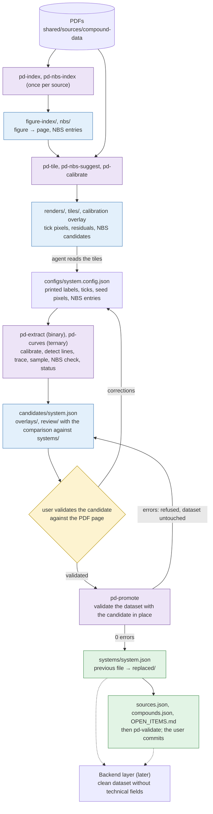
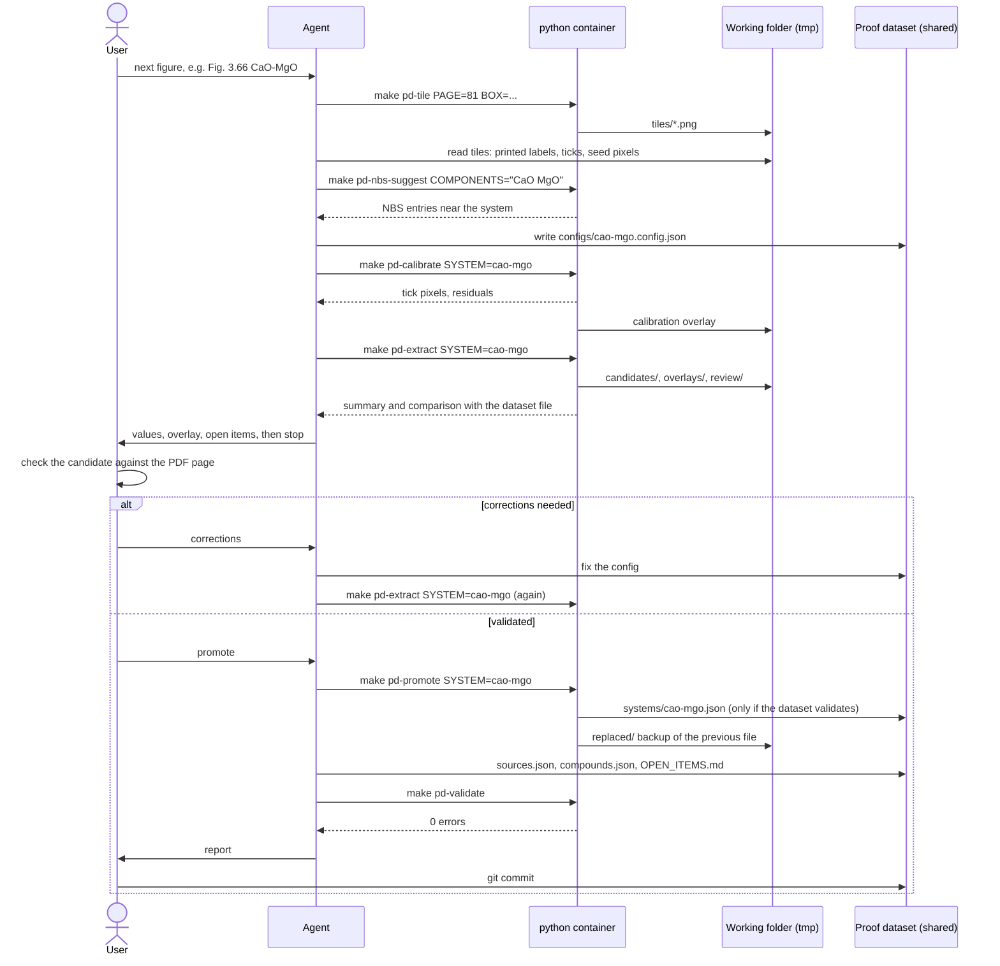

# Phase-Diagram Extraction — Per-diagram workflow

Part of the [phase-diagram extraction specification](README.md).

## Per-diagram workflow

### Data flow

One figure from PDF to the proof dataset. Colours: purple runs as `make pd-*` in the
`python` container, blue is the working layer (`tmp/reports/python/phase-diagrams/`, not
committed), green is the proof layer (`shared/processed/phase-diagrams/`, committed), yellow
is the user, white is written by the agent. Dotted: the later backend step.

### Interaction

Who does what for one figure. The agent runs every command in the container and never
writes `systems/` itself; the user validates, decides on promotion and commits.

### Binary system

1. **Locate** the figure in `figure-index/slag-atlas-1995.json` (`make pd-index` once).
2. **Render and look**: `make pd-tile PAGE=108 BOX="1050 1700 2950 4000"`. Read the
  printed labels from the tiles.
3. **Write the config** `configs/<system>.config.json`: source, axis tick values, phases,
  invariants with printed labels and seed pixels, liquidus branches, verbatim blocks.
4. **Calibrate**: `make pd-calibrate SYSTEM=mgo-sio2` detects the frame and ticks, prints
  the tick pixels and residuals, and writes an overlay. Fix the config if a tick is wrong
   (optional `tickPixels` override).
5. **Find NBS candidates**: `make pd-nbs-suggest COMPONENTS="MgO SiO2"`; add the chosen
  entry numbers to the invariants.
6. **Extract**: `make pd-extract SYSTEM=mgo-sio2` writes `candidates/mgo-sio2.json`, the
  overlay and the review list, and compares the candidate with the dataset file.
7. **Review** the overlay and `review/mgo-sio2.md`; carry open items into `OPEN_ITEMS.md`.
8. **Stop for user validation** of the candidate (overlay, review list, values vs. the page).
9. **Promote**: `make pd-promote SYSTEM=mgo-sio2` copies the candidate into `systems/` if
  the dataset still validates; the replaced file goes to `replaced/`.
10. Update `compounds.json` and `sources.json` by hand where the new figure adds sources
  (`pd-new` adds missing single oxides of a new ternary, § New ternary system),
  run `make pd-validate`; the user commits.

### New ternary system

`make pd-new SYSTEM=cao-feox-sio2` prepares a ternary that has no data yet, so that
`pd-nodes` and `pd-curves` can run on it:

1. The system id gives the components (`cao-feox-sio2` → CaO, FeOx, SiO2; a trailing `x` stays).
2. The caption index `figure-index/slag-atlas-1995.json` (`make pd-index` first) is searched
   for captions naming exactly these components, compared by letters (OCR writes `Ca0`,
   `FeO,`, `Fe,0,`; FeO and Fe2O3 both match FeOx; a four-oxide caption is not a match, nor
   a reference such as `For the base system CaO-SiO2-TiO2 see Fig. 3.264`).
   Several figures: they are listed, numbered, with pages and the caption start (wrapped,
   cut at a whole word, formulas with subscript characters: the system as the component
   formulas, `CaO-FeO,-SiO,` → `CaO-FeOₓ-SiO₂`; other formulas when the recognised text has
   the shape of a component or of `OXIDE_FORMULAS`, `7Ca0'2Si0,,14Fe,0,,` →
   `7CaO·2SiO₂·14Fe₂O₃,` (a comma cannot tell Fe₂O₃ from Fe₃O₄: the earlier one is shown);
   charges as superscripts, `Fe2+` → `Fe²⁺`. Display only: captions for the data are read
   verbatim from tiles), and the user types the number
   (q quits, nothing written). `FIGURE=3.226` skips the question; without a terminal the
   list is printed and nothing is written.
3. The triangles on the page are detected ([§ Algorithms](ALGORITHMS.md#algorithms), Triangle detection); those with a
   base of at least 40 % of the largest are kept, in the reading order of a two-column page
   (a triangle reaching 10 % of the page width past the middle on both sides is read on its
   own; otherwise the left column top-down, then the right one). With several, the figure's
   position among the page's figures in the index chooses; otherwise the user types the
   triangle number (or gives `TRIANGLE=n`). When the chosen triangle's corner labels do not
   name the components and exactly one other triangle's labels do, that one is used.
4. The corner labels are read (tesseract on boxes above the top corner and below the base
   corners) and matched to the components; at least two corners must be named, the third
   takes the remaining one. Otherwise the user types the corners top, left, right (or gives
   `CORNERS="top left right"`). Corner tiles
   `tiles/<system>-corner-{top,left,right}.png` are written for the check.
5. Outputs: the starting file `starts/<system>.json` (calibration, figure and pages,
   `diagram` and `caption` null, empty phases, invariants, curves, isotherms, inversions)
   and, only when absent, `configs/<system>.curves.config.json` (stroke widths from the
   measured line width). `pd-nodes` and `pd-curves` read the dataset file when it exists,
   otherwise the starting file. Nothing is written to `systems/`.
6. Single-oxide phases (`phase_diagrams/compounds/`), per component with a fixed formula
   (FeOx is skipped). The melting points of the oxide in `shared/processed/compound-data`
   (`index.json` `byFormula` by Hill formula, `meltingPoint` of each entry, K → °C, highest
   first: the polymorph stable at melting, rutile before anatase) are looked up.
   NSRDS-NBS 61 Part I has no single-component melting points, so it is no fallback.
   - Component already in `compounds.json`: its temperature is compared with the first
     compound-data value. Within `STATUS_TOLERANCE` (10 °C) it is reported as agreeing;
     beyond it the user chooses: `a` keep the entry and note the compound-data value,
     `c` take the compound-data value and source (the atlas value goes into `notes`),
     `x` add the compound-data source with status `conflict`, `q` leave it. An entry
     without a temperature takes the compound-data value after `y`.
   - Component missing: the compound-data values are listed (the user picks a variant
     when there are several), then the user may type a printed atlas value as
     `"<°C> <figure>"` (the figure from the caption index gives the pages). Atlas and
     compound-data within the tolerance: the atlas value with both sources; beyond it the
     same `a`/`c`/`x` choice. Only compound-data: its value. Only the atlas: the atlas
     value. Neither: melting `missing` with a note. With `PUBCHEM=1` (`--pubchem`, opt-in,
     network) a component without compound-data values is first searched in PubChem by
     formula (`PubchemSearcher`, [PUBCHEM_SPEC.md](../PUBCHEM_SPEC.md#on-demand-search)): the
     CID, CAS, title and the PubChem melting / boiling point and density strings are printed,
     and `PubChem CID … (CAS …), melting point: …` goes into the entry's `notes` (the strings
     are not parsed into the melting point; the user reads the value and its source). The
     answer is kept in the compound-data PubChem files. The entry is printed and added after
     `y` (or another id typed instead): id = the mineral variant (rutile), else the
     compound-data name; notation from `OXIDE_NOTATION` (T for TiO2), else the formula;
     status `extracted`; the compound-data source is
     `{ "ref": "CRC95", "table": "crcConstants", "line": 282, "read": "meltingPoint … K (rutile); compound-data <file>, entry <CAS>" }`.
   Entries are written in the compact layout of the file (`compounds_file_editor`; other
   entries are left byte for byte). Without a terminal the proposals are printed and
   nothing is written.
7. It prints the checklist of the system (`new_system_checklist`): molar masses of the
   components (none for FeOx), the phases compounds.json already has for the system
   (compounds whose oxides all have component letters, so Fe2O3 phases count for FeOx;
   modifications marked "modification of X", [§ Polymorph modifications](CONFIG.md#polymorph-modifications)),
   and each component without a single-oxide phase (a modification does not count; to add before the system file names
   it, PD004); then the `sources.json` figure entry the promotion needs (PD008), the NBS
   pair commands (`pd-nbs-suggest` for each component pair) and the next steps.

Then: caption and diagram verbatim from a zoomed tile into the candidate (`edits` with
`path: "source"`), phases and invariants through the curves config, as in § Ternary curves.

### Ternary curves

1. `make pd-nodes SYSTEM=cao-mgo-sio2` writes the node map (`nodes/<system>.md`, `.json` and
   tiles `nodes/<system>-r*c*.png`, plus `nodes/<system>-overview.png`: the whole diagram at
   2×, 30 px labels placed clear of each other, legend of the kinds) and the topology report
   `nodes/<system>-topology.md` (field circuits, temperature points, compound rings and curve
   routes of the dataset file in node labels); it prints the paths from the repository root.
   The user gives the topology by labels, e.g.
   `I1->X2->I5` (boundary, arrow direction), `E3-D6-D9 1600` (isotherm), `X14-X15 straight`
   (hidden under a label), `add near (x, y)` for a point the map missed.
2. Write `configs/<system>.curves.config.json`: the used labels in `nodes` (pixels copied from
   `nodes/<system>.json`), boundary curves with intermediate labels as waypoints, isotherms
   from label to label (a crossing shared by an isotherm and a boundary keeps them continuous).
3. `make pd-curves SYSTEM=cao-mgo-sio2` writes a candidate copy of the system file with
   `polyline_wt` filled, the overlay and the review list. Check the traces on
   `make pd-tile PAGE=… BOX=… OVERLAY=cao-mgo-sio2` zooms.
4. `make pd-validate SYSTEM=cao-mgo-sio2` (dataset with the candidate in place).
5. Stop for user validation, `make pd-promote SYSTEM=cao-mgo-sio2`, validate; the user commits.

### Candidates, comparison and promotion

- The candidate name is the file name of the config output (`output` of a binary config,
  `systemFile` of a curves config): `candidates/mgo-sio2.json`.
- `compare_systems(old, new)` (also printed by `extract` / `trace-curves` and appended to the
  review list): invariant ids, type, reaction, phases, temperature, liquid compositions,
  status and NBS sources must be identical; liquidus branches and the miscibility dome must
  pass through the box ±0.2 wt% × ±3 °C (`COMPARISON_TOLERANCE`) around every point of the
  dataset file. Changed atlas source text or pixels and filled ternary polylines are notes,
  not differences. `compare` exits 1 when there are differences.
- `promote` validates a temporary copy of the dataset with the candidate in place
  (`validate_with_candidate`); with errors it refuses (exit 1) and the dataset is untouched.
  Differences do not block promotion: they are what the user validated.
- After writing the system file, `promote` copies the working overlay `overlays/<system>.png`
  (from the same `extract` / `trace-curves` run as the candidate) to the dataset's
  `overlays/<system>.png`, so the dataset keeps the picture the user validated. Without a
  working overlay the dataset overlay is left as it is (logged).
- `validate --candidate SYSTEM` (`make pd-validate SYSTEM=…`) runs the same check without
  writing, so a candidate can be validated before the user review.
